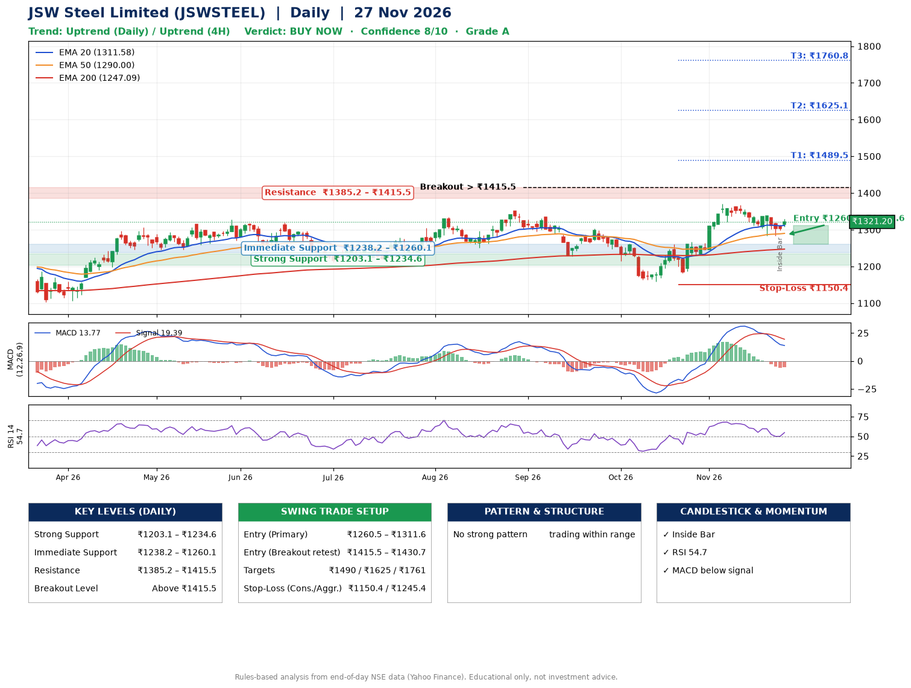

📌 **JSW Steel Limited (JSWSTEEL) – Multi-Timeframe Technical Analysis (Daily + 4H Combined)**
_Data up to 27 Nov 2026 · Close ₹1321.20_

**📍 Daily Timeframe Trend**
- Trend: **Uptrend** (price above rising EMAs)
- Recent swing highs: ₹1335.0, ₹1304.0, ₹1370.0 · swing lows: ₹1250.4, ₹1227.0, ₹1158.0
- EMAs: EMA20 ₹1311.6, EMA50 ₹1290.0, EMA200 ₹1247.1; bullish stack (EMA20 > EMA50 > EMA200); price above EMA20, EMA50, EMA200
- MACD 13.77 below signal 19.39 (above zero), fresh bearish crossover; histogram rising
- RSI(14) 54.7; no divergence on the last two swings

**📍 4-Hour Timeframe Trend**
- Structure: **Uptrend** (price above rising EMAs)
- Pullback/support area: recent 4H swing lows ₹1286.1, ₹1283.6; EMA20 ₹1316.3
- EMA20/50: bullish stack (EMA20 > EMA50); price above EMA20, EMA50
- MACD -1.44 below signal 1.32 (below zero); histogram rising
- RSI(14) 52.3; no divergence

**📍 Pattern Detection (Both Timeframes)**
- 4H: **Double Top** – tops near ₹1365.9/₹1337.0, neckline ₹1286.1, forming

**📍 Candlestick Patterns (last 3 daily candles)**
- **Inside Bar** – 26 Nov: compression inside the prior range ₹1283.5–₹1318.9

**📍 Price Action Key Levels (Daily Structure)**

| Zone | Price Level (₹) | Context |
|------|-----------------|---------|
| Strong Support | ₹1203.1 – ₹1234.6 | Cluster of earlier swing lows (demand) |
| Immediate Support | ₹1238.2 – ₹1260.1 | Nearest swing-low / wick area |
| Resistance | ₹1385.2 – ₹1415.5 | Nearest swing-high supply |
| Breakout Level | Above ₹1415.5 | Swing continuation trigger (52-week high ₹1370.0) |

**📍 Swing Trade Setup**

🟢 **Entry Zone**
- Primary: ₹1260.5 – ₹1311.6 (daily support / EMA20 area; enter on a bullish 4H candle)
- Alternate: ₹1415.5 – ₹1430.7 (breakout retest)

🎯 **Profit Targets**
- T1: ₹1489.5
- T2: ₹1625.1
- T3: ₹1760.8

🛑 **Stop-Loss**
- Conservative: below daily swing low (₹1150.4)
- Aggressive: below 4H structure (₹1245.4)
- Risk per share ≈ ₹135.6; reward:risk to T1 ≈ 1.5
- Time to T1: about 44 trading days (it rose this much within 60 trading days 14% of the time in the last 2 years)
- Time to T2: it never rose this much within 60 trading days in the price history

**📌 Strategy Notes**
- Higher timeframe: daily trend is uptrend; only take longs while price holds above ₹1203.1.
- Entry timing: wait for a bullish 4H candle (engulfing/hammer) inside ₹1260.5 – ₹1311.6 rather than buying mid-range.
- EMA stacking: bullish stack (EMA20 > EMA50 > EMA200); price above EMA20, EMA50, EMA200.
- Breakout rule: a daily close above ₹1415.5 with volume above its 20-day average (≈2,181,013) opens T2/T3.
- Momentum: RSI 55 – room to run; no divergence on the last two swings.
- Exit discipline: move the stop to entry once T1 is hit; book partial profits at each target.

**STEP 2 — Marked Up Chart**

**✅ Trade Validation Checklist**
- Trend + momentum aligned: No · Price at entry zone: No
- Stop defined (₹1150.4) · Reward:risk ≥ 1.5 to T1: No

## 📌 Final Verdict

Recommendation: **🟢 BUY NOW**

Confidence: **8/10**

Trade Quality: **A**

Reason:
• Daily uptrend (price above rising EMAs)
• EMAs stacked bullishly

Next Action:
• Buy now within the entry zone, with the stop-loss in place

_Rules-based analysis from end-of-day data. Educational only, not investment advice. Never place orders without your own confirmation._