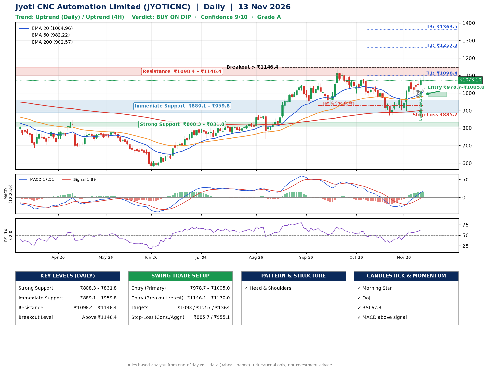

📌 **Jyoti CNC Automation Limited (JYOTICNC) – Multi-Timeframe Technical Analysis (Daily + 4H Combined)**
_Data up to 13 Nov 2026 · Close ₹1073.10_

**📍 Daily Timeframe Trend**
- Trend: **Uptrend** (price above rising EMAs)
- Recent swing highs: ₹1058.8, ₹1134.6, ₹1081.0 · swing lows: ₹928.6, ₹871.8, ₹897.5
- EMAs: EMA20 ₹1005.0, EMA50 ₹982.2, EMA200 ₹902.6; bullish stack (EMA20 > EMA50 > EMA200); price above EMA20, EMA50, EMA200
- MACD 17.51 above signal 1.89 (above zero); histogram rising
- RSI(14) 62.8; no divergence on the last two swings

**📍 4-Hour Timeframe Trend**
- Structure: **Uptrend** (higher highs and higher lows)
- Pullback/support area: recent 4H swing lows ₹897.5, ₹996.0; EMA20 ₹1024.5
- EMA20/50: bullish stack (EMA20 > EMA50); price above EMA20, EMA50
- MACD 30.05 above signal 22.64 (above zero); histogram falling
- RSI(14) 64.6; no divergence

**📍 Pattern Detection (Both Timeframes)**
- Daily: **Head & Shoulders** – head ₹1134.6, neckline ₹928.6

**📍 Candlestick Patterns (last 3 daily candles)**
- **Doji** – 11 Nov: indecision; wait for the next candle to confirm direction
- **Bullish Engulfing** – 12 Nov: buyers fully reversed the prior red candle
- **Morning Star** – 12 Nov: three-candle bullish reversal
- **Doji** – 13 Nov: indecision; wait for the next candle to confirm direction

**📍 Price Action Key Levels (Daily Structure)**

| Zone | Price Level (₹) | Context |
|------|-----------------|---------|
| Strong Support | ₹808.3 – ₹831.8 | Cluster of earlier swing lows (demand) |
| Immediate Support | ₹889.1 – ₹959.8 | Nearest swing-low / wick area |
| Resistance | ₹1098.4 – ₹1146.4 | Nearest swing-high supply |
| Breakout Level | Above ₹1146.4 | Swing continuation trigger (52-week high ₹1134.6) |

**📍 Swing Trade Setup**

🟢 **Entry Zone**
- Primary: ₹978.7 – ₹1005.0 (daily support / EMA20 area; enter on a bullish 4H candle)
- Alternate: ₹1146.4 – ₹1170.0 (breakout retest)

🎯 **Profit Targets**
- T1: ₹1098.4
- T2: ₹1257.3
- T3: ₹1363.5

🛑 **Stop-Loss**
- Conservative: below daily swing low (₹885.7)
- Aggressive: below 4H structure (₹955.1)
- Risk per share ≈ ₹106.2; reward:risk to T1 ≈ 1.0
- Time to T1: about 12 trading days (it rose this much within 60 trading days 53% of the time in the last 2 years)
- Time to T2: about 29 trading days (it rose this much within 60 trading days 22% of the time in the last 2 years)

**📌 Strategy Notes**
- Higher timeframe: daily trend is uptrend; only take longs while price holds above ₹808.3.
- Entry timing: wait for a bullish 4H candle (engulfing/hammer) inside ₹978.7 – ₹1005.0 rather than buying mid-range.
- EMA stacking: bullish stack (EMA20 > EMA50 > EMA200); price above EMA20, EMA50, EMA200.
- Breakout rule: a daily close above ₹1146.4 with volume above its 20-day average (≈978,891) opens T2/T3.
- Momentum: RSI 63 – room to run; no divergence on the last two swings.
- Exit discipline: move the stop to entry once T1 is hit; book partial profits at each target.

**STEP 2 — Marked Up Chart**

**✅ Trade Validation Checklist**
- Trend + momentum aligned: Yes · Price at entry zone: No
- Stop defined (₹885.7) · Reward:risk ≥ 1.5 to T1: No

## 📌 Final Verdict

Recommendation: **🟡 BUY ON DIP**

Confidence: **9/10**

Trade Quality: **A**

Reason:
• Daily uptrend (price above rising EMAs)
• EMAs stacked bullishly

Next Action:
• Wait for a pullback to ₹978.7–₹1005.0

_Rules-based analysis from end-of-day data. Educational only, not investment advice. Never place orders without your own confirmation._