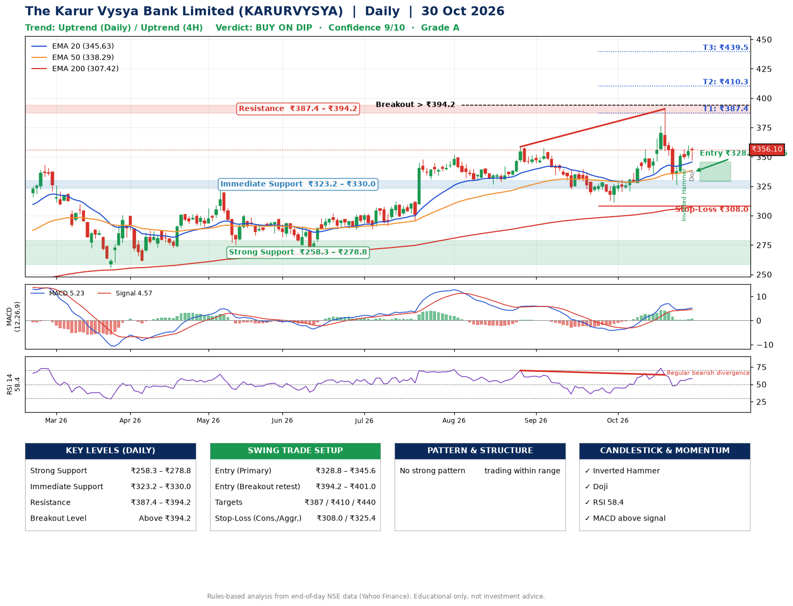

📌 **The Karur Vysya Bank Limited (KARURVYSYA) – Multi-Timeframe Technical Analysis (Daily + 4H Combined)**
_Data up to 30 Oct 2026 · Close ₹356.10_

**📍 Daily Timeframe Trend**
- Trend: **Uptrend** (price above rising EMAs)
- Recent swing highs: ₹351.8, ₹358.6, ₹390.8 · swing lows: ₹296.1, ₹326.6, ₹311.4
- EMAs: EMA20 ₹345.6, EMA50 ₹338.3, EMA200 ₹307.4; bullish stack (EMA20 > EMA50 > EMA200); price above EMA20, EMA50, EMA200
- MACD 5.23 above signal 4.57 (above zero); histogram rising
- RSI(14) 58.4; Regular bearish divergence

**📍 4-Hour Timeframe Trend**
- Structure: **Uptrend** (price above rising EMAs)
- Pullback/support area: recent 4H swing lows ₹336.0, ₹326.3; EMA20 ₹349.8
- EMA20/50: bullish stack (EMA20 > EMA50); price above EMA20, EMA50
- MACD 3.29 above signal 3.13 (above zero), fresh bullish crossover; histogram rising
- RSI(14) 56.0; Regular bearish divergence

**📍 Pattern Detection (Both Timeframes)**
- 4H: **Double Bottom** – bottoms near ₹336.0/₹326.3, neckline ₹390.4, forming

**📍 Candlestick Patterns (last 3 daily candles)**
- **Inverted Hammer** – 28 Oct: long upper wick shows selling near ₹356.4
- **Doji** – 30 Oct: indecision; wait for the next candle to confirm direction

**📍 Price Action Key Levels (Daily Structure)**

| Zone | Price Level (₹) | Context |
|------|-----------------|---------|
| Strong Support | ₹258.3 – ₹278.8 | Cluster of earlier swing lows (demand) |
| Immediate Support | ₹323.2 – ₹330.0 | Nearest swing-low / wick area |
| Resistance | ₹387.4 – ₹394.2 | Nearest swing-high supply |
| Breakout Level | Above ₹394.2 | Swing continuation trigger (52-week high ₹390.8) |

**📍 Swing Trade Setup**

🟢 **Entry Zone**
- Primary: ₹328.8 – ₹345.6 (daily support / EMA20 area; enter on a bullish 4H candle)
- Alternate: ₹394.2 – ₹401.0 (breakout retest)

🎯 **Profit Targets**
- T1: ₹387.4
- T2: ₹410.3
- T3: ₹439.5

🛑 **Stop-Loss**
- Conservative: below daily swing low (₹308.0)
- Aggressive: below 4H structure (₹325.4)
- Risk per share ≈ ₹29.2; reward:risk to T1 ≈ 1.7

**📌 Strategy Notes**
- Higher timeframe: daily trend is uptrend; only take longs while price holds above ₹258.3.
- Entry timing: wait for a bullish 4H candle (engulfing/hammer) inside ₹328.8 – ₹345.6 rather than buying mid-range.
- EMA stacking: bullish stack (EMA20 > EMA50 > EMA200); price above EMA20, EMA50, EMA200.
- Breakout rule: a daily close above ₹394.2 with volume above its 20-day average (≈4,734,019) opens T2/T3.
- Momentum: RSI 58 – room to run; Regular bearish divergence.
- Exit discipline: move the stop to entry once T1 is hit; book partial profits at each target.

**STEP 2 — Marked Up Chart**

**✅ Trade Validation Checklist**
- Trend + momentum aligned: Yes · Price at entry zone: No
- Stop defined (₹308.0) · Reward:risk ≥ 1.5 to T1: Yes

## 📌 Final Verdict

Recommendation: **🟡 BUY ON DIP**

Confidence: **9/10**

Trade Quality: **A**

Reason:
• Daily uptrend (price above rising EMAs)
• EMAs stacked bullishly

Next Action:
• Wait for a pullback to ₹328.8–₹345.6

_Rules-based analysis from end-of-day data. Educational only, not investment advice. Never place orders without your own confirmation._