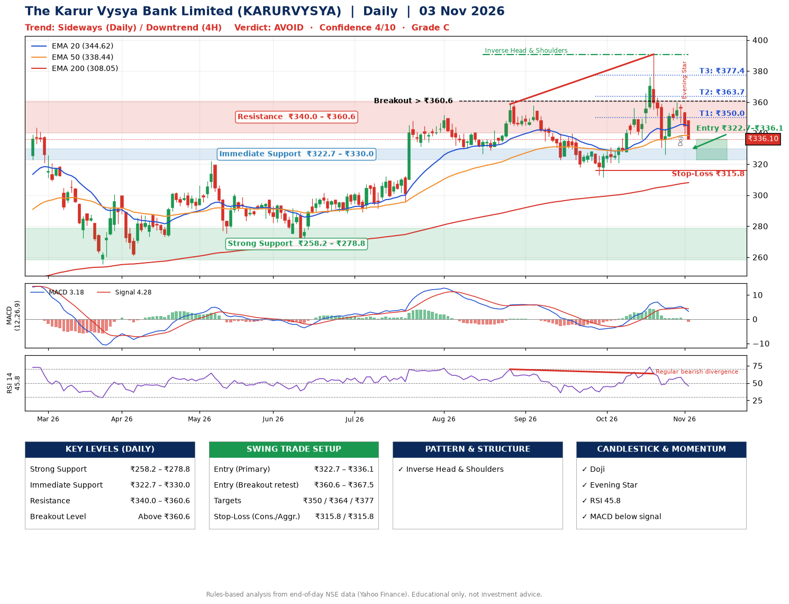

📌 **The Karur Vysya Bank Limited (KARURVYSYA) – Multi-Timeframe Technical Analysis (Daily + 4H Combined)**
_Data up to 03 Nov 2026 · Close ₹336.10_

**📍 Daily Timeframe Trend**
- Trend: **Sideways** (mixed swing structure)
- Recent swing highs: ₹351.8, ₹358.6, ₹390.8 · swing lows: ₹326.6, ₹311.4, ₹326.1
- EMAs: EMA20 ₹344.6, EMA50 ₹338.4, EMA200 ₹308.0; bullish stack (EMA20 > EMA50 > EMA200); price above EMA200
- MACD 3.18 below signal 4.28 (above zero), fresh bearish crossover; histogram falling
- RSI(14) 45.8; Regular bearish divergence

**📍 4-Hour Timeframe Trend**
- Structure: **Downtrend** (lower highs and lower lows)
- Pullback/support area: recent 4H swing lows ₹336.0, ₹326.3; EMA20 ₹347.0
- EMA20/50: bullish stack (EMA20 > EMA50); price below all EMAs
- MACD -0.03 below signal 1.90 (below zero), fresh bearish crossover; histogram falling
- RSI(14) 42.5; no divergence

**📍 Pattern Detection (Both Timeframes)**
- Daily: **Inverse Head & Shoulders** – head ₹311.4, neckline ₹390.8
- 4H: **Double Bottom** – bottoms near ₹336.0/₹326.3, neckline ₹390.4, forming
- 4H: **Head & Shoulders** – head ₹390.4, neckline ₹326.3

**📍 Candlestick Patterns (last 3 daily candles)**
- **Doji** – 30 Oct: indecision; wait for the next candle to confirm direction
- **Evening Star** – 02 Nov: three-candle bearish reversal

**📍 Price Action Key Levels (Daily Structure)**

| Zone | Price Level (₹) | Context |
|------|-----------------|---------|
| Strong Support | ₹258.2 – ₹278.8 | Cluster of earlier swing lows (demand) |
| Immediate Support | ₹322.7 – ₹330.0 | Nearest swing-low / wick area |
| Resistance | ₹340.0 – ₹360.6 | Nearest swing-high supply |
| Breakout Level | Above ₹360.6 | Swing continuation trigger (52-week high ₹390.8) |

**📍 Swing Trade Setup**

🟢 **Entry Zone**
- Primary: ₹322.7 – ₹336.1 (daily support / EMA20 area; enter on a bullish 4H candle)
- Alternate: ₹360.6 – ₹367.5 (breakout retest)

🎯 **Profit Targets**
- T1: ₹350.0
- T2: ₹363.7
- T3: ₹377.4

🛑 **Stop-Loss**
- Conservative: below daily swing low (₹315.8)
- Aggressive: below 4H structure (₹315.8)
- Risk per share ≈ ₹13.7; reward:risk to T1 ≈ 1.5

**📌 Strategy Notes**
- Higher timeframe: daily trend is sideways; only take longs while price holds above ₹258.2.
- Entry timing: wait for a bullish 4H candle (engulfing/hammer) inside ₹322.7 – ₹336.1 rather than buying mid-range.
- EMA stacking: bullish stack (EMA20 > EMA50 > EMA200); price above EMA200.
- Breakout rule: a daily close above ₹360.6 with volume above its 20-day average (≈4,733,739) opens T2/T3.
- Momentum: RSI 46 – room to run; Regular bearish divergence.
- Exit discipline: move the stop to entry once T1 is hit; book partial profits at each target.

**STEP 2 — Marked Up Chart**

**✅ Trade Validation Checklist**
- Trend + momentum aligned: No · Price at entry zone: Yes
- Stop defined (₹315.8) · Reward:risk ≥ 1.5 to T1: Yes

## 📌 Final Verdict

Recommendation: **🔴 AVOID**

Confidence: **4/10**

Trade Quality: **C**

Reason:
• Sharp pullback: 14% below the recent ₹390.8 high
• EMAs stacked bullishly

Next Action:
• Avoid until the trend changes (reclaim EMA50 and a higher low)

_Rules-based analysis from end-of-day data. Educational only, not investment advice. Never place orders without your own confirmation._