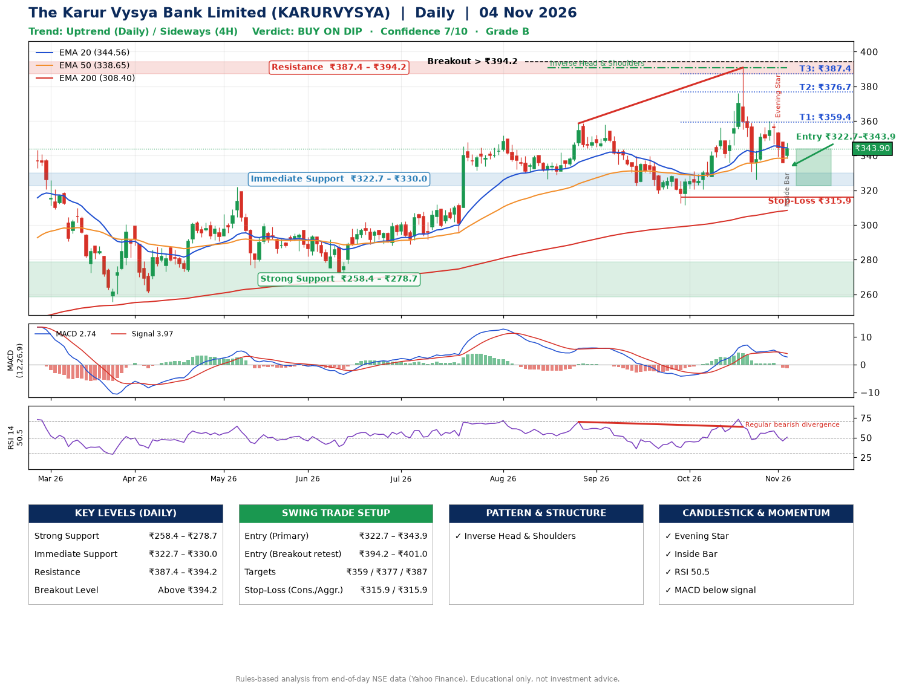

📌 **The Karur Vysya Bank Limited (KARURVYSYA) – Multi-Timeframe Technical Analysis (Daily + 4H Combined)**
_Data up to 04 Nov 2026 · Close ₹343.90_

**📍 Daily Timeframe Trend**
- Trend: **Uptrend** (higher highs and higher lows)
- Recent swing highs: ₹351.8, ₹358.6, ₹390.8 · swing lows: ₹326.6, ₹311.4, ₹326.1
- EMAs: EMA20 ₹344.6, EMA50 ₹338.7, EMA200 ₹308.4; bullish stack (EMA20 > EMA50 > EMA200); price above EMA50, EMA200
- MACD 2.74 below signal 3.97 (above zero), fresh bearish crossover; histogram falling
- RSI(14) 50.5; Regular bearish divergence

**📍 4-Hour Timeframe Trend**
- Structure: **Sideways** (mixed swing structure)
- Pullback/support area: recent 4H swing lows ₹336.0, ₹326.3; EMA20 ₹346.5
- EMA20/50: bullish stack (EMA20 > EMA50); price above EMA50
- MACD -0.34 below signal 1.12 (below zero); histogram rising
- RSI(14) 48.4; no divergence

**📍 Pattern Detection (Both Timeframes)**
- Daily: **Inverse Head & Shoulders** – head ₹311.4, neckline ₹390.8
- 4H: **Double Bottom** – bottoms near ₹336.0/₹326.3, neckline ₹390.4, forming
- 4H: **Head & Shoulders** – head ₹390.4, neckline ₹326.3
- 4H: **Ascending Triangle** – converging swing highs and lows over the last ~60 sessions

**📍 Candlestick Patterns (last 3 daily candles)**
- **Evening Star** – 02 Nov: three-candle bearish reversal
- **Inside Bar** – 04 Nov: compression inside the prior range ₹336.1–₹347.9

**📍 Price Action Key Levels (Daily Structure)**

| Zone | Price Level (₹) | Context |
|------|-----------------|---------|
| Strong Support | ₹258.4 – ₹278.7 | Cluster of earlier swing lows (demand) |
| Immediate Support | ₹322.7 – ₹330.0 | Nearest swing-low / wick area |
| Resistance | ₹387.4 – ₹394.2 | Nearest swing-high supply |
| Breakout Level | Above ₹394.2 | Swing continuation trigger (52-week high ₹390.8) |

**📍 Swing Trade Setup**

🟢 **Entry Zone**
- Primary: ₹322.7 – ₹343.9 (daily support / EMA20 area; enter on a bullish 4H candle)
- Alternate: ₹394.2 – ₹401.0 (breakout retest)

🎯 **Profit Targets**
- T1: ₹359.4
- T2: ₹376.7
- T3: ₹387.4

🛑 **Stop-Loss**
- Conservative: below daily swing low (₹315.9)
- Aggressive: below 4H structure (₹315.9)
- Risk per share ≈ ₹17.4; reward:risk to T1 ≈ 1.5

**📌 Strategy Notes**
- Higher timeframe: daily trend is uptrend; only take longs while price holds above ₹258.4.
- Entry timing: wait for a bullish 4H candle (engulfing/hammer) inside ₹322.7 – ₹343.9 rather than buying mid-range.
- EMA stacking: bullish stack (EMA20 > EMA50 > EMA200); price above EMA50, EMA200.
- Breakout rule: a daily close above ₹394.2 with volume above its 20-day average (≈4,760,716) opens T2/T3.
- Momentum: RSI 50 – room to run; Regular bearish divergence.
- Exit discipline: move the stop to entry once T1 is hit; book partial profits at each target.

**STEP 2 — Marked Up Chart**

**✅ Trade Validation Checklist**
- Trend + momentum aligned: No · Price at entry zone: Yes
- Stop defined (₹315.9) · Reward:risk ≥ 1.5 to T1: Yes

## 📌 Final Verdict

Recommendation: **🟡 BUY ON DIP**

Confidence: **7/10**

Trade Quality: **B**

Reason:
• Daily uptrend (higher highs and higher lows)
• EMAs stacked bullishly

Next Action:
• Wait for a pullback to ₹322.7–₹343.9, or a breakout above ₹394.2

_Rules-based analysis from end-of-day data. Educational only, not investment advice. Never place orders without your own confirmation._