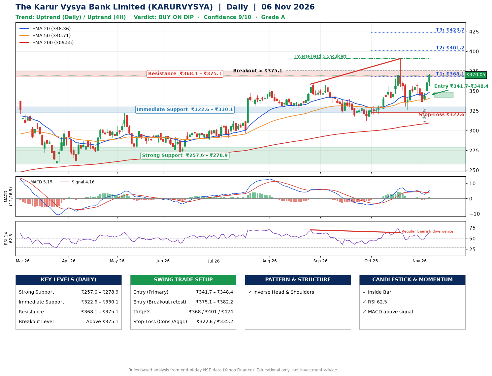

📌 **The Karur Vysya Bank Limited (KARURVYSYA) – Multi-Timeframe Technical Analysis (Daily + 4H Combined)**
_Data up to 06 Nov 2026 · Close ₹370.05_

**📍 Daily Timeframe Trend**
- Trend: **Uptrend** (higher highs and higher lows)
- Recent swing highs: ₹351.8, ₹358.6, ₹390.8 · swing lows: ₹326.6, ₹311.4, ₹326.1
- EMAs: EMA20 ₹348.4, EMA50 ₹340.7, EMA200 ₹309.5; bullish stack (EMA20 > EMA50 > EMA200); price above EMA20, EMA50, EMA200
- MACD 5.15 above signal 4.16 (above zero), fresh bullish crossover; histogram rising
- RSI(14) 62.5; Regular bearish divergence

**📍 4-Hour Timeframe Trend**
- Structure: **Uptrend** (price above rising EMAs)
- Pullback/support area: recent 4H swing lows ₹326.3, ₹336.1; EMA20 ₹352.7
- EMA20/50: bullish stack (EMA20 > EMA50); price above EMA20, EMA50
- MACD 4.26 above signal 2.12 (above zero), fresh bullish crossover; histogram rising
- RSI(14) 63.5; Hidden bullish divergence

**📍 Pattern Detection (Both Timeframes)**
- Daily: **Inverse Head & Shoulders** – head ₹311.4, neckline ₹390.8
- 4H: **Head & Shoulders** – head ₹390.4, neckline ₹326.3

**📍 Candlestick Patterns (last 3 daily candles)**
- **Inside Bar** – 04 Nov: compression inside the prior range ₹336.1–₹347.9

**📍 Price Action Key Levels (Daily Structure)**

| Zone | Price Level (₹) | Context |
|------|-----------------|---------|
| Strong Support | ₹257.6 – ₹278.9 | Cluster of earlier swing lows (demand) |
| Immediate Support | ₹322.6 – ₹330.1 | Nearest swing-low / wick area |
| Resistance | ₹368.1 – ₹375.1 | Nearest swing-high supply |
| Breakout Level | Above ₹375.1 | Swing continuation trigger (52-week high ₹390.8) |

**📍 Swing Trade Setup**

🟢 **Entry Zone**
- Primary: ₹341.7 – ₹348.4 (daily support / EMA20 area; enter on a bullish 4H candle)
- Alternate: ₹375.1 – ₹382.2 (breakout retest)

🎯 **Profit Targets**
- T1: ₹368.1
- T2: ₹401.2
- T3: ₹423.7

🛑 **Stop-Loss**
- Conservative: below daily swing low (₹322.6)
- Aggressive: below 4H structure (₹335.2)
- Risk per share ≈ ₹22.5; reward:risk to T1 ≈ 1.0

**📌 Strategy Notes**
- Higher timeframe: daily trend is uptrend; only take longs while price holds above ₹257.6.
- Entry timing: wait for a bullish 4H candle (engulfing/hammer) inside ₹341.7 – ₹348.4 rather than buying mid-range.
- EMA stacking: bullish stack (EMA20 > EMA50 > EMA200); price above EMA20, EMA50, EMA200.
- Breakout rule: a daily close above ₹375.1 with volume above its 20-day average (≈4,928,424) opens T2/T3.
- Momentum: RSI 63 – room to run; Regular bearish divergence.
- Exit discipline: move the stop to entry once T1 is hit; book partial profits at each target.

**STEP 2 — Marked Up Chart**

**✅ Trade Validation Checklist**
- Trend + momentum aligned: Yes · Price at entry zone: No
- Stop defined (₹322.6) · Reward:risk ≥ 1.5 to T1: No

## 📌 Final Verdict

Recommendation: **🟡 BUY ON DIP**

Confidence: **9/10**

Trade Quality: **A**

Reason:
• Daily uptrend (higher highs and higher lows)
• EMAs stacked bullishly

Next Action:
• Wait for a pullback to ₹341.7–₹348.4

_Rules-based analysis from end-of-day data. Educational only, not investment advice. Never place orders without your own confirmation._