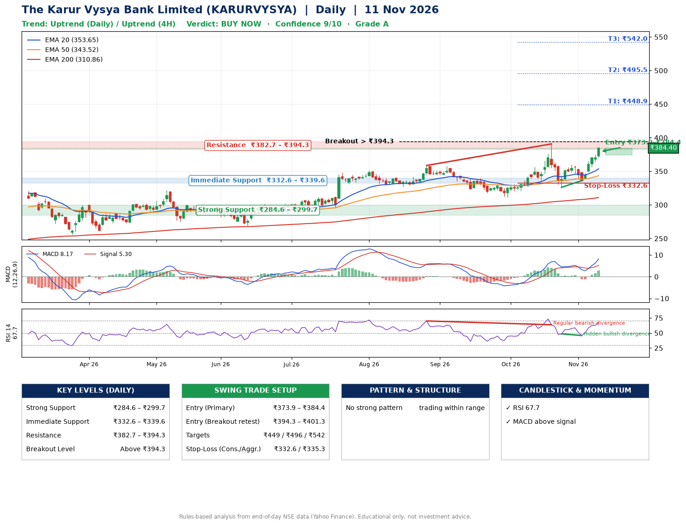

📌 **The Karur Vysya Bank Limited (KARURVYSYA) – Multi-Timeframe Technical Analysis (Daily + 4H Combined)**
_Data up to 11 Nov 2026 · Close ₹384.40_

**📍 Daily Timeframe Trend**
- Trend: **Uptrend** (higher highs and higher lows)
- Recent swing highs: ₹351.8, ₹358.6, ₹390.8 · swing lows: ₹311.4, ₹326.1, ₹336.1
- EMAs: EMA20 ₹353.7, EMA50 ₹343.5, EMA200 ₹310.9; bullish stack (EMA20 > EMA50 > EMA200); price above EMA20, EMA50, EMA200
- MACD 8.17 above signal 5.30 (above zero), fresh bullish crossover; histogram rising
- RSI(14) 67.7; Hidden bullish divergence; Regular bearish divergence

**📍 4-Hour Timeframe Trend**
- Structure: **Uptrend** (price above rising EMAs)
- Pullback/support area: recent 4H swing lows ₹326.3, ₹336.1; EMA20 ₹364.7
- EMA20/50: bullish stack (EMA20 > EMA50); price above EMA20, EMA50
- MACD 9.26 above signal 6.45 (above zero); histogram falling
- RSI(14) 66.1; Hidden bullish divergence

**📍 Pattern Detection (Both Timeframes)**
- 4H: **Head & Shoulders** – head ₹390.4, neckline ₹326.3

**📍 Candlestick Patterns (last 3 daily candles)**
- No notable candlestick signal in the last 3 sessions.

**📍 Price Action Key Levels (Daily Structure)**

| Zone | Price Level (₹) | Context |
|------|-----------------|---------|
| Strong Support | ₹284.6 – ₹299.7 | Cluster of earlier swing lows (demand) |
| Immediate Support | ₹332.6 – ₹339.6 | Nearest swing-low / wick area |
| Resistance | ₹382.7 – ₹394.3 | Nearest swing-high supply |
| Breakout Level | Above ₹394.3 | Swing continuation trigger (52-week high ₹390.8) |

**📍 Swing Trade Setup**

🟢 **Entry Zone**
- Primary: ₹373.9 – ₹384.4 (daily support / EMA20 area; enter on a bullish 4H candle)
- Alternate: ₹394.3 – ₹401.3 (breakout retest)

🎯 **Profit Targets**
- T1: ₹448.9
- T2: ₹495.5
- T3: ₹542.0

🛑 **Stop-Loss**
- Conservative: below daily swing low (₹332.6)
- Aggressive: below 4H structure (₹335.3)
- Risk per share ≈ ₹46.5; reward:risk to T1 ≈ 1.5
- Time to T1: about 33 trading days (it rose this much within 60 trading days 49% of the time in the last 2 years)
- Time to T2: about 44 trading days (it rose this much within 60 trading days 9% of the time in the last 2 years)

**📌 Strategy Notes**
- Higher timeframe: daily trend is uptrend; only take longs while price holds above ₹284.6.
- Entry timing: wait for a bullish 4H candle (engulfing/hammer) inside ₹373.9 – ₹384.4 rather than buying mid-range.
- EMA stacking: bullish stack (EMA20 > EMA50 > EMA200); price above EMA20, EMA50, EMA200.
- Breakout rule: a daily close above ₹394.3 with volume above its 20-day average (≈4,973,362) opens T2/T3.
- Momentum: RSI 68 – elevated, prefer dips; Hidden bullish divergence; Regular bearish divergence.
- Exit discipline: move the stop to entry once T1 is hit; book partial profits at each target.

**STEP 2 — Marked Up Chart**

**✅ Trade Validation Checklist**
- Trend + momentum aligned: Yes · Price at entry zone: Yes
- Stop defined (₹332.6) · Reward:risk ≥ 1.5 to T1: No

## 📌 Final Verdict

Recommendation: **🟢 BUY NOW**

Confidence: **9/10**

Trade Quality: **A**

Reason:
• Daily uptrend (higher highs and higher lows)
• EMAs stacked bullishly

Next Action:
• Buy now within the entry zone, with the stop-loss in place

_Rules-based analysis from end-of-day data. Educational only, not investment advice. Never place orders without your own confirmation._