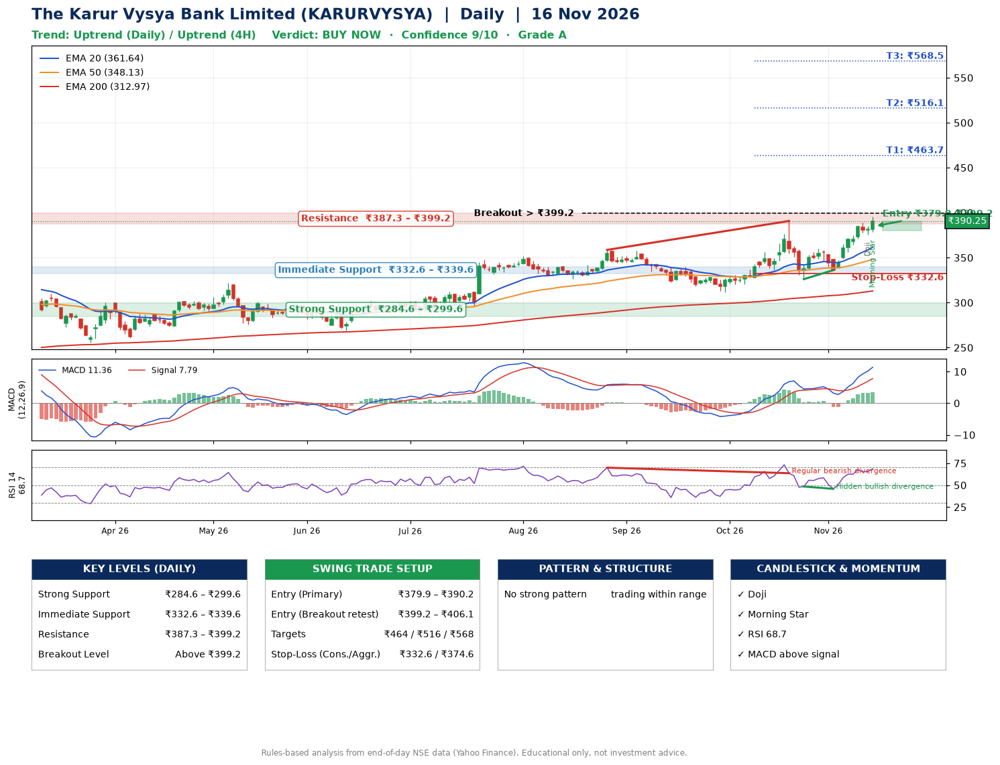

📌 **The Karur Vysya Bank Limited (KARURVYSYA) – Multi-Timeframe Technical Analysis (Daily + 4H Combined)**
_Data up to 16 Nov 2026 · Close ₹390.25_

**📍 Daily Timeframe Trend**
- Trend: **Uptrend** (higher highs and higher lows)
- Recent swing highs: ₹351.8, ₹358.6, ₹390.8 · swing lows: ₹311.4, ₹326.1, ₹336.1
- EMAs: EMA20 ₹361.6, EMA50 ₹348.1, EMA200 ₹313.0; bullish stack (EMA20 > EMA50 > EMA200); price above EMA20, EMA50, EMA200
- MACD 11.36 above signal 7.79 (above zero); histogram rising
- RSI(14) 68.7; Hidden bullish divergence; Regular bearish divergence

**📍 4-Hour Timeframe Trend**
- Structure: **Uptrend** (higher highs and higher lows)
- Pullback/support area: recent 4H swing lows ₹336.1, ₹375.4; EMA20 ₹376.2
- EMA20/50: bullish stack (EMA20 > EMA50); price above EMA20, EMA50
- MACD 11.31 above signal 9.56 (above zero); histogram falling
- RSI(14) 69.2; no divergence

**📍 Pattern Detection (Both Timeframes)**
- 4H: **Ascending Triangle** – converging swing highs and lows over the last ~60 sessions

**📍 Candlestick Patterns (last 3 daily candles)**
- **Doji** – 13 Nov: indecision; wait for the next candle to confirm direction
- **Morning Star** – 16 Nov: three-candle bullish reversal

**📍 Price Action Key Levels (Daily Structure)**

| Zone | Price Level (₹) | Context |
|------|-----------------|---------|
| Strong Support | ₹284.6 – ₹299.6 | Cluster of earlier swing lows (demand) |
| Immediate Support | ₹332.6 – ₹339.6 | Nearest swing-low / wick area |
| Resistance | ₹387.3 – ₹399.2 | Nearest swing-high supply |
| Breakout Level | Above ₹399.2 | Swing continuation trigger (52-week high ₹395.7) |

**📍 Swing Trade Setup**

🟢 **Entry Zone**
- Primary: ₹379.9 – ₹390.2 (daily support / EMA20 area; enter on a bullish 4H candle)
- Alternate: ₹399.2 – ₹406.1 (breakout retest)

🎯 **Profit Targets**
- T1: ₹463.7
- T2: ₹516.1
- T3: ₹568.5

🛑 **Stop-Loss**
- Conservative: below daily swing low (₹332.6)
- Aggressive: below 4H structure (₹374.6)
- Risk per share ≈ ₹52.4; reward:risk to T1 ≈ 1.5
- Time to T1: about 38 trading days (it rose this much within 60 trading days 43% of the time in the last 2 years)
- Time to T2: about 45 trading days (it rose this much within 60 trading days 6% of the time in the last 2 years)

**📌 Strategy Notes**
- Higher timeframe: daily trend is uptrend; only take longs while price holds above ₹284.6.
- Entry timing: wait for a bullish 4H candle (engulfing/hammer) inside ₹379.9 – ₹390.2 rather than buying mid-range.
- EMA stacking: bullish stack (EMA20 > EMA50 > EMA200); price above EMA20, EMA50, EMA200.
- Breakout rule: a daily close above ₹399.2 with volume above its 20-day average (≈4,743,410) opens T2/T3.
- Momentum: RSI 69 – elevated, prefer dips; Hidden bullish divergence; Regular bearish divergence.
- Exit discipline: move the stop to entry once T1 is hit; book partial profits at each target.

**STEP 2 — Marked Up Chart**

**✅ Trade Validation Checklist**
- Trend + momentum aligned: Yes · Price at entry zone: Yes
- Stop defined (₹332.6) · Reward:risk ≥ 1.5 to T1: Yes

## 📌 Final Verdict

Recommendation: **🟢 BUY NOW**

Confidence: **9/10**

Trade Quality: **A**

Reason:
• Daily uptrend (higher highs and higher lows)
• EMAs stacked bullishly

Next Action:
• Buy now within the entry zone, with the stop-loss in place

_Rules-based analysis from end-of-day data. Educational only, not investment advice. Never place orders without your own confirmation._