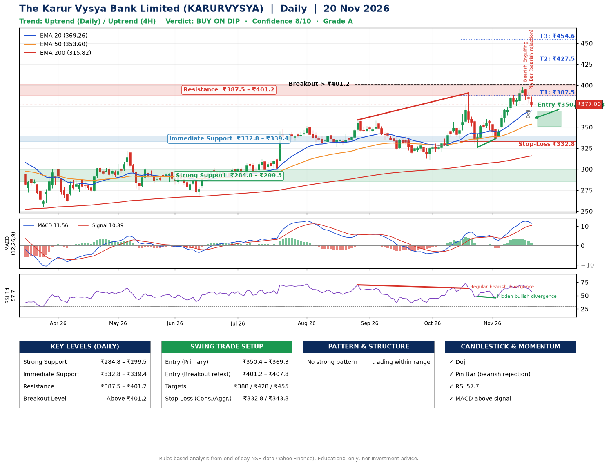

📌 **The Karur Vysya Bank Limited (KARURVYSYA) – Multi-Timeframe Technical Analysis (Daily + 4H Combined)**
_Data up to 20 Nov 2026 · Close ₹377.00_

**📍 Daily Timeframe Trend**
- Trend: **Uptrend** (higher highs and higher lows)
- Recent swing highs: ₹351.8, ₹358.6, ₹390.8 · swing lows: ₹311.4, ₹326.1, ₹336.1
- EMAs: EMA20 ₹369.3, EMA50 ₹353.6, EMA200 ₹315.8; bullish stack (EMA20 > EMA50 > EMA200); price above EMA20, EMA50, EMA200
- MACD 11.56 above signal 10.39 (above zero); histogram falling
- RSI(14) 57.7; Hidden bullish divergence; Regular bearish divergence

**📍 4-Hour Timeframe Trend**
- Structure: **Uptrend** (higher highs and higher lows)
- Pullback/support area: recent 4H swing lows ₹336.1, ₹375.4; EMA20 ₹378.9
- EMA20/50: bullish stack (EMA20 > EMA50); price above EMA50
- MACD 6.56 below signal 8.61 (above zero), fresh bearish crossover; histogram falling
- RSI(14) 51.5; no divergence

**📍 Pattern Detection (Both Timeframes)**
- 4H: **Bull Flag** – 16% pole then a tight 6% flag; trigger above ₹397.9

**📍 Candlestick Patterns (last 3 daily candles)**
- **Bearish Engulfing** – 18 Nov: sellers fully reversed the prior green candle
- **Doji** – 19 Nov: indecision; wait for the next candle to confirm direction
- **Pin Bar (bearish rejection)** – 20 Nov: long upper wick shows selling near ₹386.5

**📍 Price Action Key Levels (Daily Structure)**

| Zone | Price Level (₹) | Context |
|------|-----------------|---------|
| Strong Support | ₹284.8 – ₹299.5 | Cluster of earlier swing lows (demand) |
| Immediate Support | ₹332.8 – ₹339.4 | Nearest swing-low / wick area |
| Resistance | ₹387.5 – ₹401.2 | Nearest swing-high supply |
| Breakout Level | Above ₹401.2 | Swing continuation trigger (52-week high ₹397.9) |

**📍 Swing Trade Setup**

🟢 **Entry Zone**
- Primary: ₹350.4 – ₹369.3 (daily support / EMA20 area; enter on a bullish 4H candle)
- Alternate: ₹401.2 – ₹407.8 (breakout retest)

🎯 **Profit Targets**
- T1: ₹387.5
- T2: ₹427.5
- T3: ₹454.6

🛑 **Stop-Loss**
- Conservative: below daily swing low (₹332.8)
- Aggressive: below 4H structure (₹343.8)
- Risk per share ≈ ₹27.1; reward:risk to T1 ≈ 1.0
- Time to T1: about 16 trading days (it rose this much within 60 trading days 81% of the time in the last 2 years)
- Time to T2: about 35 trading days (it rose this much within 60 trading days 48% of the time in the last 2 years)

**📌 Strategy Notes**
- Higher timeframe: daily trend is uptrend; only take longs while price holds above ₹284.8.
- Entry timing: wait for a bullish 4H candle (engulfing/hammer) inside ₹350.4 – ₹369.3 rather than buying mid-range.
- EMA stacking: bullish stack (EMA20 > EMA50 > EMA200); price above EMA20, EMA50, EMA200.
- Breakout rule: a daily close above ₹401.2 with volume above its 20-day average (≈3,103,826) opens T2/T3.
- Momentum: RSI 58 – room to run; Hidden bullish divergence; Regular bearish divergence.
- Exit discipline: move the stop to entry once T1 is hit; book partial profits at each target.

**STEP 2 — Marked Up Chart**

**✅ Trade Validation Checklist**
- Trend + momentum aligned: Yes · Price at entry zone: No
- Stop defined (₹332.8) · Reward:risk ≥ 1.5 to T1: No

## 📌 Final Verdict

Recommendation: **🟡 BUY ON DIP**

Confidence: **8/10**

Trade Quality: **A**

Reason:
• Daily uptrend (higher highs and higher lows)
• EMAs stacked bullishly

Next Action:
• Wait for a pullback to ₹350.4–₹369.3, or a breakout above ₹401.2

_Rules-based analysis from end-of-day data. Educational only, not investment advice. Never place orders without your own confirmation._