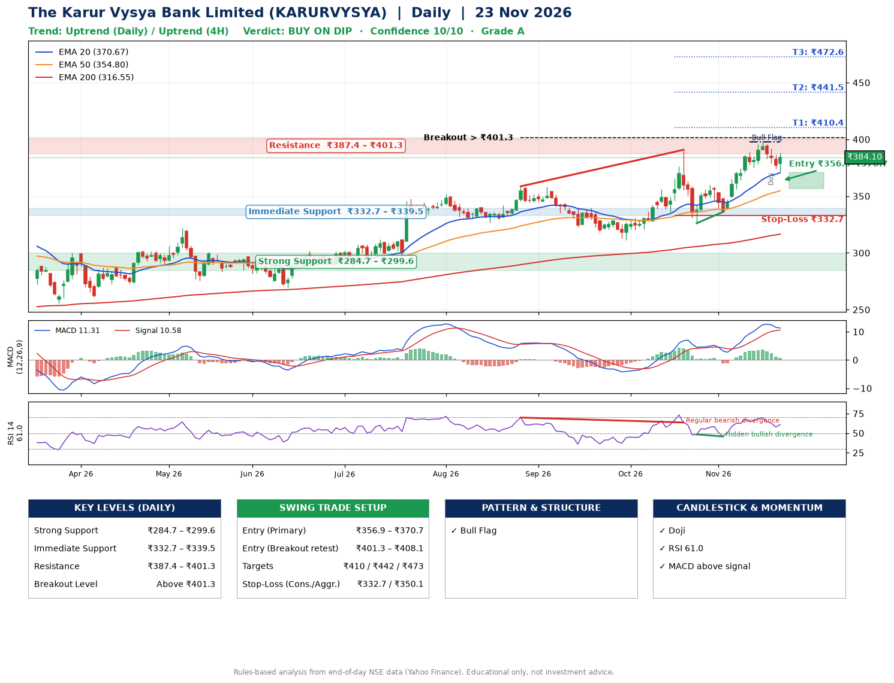

📌 **The Karur Vysya Bank Limited (KARURVYSYA) – Multi-Timeframe Technical Analysis (Daily + 4H Combined)**
_Data up to 23 Nov 2026 · Close ₹384.10_

**📍 Daily Timeframe Trend**
- Trend: **Uptrend** (higher highs and higher lows)
- Recent swing highs: ₹351.8, ₹358.6, ₹390.8 · swing lows: ₹311.4, ₹326.1, ₹336.1
- EMAs: EMA20 ₹370.7, EMA50 ₹354.8, EMA200 ₹316.5; bullish stack (EMA20 > EMA50 > EMA200); price above EMA20, EMA50, EMA200
- MACD 11.31 above signal 10.58 (above zero); histogram falling
- RSI(14) 61.0; Hidden bullish divergence; Regular bearish divergence

**📍 4-Hour Timeframe Trend**
- Structure: **Uptrend** (higher highs and higher lows)
- Pullback/support area: recent 4H swing lows ₹336.1, ₹375.4; EMA20 ₹379.9
- EMA20/50: bullish stack (EMA20 > EMA50); price above EMA20, EMA50
- MACD 5.91 below signal 7.69 (above zero); histogram rising
- RSI(14) 56.9; no divergence

**📍 Pattern Detection (Both Timeframes)**
- Daily: **Bull Flag** – 17% pole then a tight 7% flag; trigger above ₹397.9
- 4H: **Bull Flag** – 17% pole then a tight 6% flag; trigger above ₹395.9

**📍 Candlestick Patterns (last 3 daily candles)**
- **Doji** – 19 Nov: indecision; wait for the next candle to confirm direction

**📍 Price Action Key Levels (Daily Structure)**

| Zone | Price Level (₹) | Context |
|------|-----------------|---------|
| Strong Support | ₹284.7 – ₹299.6 | Cluster of earlier swing lows (demand) |
| Immediate Support | ₹332.7 – ₹339.5 | Nearest swing-low / wick area |
| Resistance | ₹387.4 – ₹401.3 | Nearest swing-high supply |
| Breakout Level | Above ₹401.3 | Swing continuation trigger (52-week high ₹397.9) |

**📍 Swing Trade Setup**

🟢 **Entry Zone**
- Primary: ₹356.9 – ₹370.7 (daily support / EMA20 area; enter on a bullish 4H candle)
- Alternate: ₹401.3 – ₹408.1 (breakout retest)

🎯 **Profit Targets**
- T1: ₹410.4
- T2: ₹441.5
- T3: ₹472.6

🛑 **Stop-Loss**
- Conservative: below daily swing low (₹332.7)
- Aggressive: below 4H structure (₹350.1)
- Risk per share ≈ ₹31.1; reward:risk to T1 ≈ 1.5
- Time to T1: about 27 trading days (it rose this much within 60 trading days 70% of the time in the last 2 years)
- Time to T2: about 38 trading days (it rose this much within 60 trading days 38% of the time in the last 2 years)

**📌 Strategy Notes**
- Higher timeframe: daily trend is uptrend; only take longs while price holds above ₹284.7.
- Entry timing: wait for a bullish 4H candle (engulfing/hammer) inside ₹356.9 – ₹370.7 rather than buying mid-range.
- EMA stacking: bullish stack (EMA20 > EMA50 > EMA200); price above EMA20, EMA50, EMA200.
- Breakout rule: a daily close above ₹401.3 with volume above its 20-day average (≈3,083,108) opens T2/T3.
- Momentum: RSI 61 – room to run; Hidden bullish divergence; Regular bearish divergence.
- Exit discipline: move the stop to entry once T1 is hit; book partial profits at each target.

**STEP 2 — Marked Up Chart**

**✅ Trade Validation Checklist**
- Trend + momentum aligned: Yes · Price at entry zone: No
- Stop defined (₹332.7) · Reward:risk ≥ 1.5 to T1: No

## 📌 Final Verdict

Recommendation: **🟡 BUY ON DIP**

Confidence: **10/10**

Trade Quality: **A**

Reason:
• Daily uptrend (higher highs and higher lows)
• EMAs stacked bullishly

Next Action:
• Wait for a pullback to ₹356.9–₹370.7

_Rules-based analysis from end-of-day data. Educational only, not investment advice. Never place orders without your own confirmation._