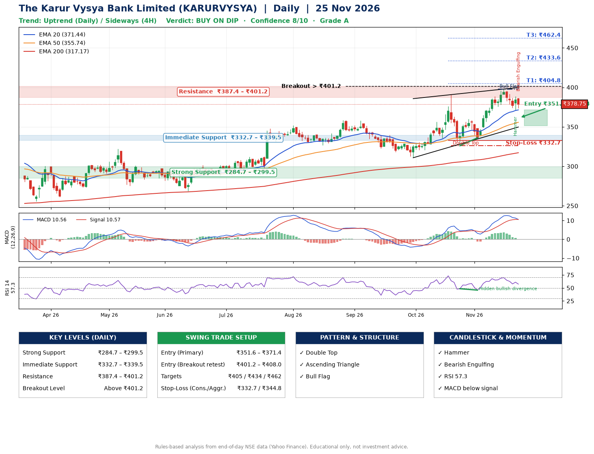

📌 **The Karur Vysya Bank Limited (KARURVYSYA) – Multi-Timeframe Technical Analysis (Daily + 4H Combined)**
_Data up to 25 Nov 2026 · Close ₹378.75_

**📍 Daily Timeframe Trend**
- Trend: **Uptrend** (higher highs and higher lows)
- Recent swing highs: ₹358.6, ₹390.8, ₹397.9 · swing lows: ₹311.4, ₹326.1, ₹336.1
- EMAs: EMA20 ₹371.4, EMA50 ₹355.7, EMA200 ₹317.2; bullish stack (EMA20 > EMA50 > EMA200); price above EMA20, EMA50, EMA200
- MACD 10.56 below signal 10.57 (above zero), fresh bearish crossover; histogram falling
- RSI(14) 57.3; Hidden bullish divergence

**📍 4-Hour Timeframe Trend**
- Structure: **Sideways** (mixed swing structure)
- Pullback/support area: recent 4H swing lows ₹375.4, ₹371.0; EMA20 ₹379.4
- EMA20/50: bullish stack (EMA20 > EMA50); price above EMA50
- MACD 4.26 below signal 6.55 (above zero); histogram falling
- RSI(14) 51.8; no divergence

**📍 Pattern Detection (Both Timeframes)**
- Daily: **Double Top** – tops near ₹390.8/₹397.9, neckline ₹326.1, forming
- Daily: **Ascending Triangle** – converging swing highs and lows over the last ~60 sessions
- Daily: **Bull Flag** – 16% pole then a tight 7% flag; trigger above ₹397.9
- 4H: **Double Bottom** – bottoms near ₹375.4/₹371.0, neckline ₹397.9, forming
- 4H: **Bull Flag** – 15% pole then a tight 5% flag; trigger above ₹391.7

**📍 Candlestick Patterns (last 3 daily candles)**
- **Hammer** – 23 Nov: long lower wick shows dip-buying near ₹371.0
- **Bearish Engulfing** – 25 Nov: sellers fully reversed the prior green candle

**📍 Price Action Key Levels (Daily Structure)**

| Zone | Price Level (₹) | Context |
|------|-----------------|---------|
| Strong Support | ₹284.7 – ₹299.5 | Cluster of earlier swing lows (demand) |
| Immediate Support | ₹332.7 – ₹339.5 | Nearest swing-low / wick area |
| Resistance | ₹387.4 – ₹401.2 | Nearest swing-high supply |
| Breakout Level | Above ₹401.2 | Swing continuation trigger (52-week high ₹397.9) |

**📍 Swing Trade Setup**

🟢 **Entry Zone**
- Primary: ₹351.6 – ₹371.4 (daily support / EMA20 area; enter on a bullish 4H candle)
- Alternate: ₹401.2 – ₹408.0 (breakout retest)

🎯 **Profit Targets**
- T1: ₹404.8
- T2: ₹433.6
- T3: ₹462.4

🛑 **Stop-Loss**
- Conservative: below daily swing low (₹332.7)
- Aggressive: below 4H structure (₹344.8)
- Risk per share ≈ ₹28.8; reward:risk to T1 ≈ 1.5
- Time to T1: about 25 trading days (it rose this much within 60 trading days 73% of the time in the last 2 years)
- Time to T2: about 39 trading days (it rose this much within 60 trading days 45% of the time in the last 2 years)

**📌 Strategy Notes**
- Higher timeframe: daily trend is uptrend; only take longs while price holds above ₹284.7.
- Entry timing: wait for a bullish 4H candle (engulfing/hammer) inside ₹351.6 – ₹371.4 rather than buying mid-range.
- EMA stacking: bullish stack (EMA20 > EMA50 > EMA200); price above EMA20, EMA50, EMA200.
- Breakout rule: a daily close above ₹401.2 with volume above its 20-day average (≈3,281,171) opens T2/T3.
- Momentum: RSI 57 – room to run; Hidden bullish divergence.
- Exit discipline: move the stop to entry once T1 is hit; book partial profits at each target.

**STEP 2 — Marked Up Chart**

**✅ Trade Validation Checklist**
- Trend + momentum aligned: No · Price at entry zone: No
- Stop defined (₹332.7) · Reward:risk ≥ 1.5 to T1: Yes

## 📌 Final Verdict

Recommendation: **🟡 BUY ON DIP**

Confidence: **8/10**

Trade Quality: **A**

Reason:
• Daily uptrend (higher highs and higher lows)
• EMAs stacked bullishly

Next Action:
• Wait for a pullback to ₹351.6–₹371.4, or a breakout above ₹401.2

_Rules-based analysis from end-of-day data. Educational only, not investment advice. Never place orders without your own confirmation._