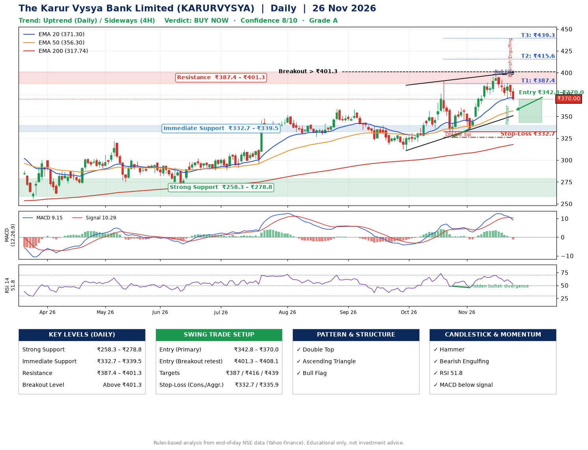

📌 **The Karur Vysya Bank Limited (KARURVYSYA) – Multi-Timeframe Technical Analysis (Daily + 4H Combined)**
_Data up to 26 Nov 2026 · Close ₹370.00_

**📍 Daily Timeframe Trend**
- Trend: **Uptrend** (higher highs and higher lows)
- Recent swing highs: ₹358.6, ₹390.8, ₹397.9 · swing lows: ₹311.4, ₹326.1, ₹336.1
- EMAs: EMA20 ₹371.3, EMA50 ₹356.3, EMA200 ₹317.7; bullish stack (EMA20 > EMA50 > EMA200); price above EMA50, EMA200
- MACD 9.15 below signal 10.29 (above zero), fresh bearish crossover; histogram falling
- RSI(14) 51.8; Hidden bullish divergence

**📍 4-Hour Timeframe Trend**
- Structure: **Sideways** (mixed swing structure)
- Pullback/support area: recent 4H swing lows ₹375.4, ₹371.0; EMA20 ₹378.4
- EMA20/50: bullish stack (EMA20 > EMA50); price above EMA50
- MACD 2.56 below signal 5.30 (above zero); histogram falling
- RSI(14) 44.6; no divergence

**📍 Pattern Detection (Both Timeframes)**
- Daily: **Double Top** – tops near ₹390.8/₹397.9, neckline ₹326.1, forming
- Daily: **Ascending Triangle** – converging swing highs and lows over the last ~60 sessions
- Daily: **Bull Flag** – 16% pole then a tight 8% flag; trigger above ₹397.9

**📍 Candlestick Patterns (last 3 daily candles)**
- **Hammer** – 23 Nov: long lower wick shows dip-buying near ₹371.0
- **Bearish Engulfing** – 25 Nov: sellers fully reversed the prior green candle

**📍 Price Action Key Levels (Daily Structure)**

| Zone | Price Level (₹) | Context |
|------|-----------------|---------|
| Strong Support | ₹258.3 – ₹278.8 | Cluster of earlier swing lows (demand) |
| Immediate Support | ₹332.7 – ₹339.5 | Nearest swing-low / wick area |
| Resistance | ₹387.4 – ₹401.3 | Nearest swing-high supply |
| Breakout Level | Above ₹401.3 | Swing continuation trigger (52-week high ₹397.9) |

**📍 Swing Trade Setup**

🟢 **Entry Zone**
- Primary: ₹342.8 – ₹370.0 (daily support / EMA20 area; enter on a bullish 4H candle)
- Alternate: ₹401.3 – ₹408.1 (breakout retest)

🎯 **Profit Targets**
- T1: ₹387.4
- T2: ₹415.6
- T3: ₹439.3

🛑 **Stop-Loss**
- Conservative: below daily swing low (₹332.7)
- Aggressive: below 4H structure (₹335.9)
- Risk per share ≈ ₹23.7; reward:risk to T1 ≈ 1.3
- Time to T1: about 19 trading days (it rose this much within 60 trading days 79% of the time in the last 2 years)
- Time to T2: about 33 trading days (it rose this much within 60 trading days 57% of the time in the last 2 years)

**📌 Strategy Notes**
- Higher timeframe: daily trend is uptrend; only take longs while price holds above ₹258.3.
- Entry timing: wait for a bullish 4H candle (engulfing/hammer) inside ₹342.8 – ₹370.0 rather than buying mid-range.
- EMA stacking: bullish stack (EMA20 > EMA50 > EMA200); price above EMA50, EMA200.
- Breakout rule: a daily close above ₹401.3 with volume above its 20-day average (≈3,274,567) opens T2/T3.
- Momentum: RSI 52 – room to run; Hidden bullish divergence.
- Exit discipline: move the stop to entry once T1 is hit; book partial profits at each target.

**STEP 2 — Marked Up Chart**

**✅ Trade Validation Checklist**
- Trend + momentum aligned: No · Price at entry zone: Yes
- Stop defined (₹332.7) · Reward:risk ≥ 1.5 to T1: No

## 📌 Final Verdict

Recommendation: **🟢 BUY NOW**

Confidence: **8/10**

Trade Quality: **A**

Reason:
• Daily uptrend (higher highs and higher lows)
• EMAs stacked bullishly

Next Action:
• Buy now within the entry zone, with the stop-loss in place

_Rules-based analysis from end-of-day data. Educational only, not investment advice. Never place orders without your own confirmation._