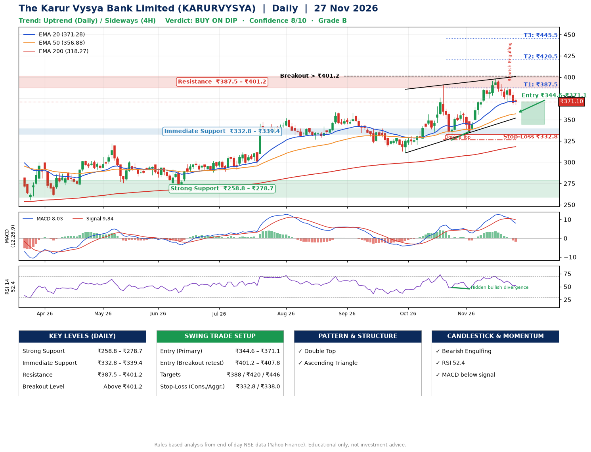

📌 **The Karur Vysya Bank Limited (KARURVYSYA) – Multi-Timeframe Technical Analysis (Daily + 4H Combined)**
_Data up to 27 Nov 2026 · Close ₹371.10_

**📍 Daily Timeframe Trend**
- Trend: **Uptrend** (higher highs and higher lows)
- Recent swing highs: ₹358.6, ₹390.8, ₹397.9 · swing lows: ₹311.4, ₹326.1, ₹336.1
- EMAs: EMA20 ₹371.3, EMA50 ₹356.9, EMA200 ₹318.3; bullish stack (EMA20 > EMA50 > EMA200); price above EMA50, EMA200
- MACD 8.03 below signal 9.84 (above zero), fresh bearish crossover; histogram falling
- RSI(14) 52.4; Hidden bullish divergence

**📍 4-Hour Timeframe Trend**
- Structure: **Sideways** (mixed swing structure)
- Pullback/support area: recent 4H swing lows ₹375.4, ₹371.0; EMA20 ₹376.9
- EMA20/50: bullish stack (EMA20 > EMA50); price above EMA50
- MACD 0.91 below signal 3.82 (above zero); histogram rising
- RSI(14) 45.9; no divergence

**📍 Pattern Detection (Both Timeframes)**
- Daily: **Double Top** – tops near ₹390.8/₹397.9, neckline ₹326.1, forming
- Daily: **Ascending Triangle** – converging swing highs and lows over the last ~60 sessions
- 4H: **Double Bottom** – bottoms near ₹375.4/₹371.0, neckline ₹397.9, forming

**📍 Candlestick Patterns (last 3 daily candles)**
- **Bearish Engulfing** – 25 Nov: sellers fully reversed the prior green candle

**📍 Price Action Key Levels (Daily Structure)**

| Zone | Price Level (₹) | Context |
|------|-----------------|---------|
| Strong Support | ₹258.8 – ₹278.7 | Cluster of earlier swing lows (demand) |
| Immediate Support | ₹332.8 – ₹339.4 | Nearest swing-low / wick area |
| Resistance | ₹387.5 – ₹401.2 | Nearest swing-high supply |
| Breakout Level | Above ₹401.2 | Swing continuation trigger (52-week high ₹397.9) |

**📍 Swing Trade Setup**

🟢 **Entry Zone**
- Primary: ₹344.6 – ₹371.1 (daily support / EMA20 area; enter on a bullish 4H candle)
- Alternate: ₹401.2 – ₹407.8 (breakout retest)

🎯 **Profit Targets**
- T1: ₹387.5
- T2: ₹420.5
- T3: ₹445.5

🛑 **Stop-Loss**
- Conservative: below daily swing low (₹332.8)
- Aggressive: below 4H structure (₹338.0)
- Risk per share ≈ ₹25.1; reward:risk to T1 ≈ 1.2
- Time to T1: about 18 trading days (it rose this much within 60 trading days 80% of the time in the last 2 years)
- Time to T2: about 34 trading days (it rose this much within 60 trading days 54% of the time in the last 2 years)

**📌 Strategy Notes**
- Higher timeframe: daily trend is uptrend; only take longs while price holds above ₹258.8.
- Entry timing: wait for a bullish 4H candle (engulfing/hammer) inside ₹344.6 – ₹371.1 rather than buying mid-range.
- EMA stacking: bullish stack (EMA20 > EMA50 > EMA200); price above EMA50, EMA200.
- Breakout rule: a daily close above ₹401.2 with volume above its 20-day average (≈3,323,488) opens T2/T3.
- Momentum: RSI 52 – room to run; Hidden bullish divergence.
- Exit discipline: move the stop to entry once T1 is hit; book partial profits at each target.

**STEP 2 — Marked Up Chart**

**✅ Trade Validation Checklist**
- Trend + momentum aligned: No · Price at entry zone: Yes
- Stop defined (₹332.8) · Reward:risk ≥ 1.5 to T1: No

## 📌 Final Verdict

Recommendation: **🟡 BUY ON DIP**

Confidence: **8/10**

Trade Quality: **B**

Reason:
• Daily uptrend (higher highs and higher lows)
• EMAs stacked bullishly

Next Action:
• Wait for a pullback to ₹344.6–₹371.1, or a breakout above ₹401.2

_Rules-based analysis from end-of-day data. Educational only, not investment advice. Never place orders without your own confirmation._