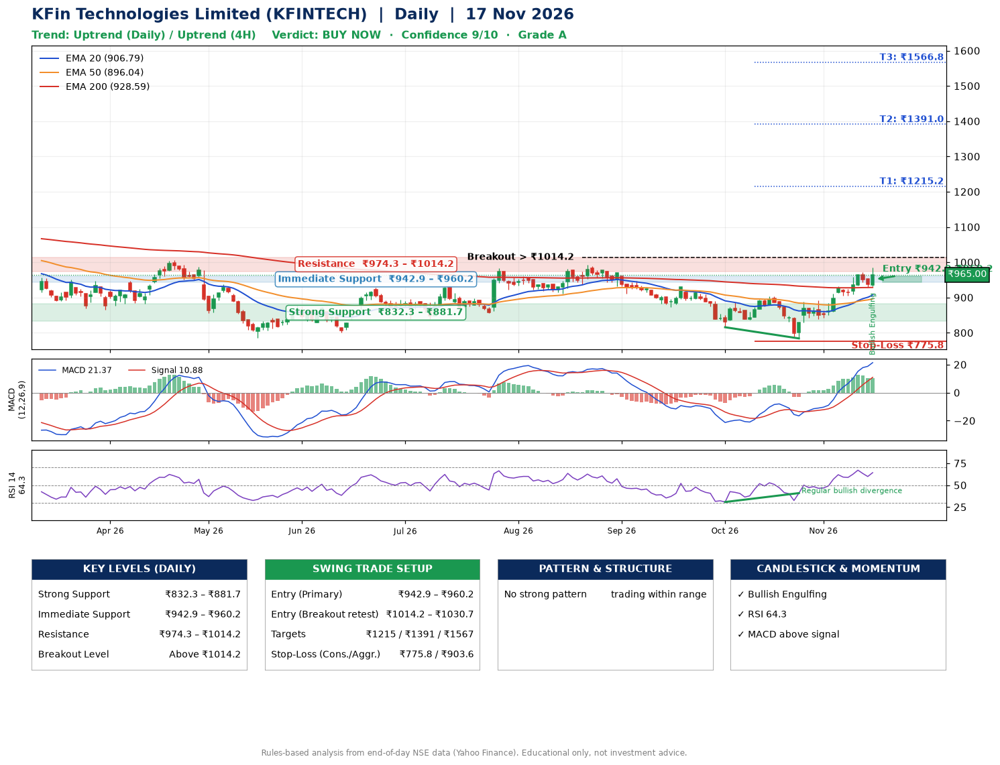

📌 **KFin Technologies Limited (KFINTECH) – Multi-Timeframe Technical Analysis (Daily + 4H Combined)**
_Data up to 17 Nov 2026 · Close ₹965.00_

**📍 Daily Timeframe Trend**
- Trend: **Uptrend** (price above rising EMAs)
- Recent swing highs: ₹992.4, ₹930.0, ₹903.1 · swing lows: ₹872.5, ₹815.7, ₹784.0
- EMAs: EMA20 ₹906.8, EMA50 ₹896.0, EMA200 ₹928.6; mixed / crossing; price above EMA20, EMA50, EMA200
- MACD 21.37 above signal 10.88 (above zero); histogram falling
- RSI(14) 64.3; Regular bullish divergence

**📍 4-Hour Timeframe Trend**
- Structure: **Uptrend** (higher highs and higher lows)
- Pullback/support area: recent 4H swing lows ₹839.4, ₹905.6; EMA20 ₹928.2
- EMA20/50: bullish stack (EMA20 > EMA50); price above EMA20, EMA50
- MACD 22.91 above signal 21.38 (above zero); histogram rising
- RSI(14) 65.6; Regular bearish divergence

**📍 Pattern Detection (Both Timeframes)**
- 4H: **Bull Flag** – 17% pole then a tight 6% flag; trigger above ₹984.7

**📍 Candlestick Patterns (last 3 daily candles)**
- **Bullish Engulfing** – 17 Nov: buyers fully reversed the prior red candle

**📍 Price Action Key Levels (Daily Structure)**

| Zone | Price Level (₹) | Context |
|------|-----------------|---------|
| Strong Support | ₹832.3 – ₹881.7 | Cluster of earlier swing lows (demand) |
| Immediate Support | ₹942.9 – ₹960.2 | Nearest swing-low / wick area |
| Resistance | ₹974.3 – ₹1014.2 | Nearest swing-high supply |
| Breakout Level | Above ₹1014.2 | Swing continuation trigger (52-week high ₹1115.8) |

**📍 Swing Trade Setup**

🟢 **Entry Zone**
- Primary: ₹942.9 – ₹960.2 (daily support / EMA20 area; enter on a bullish 4H candle)
- Alternate: ₹1014.2 – ₹1030.7 (breakout retest)

🎯 **Profit Targets**
- T1: ₹1215.2
- T2: ₹1391.0
- T3: ₹1566.8

🛑 **Stop-Loss**
- Conservative: below daily swing low (₹775.8)
- Aggressive: below 4H structure (₹903.6)
- Risk per share ≈ ₹175.8; reward:risk to T1 ≈ 1.5
- Time to T1: about 18 trading days (it rose this much within 60 trading days 17% of the time in the last 2 years)
- Time to T2: about 30 trading days (it rose this much within 60 trading days 4% of the time in the last 2 years)

**📌 Strategy Notes**
- Higher timeframe: daily trend is uptrend; only take longs while price holds above ₹832.3.
- Entry timing: wait for a bullish 4H candle (engulfing/hammer) inside ₹942.9 – ₹960.2 rather than buying mid-range.
- EMA stacking: mixed / crossing; price above EMA20, EMA50, EMA200.
- Breakout rule: a daily close above ₹1014.2 with volume above its 20-day average (≈1,221,587) opens T2/T3.
- Momentum: RSI 64 – room to run; Regular bullish divergence.
- Exit discipline: move the stop to entry once T1 is hit; book partial profits at each target.

**STEP 2 — Marked Up Chart**

**✅ Trade Validation Checklist**
- Trend + momentum aligned: Yes · Price at entry zone: No
- Stop defined (₹775.8) · Reward:risk ≥ 1.5 to T1: No

## 📌 Final Verdict

Recommendation: **🟢 BUY NOW**

Confidence: **9/10**

Trade Quality: **A**

Reason:
• Daily uptrend (price above rising EMAs)

Next Action:
• Buy now within the entry zone, with the stop-loss in place

_Rules-based analysis from end-of-day data. Educational only, not investment advice. Never place orders without your own confirmation._