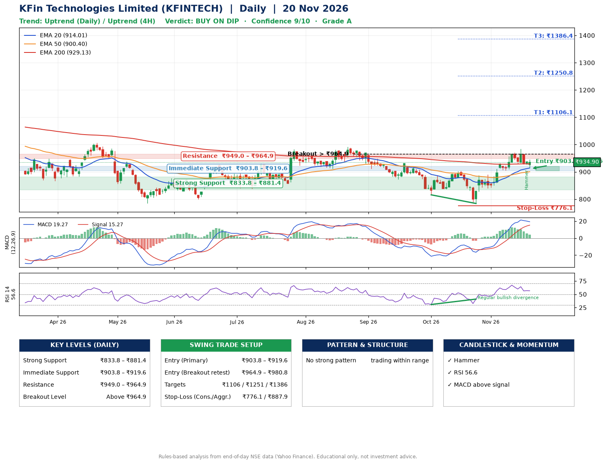

📌 **KFin Technologies Limited (KFINTECH) – Multi-Timeframe Technical Analysis (Daily + 4H Combined)**
_Data up to 20 Nov 2026 · Close ₹934.90_

**📍 Daily Timeframe Trend**
- Trend: **Uptrend** (price above rising EMAs)
- Recent swing highs: ₹992.4, ₹930.0, ₹903.1 · swing lows: ₹872.5, ₹815.7, ₹784.0
- EMAs: EMA20 ₹914.0, EMA50 ₹900.4, EMA200 ₹929.1; mixed / crossing; price above EMA20, EMA50, EMA200
- MACD 19.27 above signal 15.27 (above zero); histogram falling
- RSI(14) 56.6; Regular bullish divergence

**📍 4-Hour Timeframe Trend**
- Structure: **Uptrend** (higher highs and higher lows)
- Pullback/support area: recent 4H swing lows ₹905.6, ₹930.2; EMA20 ₹931.4
- EMA20/50: bullish stack (EMA20 > EMA50); price above EMA20, EMA50
- MACD 12.78 below signal 16.81 (above zero); histogram falling
- RSI(14) 53.8; Hidden bullish divergence

**📍 Pattern Detection (Both Timeframes)**
- No strong pattern detected. Trading within range.

**📍 Candlestick Patterns (last 3 daily candles)**
- **Hammer** – 19 Nov: long lower wick shows dip-buying near ₹925.5

**📍 Price Action Key Levels (Daily Structure)**

| Zone | Price Level (₹) | Context |
|------|-----------------|---------|
| Strong Support | ₹833.8 – ₹881.4 | Cluster of earlier swing lows (demand) |
| Immediate Support | ₹903.8 – ₹919.6 | Nearest swing-low / wick area |
| Resistance | ₹949.0 – ₹964.9 | Nearest swing-high supply |
| Breakout Level | Above ₹964.9 | Swing continuation trigger (52-week high ₹1115.8) |

**📍 Swing Trade Setup**

🟢 **Entry Zone**
- Primary: ₹903.8 – ₹919.6 (daily support / EMA20 area; enter on a bullish 4H candle)
- Alternate: ₹964.9 – ₹980.8 (breakout retest)

🎯 **Profit Targets**
- T1: ₹1106.1
- T2: ₹1250.8
- T3: ₹1386.4

🛑 **Stop-Loss**
- Conservative: below daily swing low (₹776.1)
- Aggressive: below 4H structure (₹887.9)
- Risk per share ≈ ₹135.6; reward:risk to T1 ≈ 1.4
- Time to T1: about 16 trading days (it rose this much within 60 trading days 21% of the time in the last 2 years)
- Time to T2: about 24 trading days (it rose this much within 60 trading days 7% of the time in the last 2 years)

**📌 Strategy Notes**
- Higher timeframe: daily trend is uptrend; only take longs while price holds above ₹833.8.
- Entry timing: wait for a bullish 4H candle (engulfing/hammer) inside ₹903.8 – ₹919.6 rather than buying mid-range.
- EMA stacking: mixed / crossing; price above EMA20, EMA50, EMA200.
- Breakout rule: a daily close above ₹964.9 with volume above its 20-day average (≈1,238,347) opens T2/T3.
- Momentum: RSI 57 – room to run; Regular bullish divergence.
- Exit discipline: move the stop to entry once T1 is hit; book partial profits at each target.

**STEP 2 — Marked Up Chart**

**✅ Trade Validation Checklist**
- Trend + momentum aligned: Yes · Price at entry zone: No
- Stop defined (₹776.1) · Reward:risk ≥ 1.5 to T1: No

## 📌 Final Verdict

Recommendation: **🟡 BUY ON DIP**

Confidence: **9/10**

Trade Quality: **A**

Reason:
• Daily uptrend (price above rising EMAs)

Next Action:
• Wait for a pullback to ₹903.8–₹919.6, or a breakout above ₹964.9

_Rules-based analysis from end-of-day data. Educational only, not investment advice. Never place orders without your own confirmation._