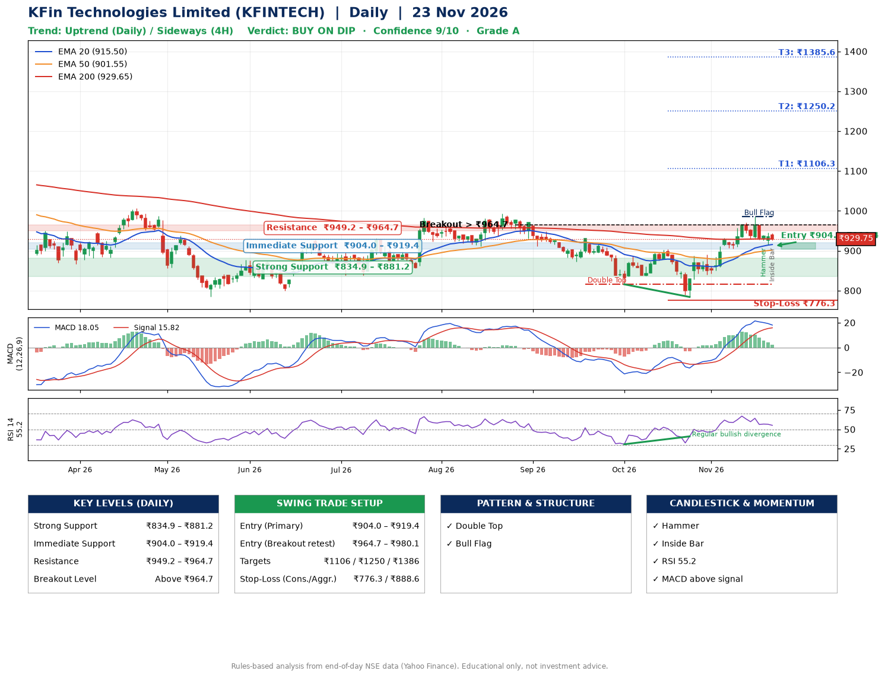

📌 **KFin Technologies Limited (KFINTECH) – Multi-Timeframe Technical Analysis (Daily + 4H Combined)**
_Data up to 23 Nov 2026 · Close ₹929.75_

**📍 Daily Timeframe Trend**
- Trend: **Uptrend** (price above rising EMAs)
- Recent swing highs: ₹992.4, ₹930.0, ₹903.1 · swing lows: ₹872.5, ₹815.7, ₹784.0
- EMAs: EMA20 ₹915.5, EMA50 ₹901.5, EMA200 ₹929.6; mixed / crossing; price above EMA20, EMA50, EMA200
- MACD 18.05 above signal 15.82 (above zero); histogram falling
- RSI(14) 55.2; Regular bullish divergence

**📍 4-Hour Timeframe Trend**
- Structure: **Sideways** (mixed swing structure)
- Pullback/support area: recent 4H swing lows ₹930.2, ₹914.7; EMA20 ₹931.6
- EMA20/50: bullish stack (EMA20 > EMA50); price above EMA50
- MACD 10.11 below signal 14.64 (above zero); histogram falling
- RSI(14) 51.7; no divergence

**📍 Pattern Detection (Both Timeframes)**
- Daily: **Double Top** – tops near ₹930.0/₹903.1, neckline ₹815.7, forming
- Daily: **Bull Flag** – 17% pole then a tight 7% flag; trigger above ₹985.0
- 4H: **Symmetrical Triangle** – converging swing highs and lows over the last ~60 sessions

**📍 Candlestick Patterns (last 3 daily candles)**
- **Hammer** – 19 Nov: long lower wick shows dip-buying near ₹925.5
- **Inside Bar** – 23 Nov: compression inside the prior range ₹914.7–₹945.8

**📍 Price Action Key Levels (Daily Structure)**

| Zone | Price Level (₹) | Context |
|------|-----------------|---------|
| Strong Support | ₹834.9 – ₹881.2 | Cluster of earlier swing lows (demand) |
| Immediate Support | ₹904.0 – ₹919.4 | Nearest swing-low / wick area |
| Resistance | ₹949.2 – ₹964.7 | Nearest swing-high supply |
| Breakout Level | Above ₹964.7 | Swing continuation trigger (52-week high ₹1115.8) |

**📍 Swing Trade Setup**

🟢 **Entry Zone**
- Primary: ₹904.0 – ₹919.4 (daily support / EMA20 area; enter on a bullish 4H candle)
- Alternate: ₹964.7 – ₹980.1 (breakout retest)

🎯 **Profit Targets**
- T1: ₹1106.3
- T2: ₹1250.2
- T3: ₹1385.6

🛑 **Stop-Loss**
- Conservative: below daily swing low (₹776.3)
- Aggressive: below 4H structure (₹888.6)
- Risk per share ≈ ₹135.4; reward:risk to T1 ≈ 1.4
- Time to T1: about 16 trading days (it rose this much within 60 trading days 20% of the time in the last 2 years)
- Time to T2: about 25 trading days (it rose this much within 60 trading days 7% of the time in the last 2 years)

**📌 Strategy Notes**
- Higher timeframe: daily trend is uptrend; only take longs while price holds above ₹834.9.
- Entry timing: wait for a bullish 4H candle (engulfing/hammer) inside ₹904.0 – ₹919.4 rather than buying mid-range.
- EMA stacking: mixed / crossing; price above EMA20, EMA50, EMA200.
- Breakout rule: a daily close above ₹964.7 with volume above its 20-day average (≈1,208,617) opens T2/T3.
- Momentum: RSI 55 – room to run; Regular bullish divergence.
- Exit discipline: move the stop to entry once T1 is hit; book partial profits at each target.

**STEP 2 — Marked Up Chart**

**✅ Trade Validation Checklist**
- Trend + momentum aligned: Yes · Price at entry zone: No
- Stop defined (₹776.3) · Reward:risk ≥ 1.5 to T1: No

## 📌 Final Verdict

Recommendation: **🟡 BUY ON DIP**

Confidence: **9/10**

Trade Quality: **A**

Reason:
• Daily uptrend (price above rising EMAs)
• Double Top: tops near ₹930.0/₹903.1, neckline ₹815.7, forming

Next Action:
• Wait for a pullback to ₹904.0–₹919.4, or a breakout above ₹964.7

_Rules-based analysis from end-of-day data. Educational only, not investment advice. Never place orders without your own confirmation._