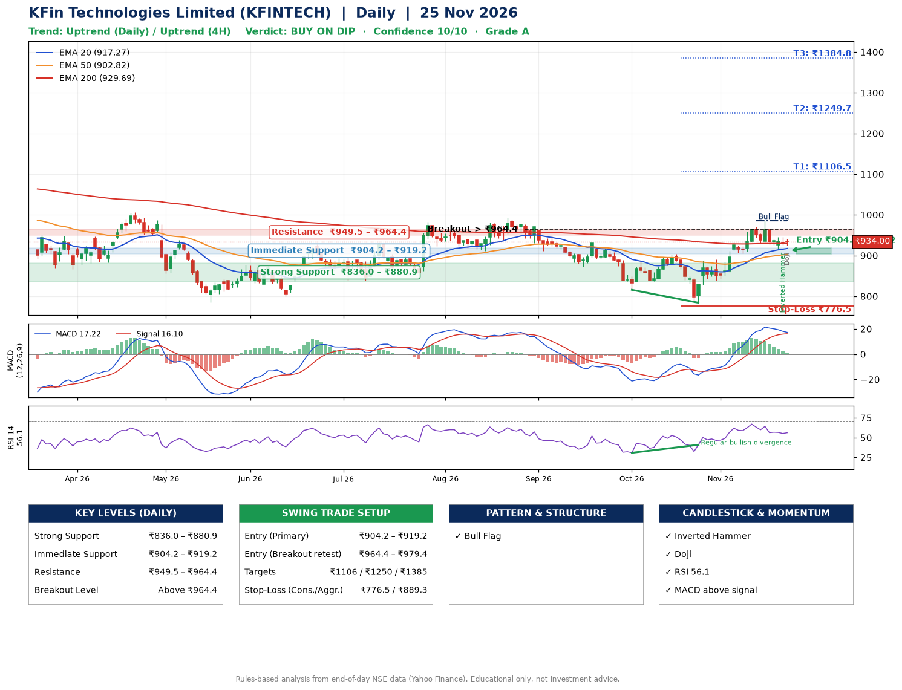

📌 **KFin Technologies Limited (KFINTECH) – Multi-Timeframe Technical Analysis (Daily + 4H Combined)**
_Data up to 25 Nov 2026 · Close ₹934.00_

**📍 Daily Timeframe Trend**
- Trend: **Uptrend** (price above rising EMAs)
- Recent swing highs: ₹930.0, ₹903.1, ₹985.0 · swing lows: ₹872.5, ₹815.7, ₹784.0
- EMAs: EMA20 ₹917.3, EMA50 ₹902.8, EMA200 ₹929.7; mixed / crossing; price above EMA20, EMA50, EMA200
- MACD 17.22 above signal 16.10 (above zero); histogram falling
- RSI(14) 56.1; Regular bullish divergence

**📍 4-Hour Timeframe Trend**
- Structure: **Uptrend** (price above rising EMAs)
- Pullback/support area: recent 4H swing lows ₹930.2, ₹914.7; EMA20 ₹931.7
- EMA20/50: bullish stack (EMA20 > EMA50); price above EMA20, EMA50
- MACD 8.02 below signal 12.38 (above zero); histogram rising
- RSI(14) 53.4; no divergence

**📍 Pattern Detection (Both Timeframes)**
- Daily: **Bull Flag** – 16% pole then a tight 7% flag; trigger above ₹985.0
- 4H: **Symmetrical Triangle** – converging swing highs and lows over the last ~60 sessions

**📍 Candlestick Patterns (last 3 daily candles)**
- **Inverted Hammer** – 23 Nov: long upper wick shows selling near ₹945.6
- **Doji** – 25 Nov: indecision; wait for the next candle to confirm direction

**📍 Price Action Key Levels (Daily Structure)**

| Zone | Price Level (₹) | Context |
|------|-----------------|---------|
| Strong Support | ₹836.0 – ₹880.9 | Cluster of earlier swing lows (demand) |
| Immediate Support | ₹904.2 – ₹919.2 | Nearest swing-low / wick area |
| Resistance | ₹949.5 – ₹964.4 | Nearest swing-high supply |
| Breakout Level | Above ₹964.4 | Swing continuation trigger (52-week high ₹1115.8) |

**📍 Swing Trade Setup**

🟢 **Entry Zone**
- Primary: ₹904.2 – ₹919.2 (daily support / EMA20 area; enter on a bullish 4H candle)
- Alternate: ₹964.4 – ₹979.4 (breakout retest)

🎯 **Profit Targets**
- T1: ₹1106.5
- T2: ₹1249.7
- T3: ₹1384.8

🛑 **Stop-Loss**
- Conservative: below daily swing low (₹776.5)
- Aggressive: below 4H structure (₹889.3)
- Risk per share ≈ ₹135.2; reward:risk to T1 ≈ 1.4
- Time to T1: about 16 trading days (it rose this much within 60 trading days 20% of the time in the last 2 years)
- Time to T2: about 25 trading days (it rose this much within 60 trading days 7% of the time in the last 2 years)

**📌 Strategy Notes**
- Higher timeframe: daily trend is uptrend; only take longs while price holds above ₹836.0.
- Entry timing: wait for a bullish 4H candle (engulfing/hammer) inside ₹904.2 – ₹919.2 rather than buying mid-range.
- EMA stacking: mixed / crossing; price above EMA20, EMA50, EMA200.
- Breakout rule: a daily close above ₹964.4 with volume above its 20-day average (≈1,199,605) opens T2/T3.
- Momentum: RSI 56 – room to run; Regular bullish divergence.
- Exit discipline: move the stop to entry once T1 is hit; book partial profits at each target.

**STEP 2 — Marked Up Chart**

**✅ Trade Validation Checklist**
- Trend + momentum aligned: Yes · Price at entry zone: No
- Stop defined (₹776.5) · Reward:risk ≥ 1.5 to T1: No

## 📌 Final Verdict

Recommendation: **🟡 BUY ON DIP**

Confidence: **10/10**

Trade Quality: **A**

Reason:
• Daily uptrend (price above rising EMAs)
• Bull Flag: 16% pole then a tight 7% flag; trigger above ₹985.0

Next Action:
• Wait for a pullback to ₹904.2–₹919.2, or a breakout above ₹964.4

_Rules-based analysis from end-of-day data. Educational only, not investment advice. Never place orders without your own confirmation._