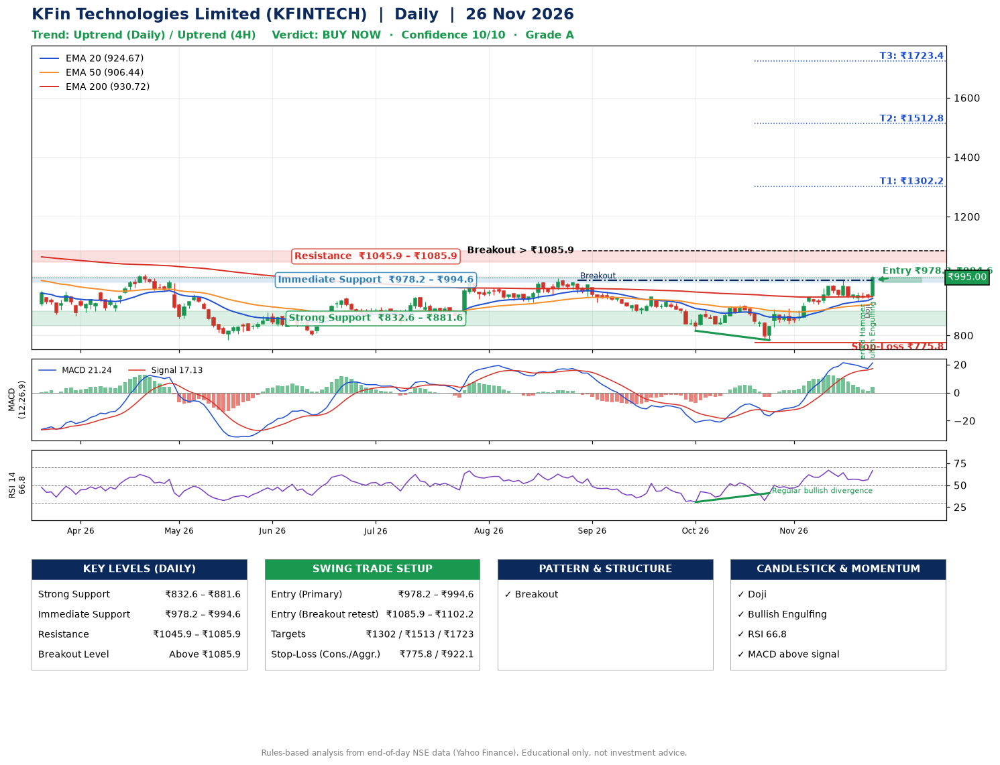

📌 **KFin Technologies Limited (KFINTECH) – Multi-Timeframe Technical Analysis (Daily + 4H Combined)**
_Data up to 26 Nov 2026 · Close ₹995.00_

**📍 Daily Timeframe Trend**
- Trend: **Uptrend** (price above rising EMAs)
- Recent swing highs: ₹930.0, ₹903.1, ₹985.0 · swing lows: ₹872.5, ₹815.7, ₹784.0
- EMAs: EMA20 ₹924.7, EMA50 ₹906.4, EMA200 ₹930.7; mixed / crossing; price above EMA20, EMA50, EMA200
- MACD 21.24 above signal 17.13 (above zero); histogram rising
- RSI(14) 66.8; Regular bullish divergence

**📍 4-Hour Timeframe Trend**
- Structure: **Uptrend** (price above rising EMAs)
- Pullback/support area: recent 4H swing lows ₹914.7, ₹924.2; EMA20 ₹942.2
- EMA20/50: bullish stack (EMA20 > EMA50); price above EMA20, EMA50
- MACD 14.64 above signal 12.66 (above zero), fresh bullish crossover; histogram rising
- RSI(14) 70.0; Hidden bullish divergence

**📍 Pattern Detection (Both Timeframes)**
- Daily: **Breakout** – closed above the 60-session high ₹985.0 on strong volume

**📍 Candlestick Patterns (last 3 daily candles)**
- **Inverted Hammer** – 23 Nov: long upper wick shows selling near ₹945.6
- **Doji** – 25 Nov: indecision; wait for the next candle to confirm direction
- **Bullish Engulfing** – 26 Nov: buyers fully reversed the prior red candle

**📍 Price Action Key Levels (Daily Structure)**

| Zone | Price Level (₹) | Context |
|------|-----------------|---------|
| Strong Support | ₹832.6 – ₹881.6 | Cluster of earlier swing lows (demand) |
| Immediate Support | ₹978.2 – ₹994.6 | Nearest swing-low / wick area |
| Resistance | ₹1045.9 – ₹1085.9 | Nearest swing-high supply |
| Breakout Level | Above ₹1085.9 | Swing continuation trigger (52-week high ₹1115.8) |

**📍 Swing Trade Setup**

🟢 **Entry Zone**
- Primary: ₹978.2 – ₹994.6 (daily support / EMA20 area; enter on a bullish 4H candle)
- Alternate: ₹1085.9 – ₹1102.2 (breakout retest)

🎯 **Profit Targets**
- T1: ₹1302.2
- T2: ₹1512.8
- T3: ₹1723.4

🛑 **Stop-Loss**
- Conservative: below daily swing low (₹775.8)
- Aggressive: below 4H structure (₹922.1)
- Risk per share ≈ ₹210.6; reward:risk to T1 ≈ 1.5
- Time to T1: about 23 trading days (it rose this much within 60 trading days 11% of the time in the last 2 years)
- Time to T2: about 39 trading days (it rose this much within 60 trading days 1% of the time in the last 2 years)

**📌 Strategy Notes**
- Higher timeframe: daily trend is uptrend; only take longs while price holds above ₹832.6.
- Entry timing: wait for a bullish 4H candle (engulfing/hammer) inside ₹978.2 – ₹994.6 rather than buying mid-range.
- EMA stacking: mixed / crossing; price above EMA20, EMA50, EMA200.
- Breakout rule: a daily close above ₹1085.9 with volume above its 20-day average (≈1,235,673) opens T2/T3.
- Momentum: RSI 67 – elevated, prefer dips; Regular bullish divergence.
- Exit discipline: move the stop to entry once T1 is hit; book partial profits at each target.

**STEP 2 — Marked Up Chart**

**✅ Trade Validation Checklist**
- Trend + momentum aligned: Yes · Price at entry zone: No
- Stop defined (₹775.8) · Reward:risk ≥ 1.5 to T1: No

## 📌 Final Verdict

Recommendation: **🟢 BUY NOW**

Confidence: **10/10**

Trade Quality: **A**

Reason:
• Daily uptrend (price above rising EMAs)
• Breakout: closed above the 60-session high ₹985.0 on strong volume

Next Action:
• Buy now within the entry zone, with the stop-loss in place

_Rules-based analysis from end-of-day data. Educational only, not investment advice. Never place orders without your own confirmation._