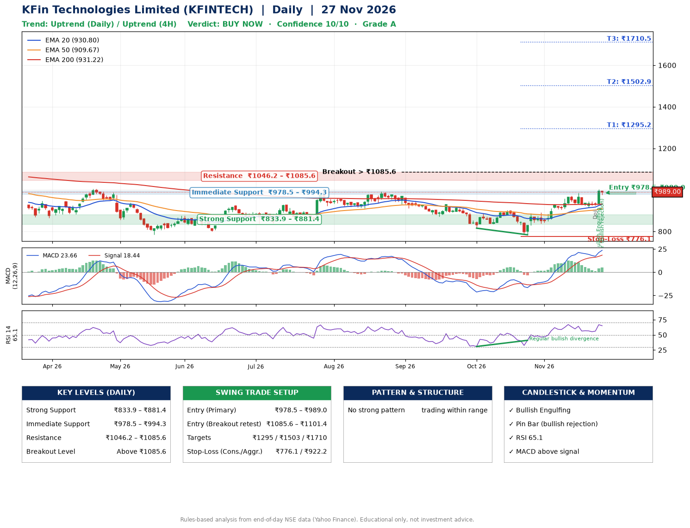

📌 **KFin Technologies Limited (KFINTECH) – Multi-Timeframe Technical Analysis (Daily + 4H Combined)**
_Data up to 27 Nov 2026 · Close ₹989.00_

**📍 Daily Timeframe Trend**
- Trend: **Uptrend** (price above rising EMAs)
- Recent swing highs: ₹930.0, ₹903.1, ₹985.0 · swing lows: ₹872.5, ₹815.7, ₹784.0
- EMAs: EMA20 ₹930.8, EMA50 ₹909.7, EMA200 ₹931.2; mixed / crossing; price above EMA20, EMA50, EMA200
- MACD 23.66 above signal 18.44 (above zero); histogram rising
- RSI(14) 65.1; Regular bullish divergence

**📍 4-Hour Timeframe Trend**
- Structure: **Uptrend** (price above rising EMAs)
- Pullback/support area: recent 4H swing lows ₹914.7, ₹924.2; EMA20 ₹950.4
- EMA20/50: bullish stack (EMA20 > EMA50); price above EMA20, EMA50
- MACD 17.77 above signal 14.28 (above zero), fresh bullish crossover; histogram rising
- RSI(14) 66.7; Hidden bullish divergence

**📍 Pattern Detection (Both Timeframes)**
- No strong pattern detected. Trading within range.

**📍 Candlestick Patterns (last 3 daily candles)**
- **Doji** – 25 Nov: indecision; wait for the next candle to confirm direction
- **Bullish Engulfing** – 26 Nov: buyers fully reversed the prior red candle
- **Pin Bar (bullish rejection)** – 27 Nov: long lower wick shows dip-buying near ₹976.7

**📍 Price Action Key Levels (Daily Structure)**

| Zone | Price Level (₹) | Context |
|------|-----------------|---------|
| Strong Support | ₹833.9 – ₹881.4 | Cluster of earlier swing lows (demand) |
| Immediate Support | ₹978.5 – ₹994.3 | Nearest swing-low / wick area |
| Resistance | ₹1046.2 – ₹1085.6 | Nearest swing-high supply |
| Breakout Level | Above ₹1085.6 | Swing continuation trigger (52-week high ₹1115.8) |

**📍 Swing Trade Setup**

🟢 **Entry Zone**
- Primary: ₹978.5 – ₹989.0 (daily support / EMA20 area; enter on a bullish 4H candle)
- Alternate: ₹1085.6 – ₹1101.4 (breakout retest)

🎯 **Profit Targets**
- T1: ₹1295.2
- T2: ₹1502.9
- T3: ₹1710.5

🛑 **Stop-Loss**
- Conservative: below daily swing low (₹776.1)
- Aggressive: below 4H structure (₹922.2)
- Risk per share ≈ ₹207.7; reward:risk to T1 ≈ 1.5
- Time to T1: about 23 trading days (it rose this much within 60 trading days 11% of the time in the last 2 years)
- Time to T2: about 39 trading days (it rose this much within 60 trading days 1% of the time in the last 2 years)

**📌 Strategy Notes**
- Higher timeframe: daily trend is uptrend; only take longs while price holds above ₹833.9.
- Entry timing: wait for a bullish 4H candle (engulfing/hammer) inside ₹978.5 – ₹989.0 rather than buying mid-range.
- EMA stacking: mixed / crossing; price above EMA20, EMA50, EMA200.
- Breakout rule: a daily close above ₹1085.6 with volume above its 20-day average (≈1,207,090) opens T2/T3.
- Momentum: RSI 65 – elevated, prefer dips; Regular bullish divergence.
- Exit discipline: move the stop to entry once T1 is hit; book partial profits at each target.

**STEP 2 — Marked Up Chart**

**✅ Trade Validation Checklist**
- Trend + momentum aligned: Yes · Price at entry zone: Yes
- Stop defined (₹776.1) · Reward:risk ≥ 1.5 to T1: No

## 📌 Final Verdict

Recommendation: **🟢 BUY NOW**

Confidence: **10/10**

Trade Quality: **A**

Reason:
• Daily uptrend (price above rising EMAs)

Next Action:
• Buy now within the entry zone, with the stop-loss in place

_Rules-based analysis from end-of-day data. Educational only, not investment advice. Never place orders without your own confirmation._