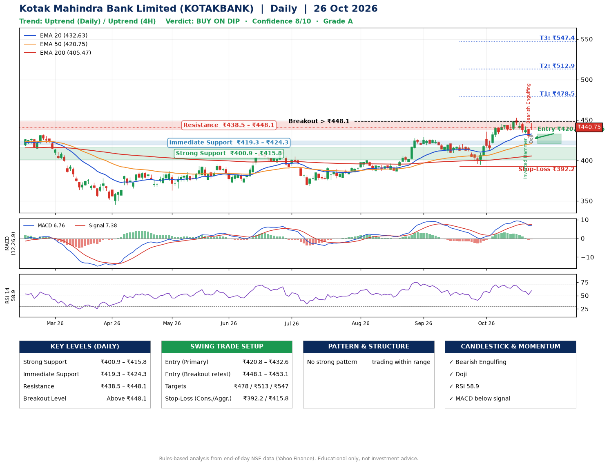

📌 **Kotak Mahindra Bank Limited (KOTAKBANK) – Multi-Timeframe Technical Analysis (Daily + 4H Combined)**
_Data up to 26 Oct 2026 · Close ₹440.75_

**📍 Daily Timeframe Trend**
- Trend: **Uptrend** (price above rising EMAs)
- Recent swing highs: ₹429.1, ₹420.6, ₹453.1 · swing lows: ₹386.8, ₹409.2, ₹394.7
- EMAs: EMA20 ₹432.6, EMA50 ₹420.7, EMA200 ₹405.5; bullish stack (EMA20 > EMA50 > EMA200); price above EMA20, EMA50, EMA200
- MACD 6.76 below signal 7.38 (above zero), fresh bearish crossover; histogram rising
- RSI(14) 58.9; no divergence on the last two swings

**📍 4-Hour Timeframe Trend**
- Structure: **Uptrend** (price above rising EMAs)
- Pullback/support area: recent 4H swing lows ₹437.3, ₹427.7; EMA20 ₹437.1
- EMA20/50: bullish stack (EMA20 > EMA50); price above EMA20, EMA50
- MACD 2.00 below signal 3.30 (above zero); histogram rising
- RSI(14) 55.7; Regular bearish divergence

**📍 Pattern Detection (Both Timeframes)**
- 4H: **Double Bottom** – bottoms near ₹437.3/₹427.7, neckline ₹453.0, forming

**📍 Candlestick Patterns (last 3 daily candles)**
- **Inverted Hammer** – 22 Oct: long upper wick shows selling near ₹442.5
- **Bearish Engulfing** – 23 Oct: sellers fully reversed the prior green candle
- **Doji** – 26 Oct: indecision; wait for the next candle to confirm direction

**📍 Price Action Key Levels (Daily Structure)**

| Zone | Price Level (₹) | Context |
|------|-----------------|---------|
| Strong Support | ₹400.9 – ₹415.8 | Cluster of earlier swing lows (demand) |
| Immediate Support | ₹419.3 – ₹424.3 | Nearest swing-low / wick area |
| Resistance | ₹438.5 – ₹448.1 | Nearest swing-high supply |
| Breakout Level | Above ₹448.1 | Swing continuation trigger (52-week high ₹453.1) |

**📍 Swing Trade Setup**

🟢 **Entry Zone**
- Primary: ₹420.8 – ₹432.6 (daily support / EMA20 area; enter on a bullish 4H candle)
- Alternate: ₹448.1 – ₹453.1 (breakout retest)

🎯 **Profit Targets**
- T1: ₹478.5
- T2: ₹512.9
- T3: ₹547.4

🛑 **Stop-Loss**
- Conservative: below daily swing low (₹392.2)
- Aggressive: below 4H structure (₹415.8)
- Risk per share ≈ ₹34.5; reward:risk to T1 ≈ 1.5

**📌 Strategy Notes**
- Higher timeframe: daily trend is uptrend; only take longs while price holds above ₹400.9.
- Entry timing: wait for a bullish 4H candle (engulfing/hammer) inside ₹420.8 – ₹432.6 rather than buying mid-range.
- EMA stacking: bullish stack (EMA20 > EMA50 > EMA200); price above EMA20, EMA50, EMA200.
- Breakout rule: a daily close above ₹448.1 with volume above its 20-day average (≈27,124,171) opens T2/T3.
- Momentum: RSI 59 – room to run; no divergence on the last two swings.
- Exit discipline: move the stop to entry once T1 is hit; book partial profits at each target.

**STEP 2 — Marked Up Chart**

**✅ Trade Validation Checklist**
- Trend + momentum aligned: No · Price at entry zone: No
- Stop defined (₹392.2) · Reward:risk ≥ 1.5 to T1: Yes

## 📌 Final Verdict

Recommendation: **🟡 BUY ON DIP**

Confidence: **8/10**

Trade Quality: **A**

Reason:
• Daily uptrend (price above rising EMAs)
• EMAs stacked bullishly

Next Action:
• Wait for a pullback to ₹420.8–₹432.6, or a breakout above ₹448.1

_Rules-based analysis from end-of-day data. Educational only, not investment advice. Never place orders without your own confirmation._