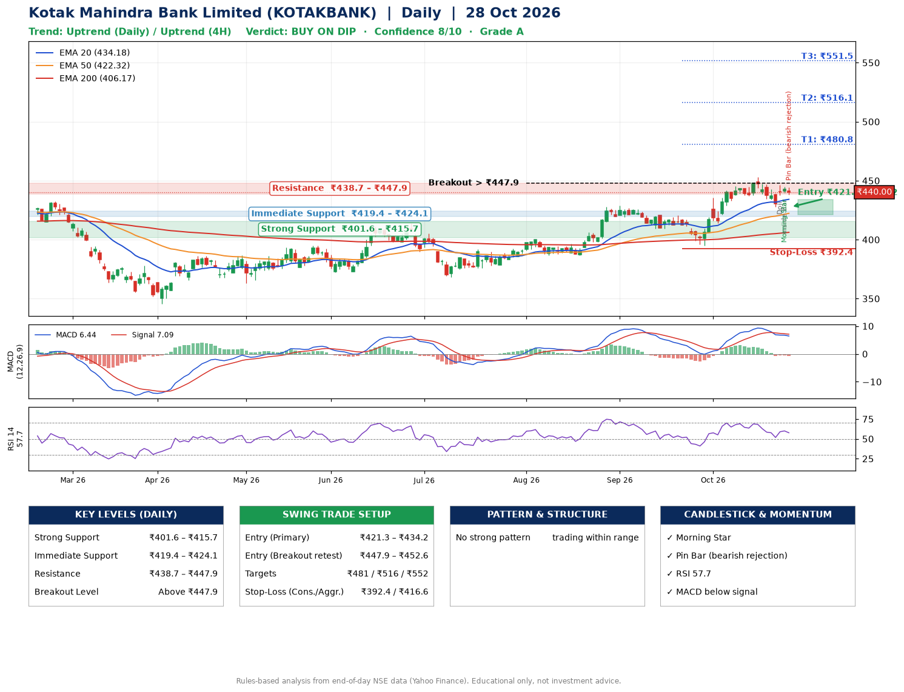

📌 **Kotak Mahindra Bank Limited (KOTAKBANK) – Multi-Timeframe Technical Analysis (Daily + 4H Combined)**
_Data up to 28 Oct 2026 · Close ₹440.00_

**📍 Daily Timeframe Trend**
- Trend: **Uptrend** (price above rising EMAs)
- Recent swing highs: ₹429.1, ₹420.6, ₹453.1 · swing lows: ₹386.8, ₹409.2, ₹394.7
- EMAs: EMA20 ₹434.2, EMA50 ₹422.3, EMA200 ₹406.2; bullish stack (EMA20 > EMA50 > EMA200); price above EMA20, EMA50, EMA200
- MACD 6.44 below signal 7.09 (above zero), fresh bearish crossover; histogram falling
- RSI(14) 57.7; no divergence on the last two swings

**📍 4-Hour Timeframe Trend**
- Structure: **Uptrend** (price above rising EMAs)
- Pullback/support area: recent 4H swing lows ₹437.3, ₹427.7; EMA20 ₹438.7
- EMA20/50: bullish stack (EMA20 > EMA50); price above EMA20, EMA50
- MACD 2.39 below signal 2.76 (above zero); histogram falling
- RSI(14) 53.5; no divergence

**📍 Pattern Detection (Both Timeframes)**
- 4H: **Double Top** – tops near ₹453.0/₹446.2, neckline ₹427.7, forming
- 4H: **Double Bottom** – bottoms near ₹437.3/₹427.7, neckline ₹453.0, forming
- 4H: **Ascending Triangle** – converging swing highs and lows over the last ~60 sessions

**📍 Candlestick Patterns (last 3 daily candles)**
- **Doji** – 26 Oct: indecision; wait for the next candle to confirm direction
- **Inside Bar** – 27 Oct: compression inside the prior range ₹437.6–₹446.3
- **Morning Star** – 27 Oct: three-candle bullish reversal
- **Pin Bar (bearish rejection)** – 28 Oct: long upper wick shows selling near ₹444.3

**📍 Price Action Key Levels (Daily Structure)**

| Zone | Price Level (₹) | Context |
|------|-----------------|---------|
| Strong Support | ₹401.6 – ₹415.7 | Cluster of earlier swing lows (demand) |
| Immediate Support | ₹419.4 – ₹424.1 | Nearest swing-low / wick area |
| Resistance | ₹438.7 – ₹447.9 | Nearest swing-high supply |
| Breakout Level | Above ₹447.9 | Swing continuation trigger (52-week high ₹453.1) |

**📍 Swing Trade Setup**

🟢 **Entry Zone**
- Primary: ₹421.3 – ₹434.2 (daily support / EMA20 area; enter on a bullish 4H candle)
- Alternate: ₹447.9 – ₹452.6 (breakout retest)

🎯 **Profit Targets**
- T1: ₹480.8
- T2: ₹516.1
- T3: ₹551.5

🛑 **Stop-Loss**
- Conservative: below daily swing low (₹392.4)
- Aggressive: below 4H structure (₹416.6)
- Risk per share ≈ ₹35.4; reward:risk to T1 ≈ 1.5

**📌 Strategy Notes**
- Higher timeframe: daily trend is uptrend; only take longs while price holds above ₹401.6.
- Entry timing: wait for a bullish 4H candle (engulfing/hammer) inside ₹421.3 – ₹434.2 rather than buying mid-range.
- EMA stacking: bullish stack (EMA20 > EMA50 > EMA200); price above EMA20, EMA50, EMA200.
- Breakout rule: a daily close above ₹447.9 with volume above its 20-day average (≈27,590,313) opens T2/T3.
- Momentum: RSI 58 – room to run; no divergence on the last two swings.
- Exit discipline: move the stop to entry once T1 is hit; book partial profits at each target.

**STEP 2 — Marked Up Chart**

**✅ Trade Validation Checklist**
- Trend + momentum aligned: No · Price at entry zone: No
- Stop defined (₹392.4) · Reward:risk ≥ 1.5 to T1: Yes

## 📌 Final Verdict

Recommendation: **🟡 BUY ON DIP**

Confidence: **8/10**

Trade Quality: **A**

Reason:
• Daily uptrend (price above rising EMAs)
• EMAs stacked bullishly

Next Action:
• Wait for a pullback to ₹421.3–₹434.2, or a breakout above ₹447.9

_Rules-based analysis from end-of-day data. Educational only, not investment advice. Never place orders without your own confirmation._