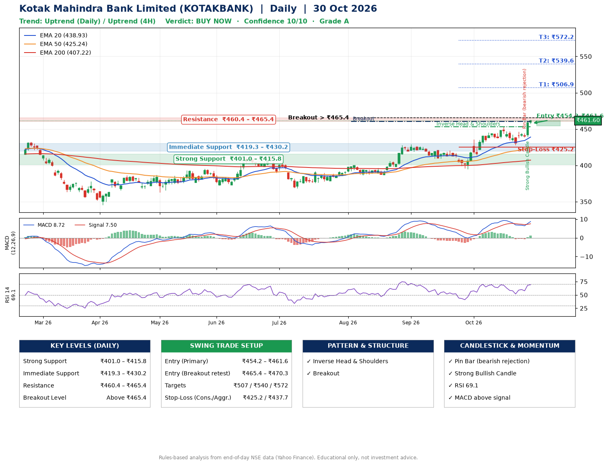

📌 **Kotak Mahindra Bank Limited (KOTAKBANK) – Multi-Timeframe Technical Analysis (Daily + 4H Combined)**
_Data up to 30 Oct 2026 · Close ₹461.60_

**📍 Daily Timeframe Trend**
- Trend: **Uptrend** (higher highs and higher lows)
- Recent swing highs: ₹429.1, ₹420.6, ₹453.1 · swing lows: ₹409.2, ₹394.7, ₹427.7
- EMAs: EMA20 ₹438.9, EMA50 ₹425.2, EMA200 ₹407.2; bullish stack (EMA20 > EMA50 > EMA200); price above EMA20, EMA50, EMA200
- MACD 8.72 above signal 7.50 (above zero), fresh bullish crossover; histogram rising
- RSI(14) 69.1; no divergence on the last two swings

**📍 4-Hour Timeframe Trend**
- Structure: **Uptrend** (price above rising EMAs)
- Pullback/support area: recent 4H swing lows ₹427.7, ₹438.4; EMA20 ₹445.7
- EMA20/50: bullish stack (EMA20 > EMA50); price above EMA20, EMA50
- MACD 6.29 above signal 4.21 (above zero), fresh bullish crossover; histogram rising
- RSI(14) 69.6; no divergence

**📍 Pattern Detection (Both Timeframes)**
- Daily: **Inverse Head & Shoulders** – head ₹394.7, neckline ₹453.1
- Daily: **Breakout** – closed above the 60-session high ₹460.2 (volume not confirming yet)

**📍 Candlestick Patterns (last 3 daily candles)**
- **Pin Bar (bearish rejection)** – 28 Oct: long upper wick shows selling near ₹444.3
- **Strong Bullish Candle** – 29 Oct: wide-range green candle, buyers in control

**📍 Price Action Key Levels (Daily Structure)**

| Zone | Price Level (₹) | Context |
|------|-----------------|---------|
| Strong Support | ₹401.0 – ₹415.8 | Cluster of earlier swing lows (demand) |
| Immediate Support | ₹419.3 – ₹430.2 | Nearest swing-low / wick area |
| Resistance | ₹460.4 – ₹465.4 | Nearest swing-high supply |
| Breakout Level | Above ₹465.4 | Swing continuation trigger (52-week high ₹462.9) |

**📍 Swing Trade Setup**

🟢 **Entry Zone**
- Primary: ₹454.2 – ₹461.6 (daily support / EMA20 area; enter on a bullish 4H candle)
- Alternate: ₹465.4 – ₹470.3 (breakout retest)

🎯 **Profit Targets**
- T1: ₹506.9
- T2: ₹539.6
- T3: ₹572.2

🛑 **Stop-Loss**
- Conservative: below daily swing low (₹425.2)
- Aggressive: below 4H structure (₹437.7)
- Risk per share ≈ ₹32.7; reward:risk to T1 ≈ 1.5

**📌 Strategy Notes**
- Higher timeframe: daily trend is uptrend; only take longs while price holds above ₹401.0.
- Entry timing: wait for a bullish 4H candle (engulfing/hammer) inside ₹454.2 – ₹461.6 rather than buying mid-range.
- EMA stacking: bullish stack (EMA20 > EMA50 > EMA200); price above EMA20, EMA50, EMA200.
- Breakout rule: a daily close above ₹465.4 with volume above its 20-day average (≈27,694,486) opens T2/T3.
- Momentum: RSI 69 – elevated, prefer dips; no divergence on the last two swings.
- Exit discipline: move the stop to entry once T1 is hit; book partial profits at each target.

**STEP 2 — Marked Up Chart**

**✅ Trade Validation Checklist**
- Trend + momentum aligned: Yes · Price at entry zone: Yes
- Stop defined (₹425.2) · Reward:risk ≥ 1.5 to T1: Yes

## 📌 Final Verdict

Recommendation: **🟢 BUY NOW**

Confidence: **10/10**

Trade Quality: **A**

Reason:
• Daily uptrend (higher highs and higher lows)
• EMAs stacked bullishly

Next Action:
• Buy now within the entry zone, with the stop-loss in place

_Rules-based analysis from end-of-day data. Educational only, not investment advice. Never place orders without your own confirmation._