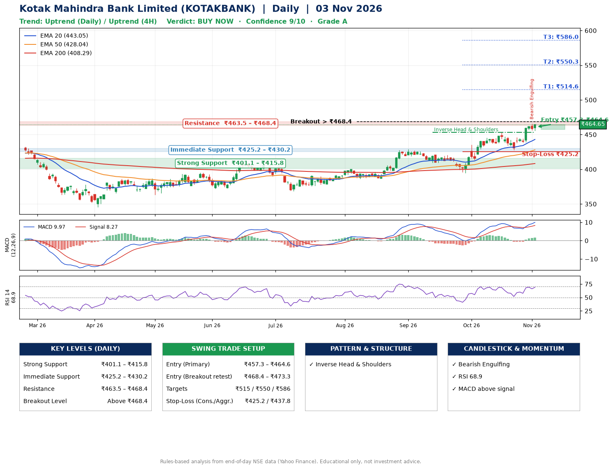

📌 **Kotak Mahindra Bank Limited (KOTAKBANK) – Multi-Timeframe Technical Analysis (Daily + 4H Combined)**
_Data up to 03 Nov 2026 · Close ₹464.65_

**📍 Daily Timeframe Trend**
- Trend: **Uptrend** (higher highs and higher lows)
- Recent swing highs: ₹429.1, ₹420.6, ₹453.1 · swing lows: ₹409.2, ₹394.7, ₹427.7
- EMAs: EMA20 ₹443.1, EMA50 ₹428.0, EMA200 ₹408.3; bullish stack (EMA20 > EMA50 > EMA200); price above EMA20, EMA50, EMA200
- MACD 9.97 above signal 8.27 (above zero), fresh bullish crossover; histogram rising
- RSI(14) 68.9; no divergence on the last two swings

**📍 4-Hour Timeframe Trend**
- Structure: **Uptrend** (higher highs and higher lows)
- Pullback/support area: recent 4H swing lows ₹427.7, ₹438.4; EMA20 ₹450.4
- EMA20/50: bullish stack (EMA20 > EMA50); price above EMA20, EMA50
- MACD 7.05 above signal 5.70 (above zero); histogram rising
- RSI(14) 69.6; no divergence

**📍 Pattern Detection (Both Timeframes)**
- Daily: **Inverse Head & Shoulders** – head ₹394.7, neckline ₹453.1

**📍 Candlestick Patterns (last 3 daily candles)**
- **Bearish Engulfing** – 02 Nov: sellers fully reversed the prior green candle

**📍 Price Action Key Levels (Daily Structure)**

| Zone | Price Level (₹) | Context |
|------|-----------------|---------|
| Strong Support | ₹401.1 – ₹415.8 | Cluster of earlier swing lows (demand) |
| Immediate Support | ₹425.2 – ₹430.2 | Nearest swing-low / wick area |
| Resistance | ₹463.5 – ₹468.4 | Nearest swing-high supply |
| Breakout Level | Above ₹468.4 | Swing continuation trigger (52-week high ₹466.0) |

**📍 Swing Trade Setup**

🟢 **Entry Zone**
- Primary: ₹457.3 – ₹464.6 (daily support / EMA20 area; enter on a bullish 4H candle)
- Alternate: ₹468.4 – ₹473.3 (breakout retest)

🎯 **Profit Targets**
- T1: ₹514.6
- T2: ₹550.3
- T3: ₹586.0

🛑 **Stop-Loss**
- Conservative: below daily swing low (₹425.2)
- Aggressive: below 4H structure (₹437.8)
- Risk per share ≈ ₹35.7; reward:risk to T1 ≈ 1.5

**📌 Strategy Notes**
- Higher timeframe: daily trend is uptrend; only take longs while price holds above ₹401.1.
- Entry timing: wait for a bullish 4H candle (engulfing/hammer) inside ₹457.3 – ₹464.6 rather than buying mid-range.
- EMA stacking: bullish stack (EMA20 > EMA50 > EMA200); price above EMA20, EMA50, EMA200.
- Breakout rule: a daily close above ₹468.4 with volume above its 20-day average (≈24,746,717) opens T2/T3.
- Momentum: RSI 69 – elevated, prefer dips; no divergence on the last two swings.
- Exit discipline: move the stop to entry once T1 is hit; book partial profits at each target.

**STEP 2 — Marked Up Chart**

**✅ Trade Validation Checklist**
- Trend + momentum aligned: Yes · Price at entry zone: Yes
- Stop defined (₹425.2) · Reward:risk ≥ 1.5 to T1: Yes

## 📌 Final Verdict

Recommendation: **🟢 BUY NOW**

Confidence: **9/10**

Trade Quality: **A**

Reason:
• Daily uptrend (higher highs and higher lows)
• EMAs stacked bullishly

Next Action:
• Buy now within the entry zone, with the stop-loss in place

_Rules-based analysis from end-of-day data. Educational only, not investment advice. Never place orders without your own confirmation._