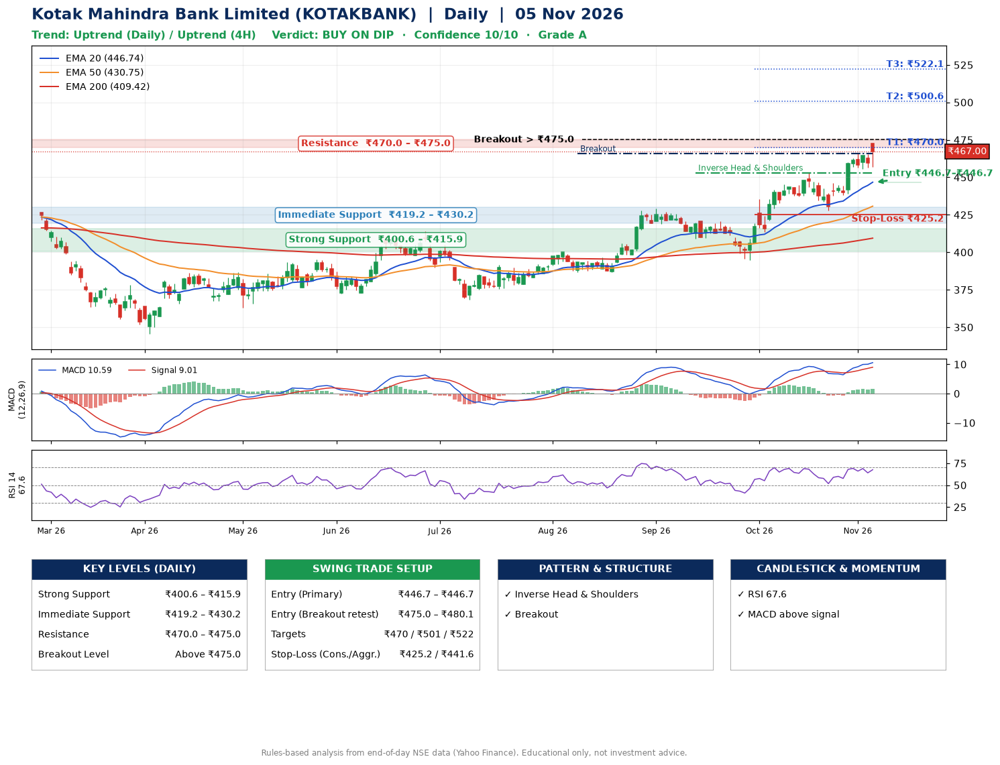

📌 **Kotak Mahindra Bank Limited (KOTAKBANK) – Multi-Timeframe Technical Analysis (Daily + 4H Combined)**
_Data up to 05 Nov 2026 · Close ₹467.00_

**📍 Daily Timeframe Trend**
- Trend: **Uptrend** (higher highs and higher lows)
- Recent swing highs: ₹429.1, ₹420.6, ₹453.1 · swing lows: ₹409.2, ₹394.7, ₹427.7
- EMAs: EMA20 ₹446.7, EMA50 ₹430.7, EMA200 ₹409.4; bullish stack (EMA20 > EMA50 > EMA200); price above EMA20, EMA50, EMA200
- MACD 10.59 above signal 9.01 (above zero); histogram rising
- RSI(14) 67.6; no divergence on the last two swings

**📍 4-Hour Timeframe Trend**
- Structure: **Uptrend** (higher highs and higher lows)
- Pullback/support area: recent 4H swing lows ₹438.4, ₹455.6; EMA20 ₹454.8
- EMA20/50: bullish stack (EMA20 > EMA50); price above EMA20, EMA50
- MACD 7.26 above signal 6.48 (above zero); histogram rising
- RSI(14) 67.9; no divergence

**📍 Pattern Detection (Both Timeframes)**
- Daily: **Inverse Head & Shoulders** – head ₹394.7, neckline ₹453.1
- Daily: **Breakout** – closed above the 60-session high ₹466.0 (volume not confirming yet)

**📍 Candlestick Patterns (last 3 daily candles)**
- No notable candlestick signal in the last 3 sessions.

**📍 Price Action Key Levels (Daily Structure)**

| Zone | Price Level (₹) | Context |
|------|-----------------|---------|
| Strong Support | ₹400.6 – ₹415.9 | Cluster of earlier swing lows (demand) |
| Immediate Support | ₹419.2 – ₹430.2 | Nearest swing-low / wick area |
| Resistance | ₹470.0 – ₹475.0 | Nearest swing-high supply |
| Breakout Level | Above ₹475.0 | Swing continuation trigger (52-week high ₹472.5) |

**📍 Swing Trade Setup**

🟢 **Entry Zone**
- Primary: ₹446.7 – ₹446.7 (daily support / EMA20 area; enter on a bullish 4H candle)
- Alternate: ₹475.0 – ₹480.1 (breakout retest)

🎯 **Profit Targets**
- T1: ₹470.0
- T2: ₹500.6
- T3: ₹522.1

🛑 **Stop-Loss**
- Conservative: below daily swing low (₹425.2)
- Aggressive: below 4H structure (₹441.6)
- Risk per share ≈ ₹21.6; reward:risk to T1 ≈ 1.1

**📌 Strategy Notes**
- Higher timeframe: daily trend is uptrend; only take longs while price holds above ₹400.6.
- Entry timing: wait for a bullish 4H candle (engulfing/hammer) inside ₹446.7 – ₹446.7 rather than buying mid-range.
- EMA stacking: bullish stack (EMA20 > EMA50 > EMA200); price above EMA20, EMA50, EMA200.
- Breakout rule: a daily close above ₹475.0 with volume above its 20-day average (≈23,135,126) opens T2/T3.
- Momentum: RSI 68 – elevated, prefer dips; no divergence on the last two swings.
- Exit discipline: move the stop to entry once T1 is hit; book partial profits at each target.

**STEP 2 — Marked Up Chart**

**✅ Trade Validation Checklist**
- Trend + momentum aligned: Yes · Price at entry zone: No
- Stop defined (₹425.2) · Reward:risk ≥ 1.5 to T1: No

## 📌 Final Verdict

Recommendation: **🟡 BUY ON DIP**

Confidence: **10/10**

Trade Quality: **A**

Reason:
• Daily uptrend (higher highs and higher lows)
• EMAs stacked bullishly

Next Action:
• Wait for a pullback to ₹446.7–₹446.7

_Rules-based analysis from end-of-day data. Educational only, not investment advice. Never place orders without your own confirmation._