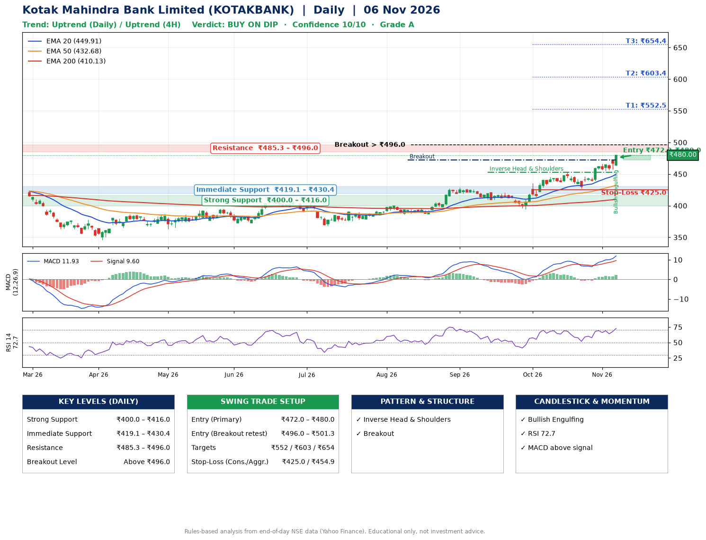

📌 **Kotak Mahindra Bank Limited (KOTAKBANK) – Multi-Timeframe Technical Analysis (Daily + 4H Combined)**
_Data up to 06 Nov 2026 · Close ₹480.00_

**📍 Daily Timeframe Trend**
- Trend: **Uptrend** (higher highs and higher lows)
- Recent swing highs: ₹429.1, ₹420.6, ₹453.1 · swing lows: ₹409.2, ₹394.7, ₹427.7
- EMAs: EMA20 ₹449.9, EMA50 ₹432.7, EMA200 ₹410.1; bullish stack (EMA20 > EMA50 > EMA200); price above EMA20, EMA50, EMA200
- MACD 11.93 above signal 9.60 (above zero); histogram rising
- RSI(14) 72.7; no divergence on the last two swings

**📍 4-Hour Timeframe Trend**
- Structure: **Uptrend** (higher highs and higher lows)
- Pullback/support area: recent 4H swing lows ₹438.4, ₹455.6; EMA20 ₹458.9
- EMA20/50: bullish stack (EMA20 > EMA50); price above EMA20, EMA50
- MACD 8.86 above signal 7.20 (above zero); histogram rising
- RSI(14) 75.5; no divergence

**📍 Pattern Detection (Both Timeframes)**
- Daily: **Inverse Head & Shoulders** – head ₹394.7, neckline ₹453.1
- Daily: **Breakout** – closed above the 60-session high ₹472.5 (volume not confirming yet)

**📍 Candlestick Patterns (last 3 daily candles)**
- **Bullish Engulfing** – 06 Nov: buyers fully reversed the prior red candle

**📍 Price Action Key Levels (Daily Structure)**

| Zone | Price Level (₹) | Context |
|------|-----------------|---------|
| Strong Support | ₹400.0 – ₹416.0 | Cluster of earlier swing lows (demand) |
| Immediate Support | ₹419.1 – ₹430.4 | Nearest swing-low / wick area |
| Resistance | ₹485.3 – ₹496.0 | Nearest swing-high supply |
| Breakout Level | Above ₹496.0 | Swing continuation trigger (52-week high ₹480.0) |

**📍 Swing Trade Setup**

🟢 **Entry Zone**
- Primary: ₹472.0 – ₹480.0 (daily support / EMA20 area; enter on a bullish 4H candle)
- Alternate: ₹496.0 – ₹501.3 (breakout retest)

🎯 **Profit Targets**
- T1: ₹552.5
- T2: ₹603.4
- T3: ₹654.4

🛑 **Stop-Loss**
- Conservative: below daily swing low (₹425.0)
- Aggressive: below 4H structure (₹454.9)
- Risk per share ≈ ₹51.0; reward:risk to T1 ≈ 1.5

**📌 Strategy Notes**
- Higher timeframe: daily trend is uptrend; only take longs while price holds above ₹400.0.
- Entry timing: wait for a bullish 4H candle (engulfing/hammer) inside ₹472.0 – ₹480.0 rather than buying mid-range.
- EMA stacking: bullish stack (EMA20 > EMA50 > EMA200); price above EMA20, EMA50, EMA200.
- Breakout rule: a daily close above ₹496.0 with volume above its 20-day average (≈23,268,584) opens T2/T3.
- Momentum: RSI 73 – elevated, prefer dips; no divergence on the last two swings.
- Exit discipline: move the stop to entry once T1 is hit; book partial profits at each target.

**STEP 2 — Marked Up Chart**

**✅ Trade Validation Checklist**
- Trend + momentum aligned: Yes · Price at entry zone: Yes
- Stop defined (₹425.0) · Reward:risk ≥ 1.5 to T1: Yes

## 📌 Final Verdict

Recommendation: **🟡 BUY ON DIP**

Confidence: **10/10**

Trade Quality: **A**

Reason:
• Daily uptrend (higher highs and higher lows)
• EMAs stacked bullishly

Next Action:
• Wait for a pullback to ₹472.0–₹480.0, or a breakout above ₹496.0

_Rules-based analysis from end-of-day data. Educational only, not investment advice. Never place orders without your own confirmation._