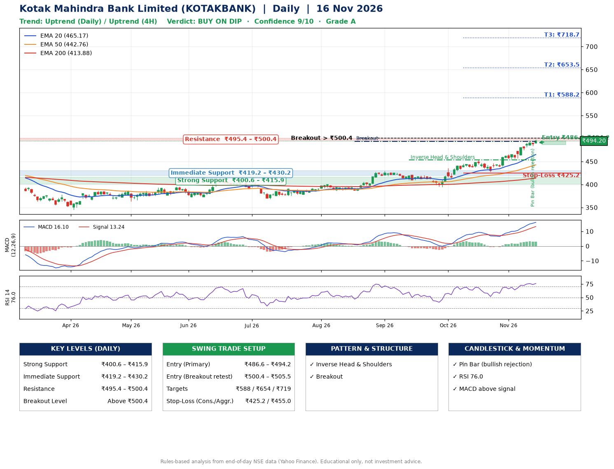

📌 **Kotak Mahindra Bank Limited (KOTAKBANK) – Multi-Timeframe Technical Analysis (Daily + 4H Combined)**
_Data up to 16 Nov 2026 · Close ₹494.20_

**📍 Daily Timeframe Trend**
- Trend: **Uptrend** (higher highs and higher lows)
- Recent swing highs: ₹429.1, ₹420.6, ₹453.1 · swing lows: ₹409.2, ₹394.7, ₹427.7
- EMAs: EMA20 ₹465.2, EMA50 ₹442.8, EMA200 ₹413.9; bullish stack (EMA20 > EMA50 > EMA200); price above EMA20, EMA50, EMA200
- MACD 16.10 above signal 13.24 (above zero); histogram falling
- RSI(14) 76.0; no divergence on the last two swings

**📍 4-Hour Timeframe Trend**
- Structure: **Uptrend** (higher highs and higher lows)
- Pullback/support area: recent 4H swing lows ₹438.4, ₹455.6; EMA20 ₹481.1
- EMA20/50: bullish stack (EMA20 > EMA50); price above EMA20, EMA50
- MACD 11.67 above signal 11.02 (above zero); histogram falling
- RSI(14) 75.8; no divergence

**📍 Pattern Detection (Both Timeframes)**
- Daily: **Inverse Head & Shoulders** – head ₹394.7, neckline ₹453.1
- Daily: **Breakout** – closed above the 60-session high ₹494.0 (volume not confirming yet)

**📍 Candlestick Patterns (last 3 daily candles)**
- **Pin Bar (bullish rejection)** – 13 Nov: long lower wick shows dip-buying near ₹484.0

**📍 Price Action Key Levels (Daily Structure)**

| Zone | Price Level (₹) | Context |
|------|-----------------|---------|
| Strong Support | ₹400.6 – ₹415.9 | Cluster of earlier swing lows (demand) |
| Immediate Support | ₹419.2 – ₹430.2 | Nearest swing-low / wick area |
| Resistance | ₹495.4 – ₹500.4 | Nearest swing-high supply |
| Breakout Level | Above ₹500.4 | Swing continuation trigger (52-week high ₹497.9) |

**📍 Swing Trade Setup**

🟢 **Entry Zone**
- Primary: ₹486.6 – ₹494.2 (daily support / EMA20 area; enter on a bullish 4H candle)
- Alternate: ₹500.4 – ₹505.5 (breakout retest)

🎯 **Profit Targets**
- T1: ₹588.2
- T2: ₹653.5
- T3: ₹718.7

🛑 **Stop-Loss**
- Conservative: below daily swing low (₹425.2)
- Aggressive: below 4H structure (₹455.0)
- Risk per share ≈ ₹65.2; reward:risk to T1 ≈ 1.5
- Time to T1: about 53 trading days (it rose this much within 60 trading days 9% of the time in the last 2 years)
- Time to T2: it never rose this much within 60 trading days in the price history

**📌 Strategy Notes**
- Higher timeframe: daily trend is uptrend; only take longs while price holds above ₹400.6.
- Entry timing: wait for a bullish 4H candle (engulfing/hammer) inside ₹486.6 – ₹494.2 rather than buying mid-range.
- EMA stacking: bullish stack (EMA20 > EMA50 > EMA200); price above EMA20, EMA50, EMA200.
- Breakout rule: a daily close above ₹500.4 with volume above its 20-day average (≈21,609,828) opens T2/T3.
- Momentum: RSI 76 – elevated, prefer dips; no divergence on the last two swings.
- Exit discipline: move the stop to entry once T1 is hit; book partial profits at each target.

**STEP 2 — Marked Up Chart**

**✅ Trade Validation Checklist**
- Trend + momentum aligned: Yes · Price at entry zone: Yes
- Stop defined (₹425.2) · Reward:risk ≥ 1.5 to T1: No

## 📌 Final Verdict

Recommendation: **🟡 BUY ON DIP**

Confidence: **9/10**

Trade Quality: **A**

Reason:
• Daily uptrend (higher highs and higher lows)
• EMAs stacked bullishly

Next Action:
• Wait for a pullback to ₹486.6–₹494.2, or a breakout above ₹500.4

_Rules-based analysis from end-of-day data. Educational only, not investment advice. Never place orders without your own confirmation._