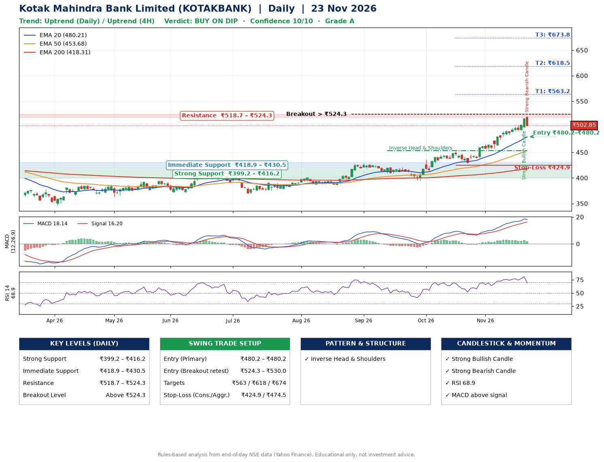

📌 **Kotak Mahindra Bank Limited (KOTAKBANK) – Multi-Timeframe Technical Analysis (Daily + 4H Combined)**
_Data up to 23 Nov 2026 · Close ₹502.85_

**📍 Daily Timeframe Trend**
- Trend: **Uptrend** (higher highs and higher lows)
- Recent swing highs: ₹429.1, ₹420.6, ₹453.1 · swing lows: ₹409.2, ₹394.7, ₹427.7
- EMAs: EMA20 ₹480.2, EMA50 ₹453.7, EMA200 ₹418.3; bullish stack (EMA20 > EMA50 > EMA200); price above EMA20, EMA50, EMA200
- MACD 18.14 above signal 16.20 (above zero); histogram falling
- RSI(14) 68.9; no divergence on the last two swings

**📍 4-Hour Timeframe Trend**
- Structure: **Uptrend** (higher highs and higher lows)
- Pullback/support area: recent 4H swing lows ₹455.6, ₹492.0; EMA20 ₹494.3
- EMA20/50: bullish stack (EMA20 > EMA50); price above EMA20, EMA50
- MACD 11.34 below signal 11.60 (above zero), fresh bullish crossover; histogram falling
- RSI(14) 63.2; no divergence

**📍 Pattern Detection (Both Timeframes)**
- Daily: **Inverse Head & Shoulders** – head ₹394.7, neckline ₹453.1

**📍 Candlestick Patterns (last 3 daily candles)**
- **Strong Bullish Candle** – 20 Nov: wide-range green candle, buyers in control
- **Strong Bearish Candle** – 23 Nov: wide-range red candle, sellers in control

**📍 Price Action Key Levels (Daily Structure)**

| Zone | Price Level (₹) | Context |
|------|-----------------|---------|
| Strong Support | ₹399.2 – ₹416.2 | Cluster of earlier swing lows (demand) |
| Immediate Support | ₹418.9 – ₹430.5 | Nearest swing-low / wick area |
| Resistance | ₹518.7 – ₹524.3 | Nearest swing-high supply |
| Breakout Level | Above ₹524.3 | Swing continuation trigger (52-week high ₹521.5) |

**📍 Swing Trade Setup**

🟢 **Entry Zone**
- Primary: ₹480.2 – ₹480.2 (daily support / EMA20 area; enter on a bullish 4H candle)
- Alternate: ₹524.3 – ₹530.0 (breakout retest)

🎯 **Profit Targets**
- T1: ₹563.2
- T2: ₹618.5
- T3: ₹673.8

🛑 **Stop-Loss**
- Conservative: below daily swing low (₹424.9)
- Aggressive: below 4H structure (₹474.5)
- Risk per share ≈ ₹55.3; reward:risk to T1 ≈ 1.5
- Time to T1: about 51 trading days (it rose this much within 60 trading days 16% of the time in the last 2 years)
- Time to T2: about 60 trading days (it rose this much within 60 trading days 0% of the time in the last 2 years)

**📌 Strategy Notes**
- Higher timeframe: daily trend is uptrend; only take longs while price holds above ₹399.2.
- Entry timing: wait for a bullish 4H candle (engulfing/hammer) inside ₹480.2 – ₹480.2 rather than buying mid-range.
- EMA stacking: bullish stack (EMA20 > EMA50 > EMA200); price above EMA20, EMA50, EMA200.
- Breakout rule: a daily close above ₹524.3 with volume above its 20-day average (≈22,156,921) opens T2/T3.
- Momentum: RSI 69 – elevated, prefer dips; no divergence on the last two swings.
- Exit discipline: move the stop to entry once T1 is hit; book partial profits at each target.

**STEP 2 — Marked Up Chart**

**✅ Trade Validation Checklist**
- Trend + momentum aligned: Yes · Price at entry zone: No
- Stop defined (₹424.9) · Reward:risk ≥ 1.5 to T1: Yes

## 📌 Final Verdict

Recommendation: **🟡 BUY ON DIP**

Confidence: **10/10**

Trade Quality: **A**

Reason:
• Daily uptrend (higher highs and higher lows)
• EMAs stacked bullishly

Next Action:
• Wait for a pullback to ₹480.2–₹480.2

_Rules-based analysis from end-of-day data. Educational only, not investment advice. Never place orders without your own confirmation._