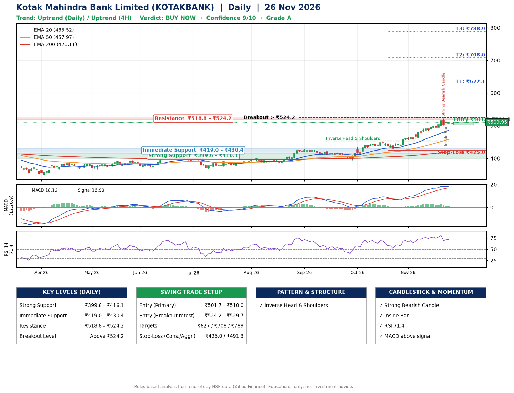

📌 **Kotak Mahindra Bank Limited (KOTAKBANK) – Multi-Timeframe Technical Analysis (Daily + 4H Combined)**
_Data up to 26 Nov 2026 · Close ₹509.95_

**📍 Daily Timeframe Trend**
- Trend: **Uptrend** (higher highs and higher lows)
- Recent swing highs: ₹429.1, ₹420.6, ₹453.1 · swing lows: ₹409.2, ₹394.7, ₹427.7
- EMAs: EMA20 ₹485.5, EMA50 ₹458.0, EMA200 ₹420.1; bullish stack (EMA20 > EMA50 > EMA200); price above EMA20, EMA50, EMA200
- MACD 18.12 above signal 16.90 (above zero); histogram falling
- RSI(14) 71.4; no divergence on the last two swings

**📍 4-Hour Timeframe Trend**
- Structure: **Uptrend** (higher highs and higher lows)
- Pullback/support area: recent 4H swing lows ₹455.6, ₹492.0; EMA20 ₹498.9
- EMA20/50: bullish stack (EMA20 > EMA50); price above EMA20, EMA50
- MACD 10.06 below signal 10.89 (above zero), fresh bearish crossover; histogram falling
- RSI(14) 67.2; Regular bearish divergence

**📍 Pattern Detection (Both Timeframes)**
- Daily: **Inverse Head & Shoulders** – head ₹394.7, neckline ₹453.1

**📍 Candlestick Patterns (last 3 daily candles)**
- **Strong Bearish Candle** – 23 Nov: wide-range red candle, sellers in control
- **Inside Bar** – 25 Nov: compression inside the prior range ₹501.1–₹521.5

**📍 Price Action Key Levels (Daily Structure)**

| Zone | Price Level (₹) | Context |
|------|-----------------|---------|
| Strong Support | ₹399.6 – ₹416.1 | Cluster of earlier swing lows (demand) |
| Immediate Support | ₹419.0 – ₹430.4 | Nearest swing-low / wick area |
| Resistance | ₹518.8 – ₹524.2 | Nearest swing-high supply |
| Breakout Level | Above ₹524.2 | Swing continuation trigger (52-week high ₹521.5) |

**📍 Swing Trade Setup**

🟢 **Entry Zone**
- Primary: ₹501.7 – ₹510.0 (daily support / EMA20 area; enter on a bullish 4H candle)
- Alternate: ₹524.2 – ₹529.7 (breakout retest)

🎯 **Profit Targets**
- T1: ₹627.1
- T2: ₹708.0
- T3: ₹788.9

🛑 **Stop-Loss**
- Conservative: below daily swing low (₹425.0)
- Aggressive: below 4H structure (₹491.3)
- Risk per share ≈ ₹80.9; reward:risk to T1 ≈ 1.5
- Time to T1: about 56 trading days (it rose this much within 60 trading days 4% of the time in the last 2 years)
- Time to T2: it never rose this much within 60 trading days in the price history

**📌 Strategy Notes**
- Higher timeframe: daily trend is uptrend; only take longs while price holds above ₹399.6.
- Entry timing: wait for a bullish 4H candle (engulfing/hammer) inside ₹501.7 – ₹510.0 rather than buying mid-range.
- EMA stacking: bullish stack (EMA20 > EMA50 > EMA200); price above EMA20, EMA50, EMA200.
- Breakout rule: a daily close above ₹524.2 with volume above its 20-day average (≈20,553,018) opens T2/T3.
- Momentum: RSI 71 – elevated, prefer dips; no divergence on the last two swings.
- Exit discipline: move the stop to entry once T1 is hit; book partial profits at each target.

**STEP 2 — Marked Up Chart**

**✅ Trade Validation Checklist**
- Trend + momentum aligned: Yes · Price at entry zone: Yes
- Stop defined (₹425.0) · Reward:risk ≥ 1.5 to T1: No

## 📌 Final Verdict

Recommendation: **🟢 BUY NOW**

Confidence: **9/10**

Trade Quality: **A**

Reason:
• Daily uptrend (higher highs and higher lows)
• EMAs stacked bullishly

Next Action:
• Buy now within the entry zone, with the stop-loss in place

_Rules-based analysis from end-of-day data. Educational only, not investment advice. Never place orders without your own confirmation._