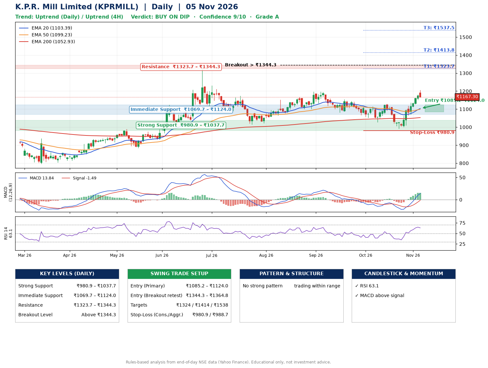

📌 **K.P.R. Mill Limited (KPRMILL) – Multi-Timeframe Technical Analysis (Daily + 4H Combined)**
_Data up to 05 Nov 2026 · Close ₹1167.30_

**📍 Daily Timeframe Trend**
- Trend: **Uptrend** (price above rising EMAs)
- Recent swing highs: ₹1197.9, ₹1154.4, ₹1129.8 · swing lows: ₹1080.0, ₹1027.4, ₹991.2
- EMAs: EMA20 ₹1103.4, EMA50 ₹1099.2, EMA200 ₹1052.9; bullish stack (EMA20 > EMA50 > EMA200); price above EMA20, EMA50, EMA200
- MACD 13.84 above signal -1.49 (above zero); histogram rising
- RSI(14) 63.1; no divergence on the last two swings

**📍 4-Hour Timeframe Trend**
- Structure: **Uptrend** (price above rising EMAs)
- Pullback/support area: recent 4H swing lows ₹1029.0, ₹991.5; EMA20 ₹1119.7
- EMA20/50: bullish stack (EMA20 > EMA50); price above EMA20, EMA50
- MACD 30.16 above signal 19.12 (above zero); histogram falling
- RSI(14) 65.7; no divergence

**📍 Pattern Detection (Both Timeframes)**
- No strong pattern detected. Trading within range.

**📍 Candlestick Patterns (last 3 daily candles)**
- No notable candlestick signal in the last 3 sessions.

**📍 Price Action Key Levels (Daily Structure)**

| Zone | Price Level (₹) | Context |
|------|-----------------|---------|
| Strong Support | ₹980.9 – ₹1037.7 | Cluster of earlier swing lows (demand) |
| Immediate Support | ₹1069.7 – ₹1124.0 | Nearest swing-low / wick area |
| Resistance | ₹1323.7 – ₹1344.3 | Nearest swing-high supply |
| Breakout Level | Above ₹1344.3 | Swing continuation trigger (52-week high ₹1334.0) |

**📍 Swing Trade Setup**

🟢 **Entry Zone**
- Primary: ₹1085.2 – ₹1124.0 (daily support / EMA20 area; enter on a bullish 4H candle)
- Alternate: ₹1344.3 – ₹1364.8 (breakout retest)

🎯 **Profit Targets**
- T1: ₹1323.7
- T2: ₹1413.8
- T3: ₹1537.5

🛑 **Stop-Loss**
- Conservative: below daily swing low (₹980.9)
- Aggressive: below 4H structure (₹988.7)
- Risk per share ≈ ₹123.7; reward:risk to T1 ≈ 1.8

**📌 Strategy Notes**
- Higher timeframe: daily trend is uptrend; only take longs while price holds above ₹980.9.
- Entry timing: wait for a bullish 4H candle (engulfing/hammer) inside ₹1085.2 – ₹1124.0 rather than buying mid-range.
- EMA stacking: bullish stack (EMA20 > EMA50 > EMA200); price above EMA20, EMA50, EMA200.
- Breakout rule: a daily close above ₹1344.3 with volume above its 20-day average (≈298,504) opens T2/T3.
- Momentum: RSI 63 – room to run; no divergence on the last two swings.
- Exit discipline: move the stop to entry once T1 is hit; book partial profits at each target.

**STEP 2 — Marked Up Chart**

**✅ Trade Validation Checklist**
- Trend + momentum aligned: Yes · Price at entry zone: No
- Stop defined (₹980.9) · Reward:risk ≥ 1.5 to T1: Yes

## 📌 Final Verdict

Recommendation: **🟡 BUY ON DIP**

Confidence: **9/10**

Trade Quality: **A**

Reason:
• Daily uptrend (price above rising EMAs)
• EMAs stacked bullishly

Next Action:
• Wait for a pullback to ₹1085.2–₹1124.0

_Rules-based analysis from end-of-day data. Educational only, not investment advice. Never place orders without your own confirmation._