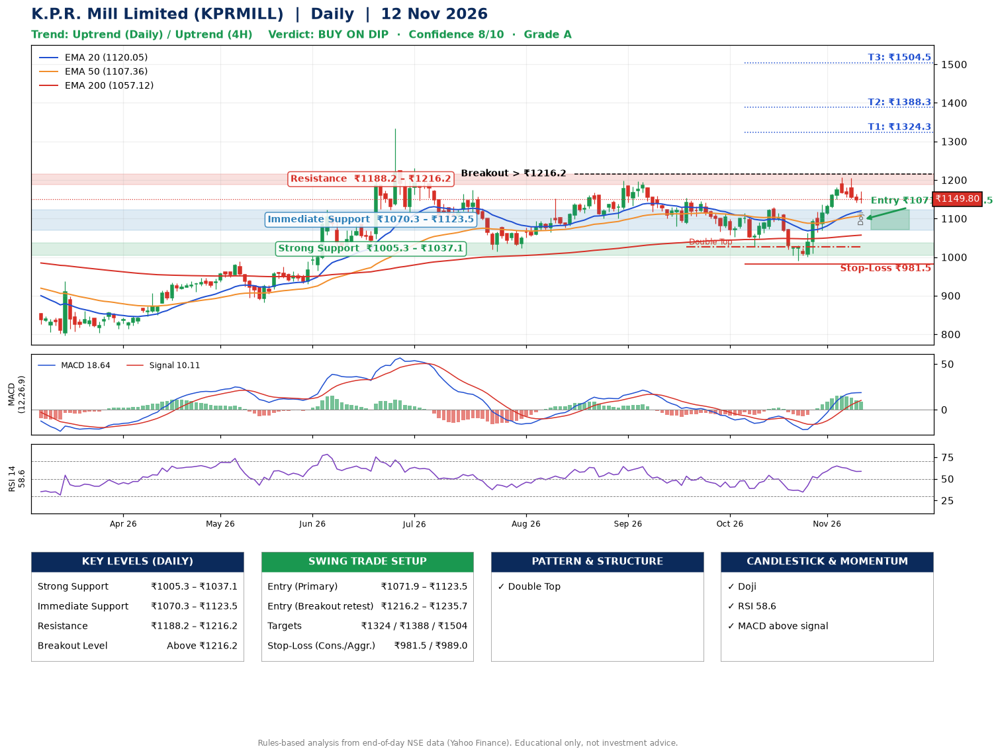

📌 **K.P.R. Mill Limited (KPRMILL) – Multi-Timeframe Technical Analysis (Daily + 4H Combined)**
_Data up to 12 Nov 2026 · Close ₹1149.80_

**📍 Daily Timeframe Trend**
- Trend: **Uptrend** (price above rising EMAs)
- Recent swing highs: ₹1197.9, ₹1154.4, ₹1129.8 · swing lows: ₹1080.0, ₹1027.4, ₹991.2
- EMAs: EMA20 ₹1120.1, EMA50 ₹1107.4, EMA200 ₹1057.1; bullish stack (EMA20 > EMA50 > EMA200); price above EMA20, EMA50, EMA200
- MACD 18.64 above signal 10.11 (above zero); histogram falling
- RSI(14) 58.6; no divergence on the last two swings

**📍 4-Hour Timeframe Trend**
- Structure: **Uptrend** (price above rising EMAs)
- Pullback/support area: recent 4H swing lows ₹1029.0, ₹991.5; EMA20 ₹1139.3
- EMA20/50: bullish stack (EMA20 > EMA50); price above EMA20, EMA50
- MACD 19.20 below signal 22.92 (above zero), fresh bearish crossover; histogram falling
- RSI(14) 54.0; no divergence

**📍 Pattern Detection (Both Timeframes)**
- Daily: **Double Top** – tops near ₹1154.4/₹1129.8, neckline ₹1027.4, forming
- 4H: **Bull Flag** – 15% pole then a tight 6% flag; trigger above ₹1205.8

**📍 Candlestick Patterns (last 3 daily candles)**
- **Doji** – 12 Nov: indecision; wait for the next candle to confirm direction

**📍 Price Action Key Levels (Daily Structure)**

| Zone | Price Level (₹) | Context |
|------|-----------------|---------|
| Strong Support | ₹1005.3 – ₹1037.1 | Cluster of earlier swing lows (demand) |
| Immediate Support | ₹1070.3 – ₹1123.5 | Nearest swing-low / wick area |
| Resistance | ₹1188.2 – ₹1216.2 | Nearest swing-high supply |
| Breakout Level | Above ₹1216.2 | Swing continuation trigger (52-week high ₹1334.0) |

**📍 Swing Trade Setup**

🟢 **Entry Zone**
- Primary: ₹1071.9 – ₹1123.5 (daily support / EMA20 area; enter on a bullish 4H candle)
- Alternate: ₹1216.2 – ₹1235.7 (breakout retest)

🎯 **Profit Targets**
- T1: ₹1324.3
- T2: ₹1388.3
- T3: ₹1504.5

🛑 **Stop-Loss**
- Conservative: below daily swing low (₹981.5)
- Aggressive: below 4H structure (₹989.0)
- Risk per share ≈ ₹116.2; reward:risk to T1 ≈ 1.9
- Time to T1: about 22 trading days (it rose this much within 60 trading days 36% of the time in the last 2 years)
- Time to T2: about 29 trading days (it rose this much within 60 trading days 31% of the time in the last 2 years)

**📌 Strategy Notes**
- Higher timeframe: daily trend is uptrend; only take longs while price holds above ₹1005.3.
- Entry timing: wait for a bullish 4H candle (engulfing/hammer) inside ₹1071.9 – ₹1123.5 rather than buying mid-range.
- EMA stacking: bullish stack (EMA20 > EMA50 > EMA200); price above EMA20, EMA50, EMA200.
- Breakout rule: a daily close above ₹1216.2 with volume above its 20-day average (≈310,434) opens T2/T3.
- Momentum: RSI 59 – room to run; no divergence on the last two swings.
- Exit discipline: move the stop to entry once T1 is hit; book partial profits at each target.

**STEP 2 — Marked Up Chart**

**✅ Trade Validation Checklist**
- Trend + momentum aligned: Yes · Price at entry zone: No
- Stop defined (₹981.5) · Reward:risk ≥ 1.5 to T1: Yes

## 📌 Final Verdict

Recommendation: **🟡 BUY ON DIP**

Confidence: **8/10**

Trade Quality: **A**

Reason:
• Daily uptrend (price above rising EMAs)
• EMAs stacked bullishly

Next Action:
• Wait for a pullback to ₹1071.9–₹1123.5, or a breakout above ₹1216.2

_Rules-based analysis from end-of-day data. Educational only, not investment advice. Never place orders without your own confirmation._