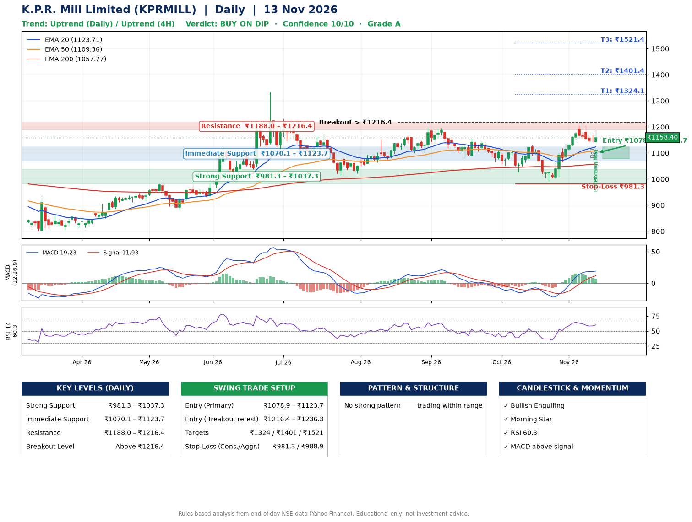

📌 **K.P.R. Mill Limited (KPRMILL) – Multi-Timeframe Technical Analysis (Daily + 4H Combined)**
_Data up to 13 Nov 2026 · Close ₹1158.40_

**📍 Daily Timeframe Trend**
- Trend: **Uptrend** (price above rising EMAs)
- Recent swing highs: ₹1154.4, ₹1129.8, ₹1206.5 · swing lows: ₹1080.0, ₹1027.4, ₹991.2
- EMAs: EMA20 ₹1123.7, EMA50 ₹1109.4, EMA200 ₹1057.8; bullish stack (EMA20 > EMA50 > EMA200); price above EMA20, EMA50, EMA200
- MACD 19.23 above signal 11.93 (above zero); histogram falling
- RSI(14) 60.3; no divergence on the last two swings

**📍 4-Hour Timeframe Trend**
- Structure: **Uptrend** (price above rising EMAs)
- Pullback/support area: recent 4H swing lows ₹1029.0, ₹991.5; EMA20 ₹1142.7
- EMA20/50: bullish stack (EMA20 > EMA50); price above EMA20, EMA50
- MACD 17.57 below signal 21.12 (above zero), fresh bearish crossover; histogram rising
- RSI(14) 58.5; no divergence

**📍 Pattern Detection (Both Timeframes)**
- 4H: **Bull Flag** – 15% pole then a tight 6% flag; trigger above ₹1205.8

**📍 Candlestick Patterns (last 3 daily candles)**
- **Doji** – 12 Nov: indecision; wait for the next candle to confirm direction
- **Bullish Engulfing** – 13 Nov: buyers fully reversed the prior red candle
- **Morning Star** – 13 Nov: three-candle bullish reversal

**📍 Price Action Key Levels (Daily Structure)**

| Zone | Price Level (₹) | Context |
|------|-----------------|---------|
| Strong Support | ₹981.3 – ₹1037.3 | Cluster of earlier swing lows (demand) |
| Immediate Support | ₹1070.1 – ₹1123.7 | Nearest swing-low / wick area |
| Resistance | ₹1188.0 – ₹1216.4 | Nearest swing-high supply |
| Breakout Level | Above ₹1216.4 | Swing continuation trigger (52-week high ₹1334.0) |

**📍 Swing Trade Setup**

🟢 **Entry Zone**
- Primary: ₹1078.9 – ₹1123.7 (daily support / EMA20 area; enter on a bullish 4H candle)
- Alternate: ₹1216.4 – ₹1236.3 (breakout retest)

🎯 **Profit Targets**
- T1: ₹1324.1
- T2: ₹1401.4
- T3: ₹1521.4

🛑 **Stop-Loss**
- Conservative: below daily swing low (₹981.3)
- Aggressive: below 4H structure (₹988.9)
- Risk per share ≈ ₹120.0; reward:risk to T1 ≈ 1.9
- Time to T1: about 22 trading days (it rose this much within 60 trading days 36% of the time in the last 2 years)
- Time to T2: about 31 trading days (it rose this much within 60 trading days 29% of the time in the last 2 years)

**📌 Strategy Notes**
- Higher timeframe: daily trend is uptrend; only take longs while price holds above ₹981.3.
- Entry timing: wait for a bullish 4H candle (engulfing/hammer) inside ₹1078.9 – ₹1123.7 rather than buying mid-range.
- EMA stacking: bullish stack (EMA20 > EMA50 > EMA200); price above EMA20, EMA50, EMA200.
- Breakout rule: a daily close above ₹1216.4 with volume above its 20-day average (≈318,483) opens T2/T3.
- Momentum: RSI 60 – room to run; no divergence on the last two swings.
- Exit discipline: move the stop to entry once T1 is hit; book partial profits at each target.

**STEP 2 — Marked Up Chart**

**✅ Trade Validation Checklist**
- Trend + momentum aligned: Yes · Price at entry zone: No
- Stop defined (₹981.3) · Reward:risk ≥ 1.5 to T1: Yes

## 📌 Final Verdict

Recommendation: **🟡 BUY ON DIP**

Confidence: **10/10**

Trade Quality: **A**

Reason:
• Daily uptrend (price above rising EMAs)
• EMAs stacked bullishly

Next Action:
• Wait for a pullback to ₹1078.9–₹1123.7

_Rules-based analysis from end-of-day data. Educational only, not investment advice. Never place orders without your own confirmation._