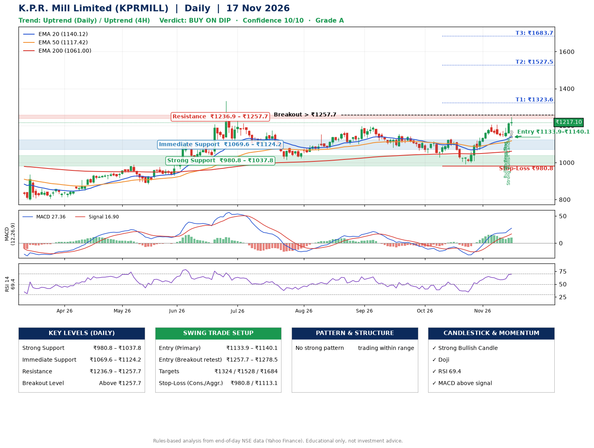

📌 **K.P.R. Mill Limited (KPRMILL) – Multi-Timeframe Technical Analysis (Daily + 4H Combined)**
_Data up to 17 Nov 2026 · Close ₹1217.10_

**📍 Daily Timeframe Trend**
- Trend: **Uptrend** (price above rising EMAs)
- Recent swing highs: ₹1154.4, ₹1129.8, ₹1206.5 · swing lows: ₹1080.0, ₹1027.4, ₹991.2
- EMAs: EMA20 ₹1140.1, EMA50 ₹1117.4, EMA200 ₹1061.0; bullish stack (EMA20 > EMA50 > EMA200); price above EMA20, EMA50, EMA200
- MACD 27.36 above signal 16.90 (above zero); histogram rising
- RSI(14) 69.4; no divergence on the last two swings

**📍 4-Hour Timeframe Trend**
- Structure: **Uptrend** (price above rising EMAs)
- Pullback/support area: recent 4H swing lows ₹991.5, ₹1140.0; EMA20 ₹1166.3
- EMA20/50: bullish stack (EMA20 > EMA50); price above EMA20, EMA50
- MACD 26.81 above signal 23.04 (above zero), fresh bullish crossover; histogram rising
- RSI(14) 71.3; no divergence

**📍 Pattern Detection (Both Timeframes)**
- No strong pattern detected. Trading within range.

**📍 Candlestick Patterns (last 3 daily candles)**
- **Bullish Engulfing** – 13 Nov: buyers fully reversed the prior red candle
- **Morning Star** – 13 Nov: three-candle bullish reversal
- **Strong Bullish Candle** – 16 Nov: wide-range green candle, buyers in control
- **Doji** – 17 Nov: indecision; wait for the next candle to confirm direction

**📍 Price Action Key Levels (Daily Structure)**

| Zone | Price Level (₹) | Context |
|------|-----------------|---------|
| Strong Support | ₹980.8 – ₹1037.8 | Cluster of earlier swing lows (demand) |
| Immediate Support | ₹1069.6 – ₹1124.2 | Nearest swing-low / wick area |
| Resistance | ₹1236.9 – ₹1257.7 | Nearest swing-high supply |
| Breakout Level | Above ₹1257.7 | Swing continuation trigger (52-week high ₹1334.0) |

**📍 Swing Trade Setup**

🟢 **Entry Zone**
- Primary: ₹1133.9 – ₹1140.1 (daily support / EMA20 area; enter on a bullish 4H candle)
- Alternate: ₹1257.7 – ₹1278.5 (breakout retest)

🎯 **Profit Targets**
- T1: ₹1323.6
- T2: ₹1527.5
- T3: ₹1683.7

🛑 **Stop-Loss**
- Conservative: below daily swing low (₹980.8)
- Aggressive: below 4H structure (₹1113.1)
- Risk per share ≈ ₹156.2; reward:risk to T1 ≈ 1.2
- Time to T1: about 16 trading days (it rose this much within 60 trading days 41% of the time in the last 2 years)
- Time to T2: about 37 trading days (it rose this much within 60 trading days 24% of the time in the last 2 years)

**📌 Strategy Notes**
- Higher timeframe: daily trend is uptrend; only take longs while price holds above ₹980.8.
- Entry timing: wait for a bullish 4H candle (engulfing/hammer) inside ₹1133.9 – ₹1140.1 rather than buying mid-range.
- EMA stacking: bullish stack (EMA20 > EMA50 > EMA200); price above EMA20, EMA50, EMA200.
- Breakout rule: a daily close above ₹1257.7 with volume above its 20-day average (≈366,007) opens T2/T3.
- Momentum: RSI 69 – elevated, prefer dips; no divergence on the last two swings.
- Exit discipline: move the stop to entry once T1 is hit; book partial profits at each target.

**STEP 2 — Marked Up Chart**

**✅ Trade Validation Checklist**
- Trend + momentum aligned: Yes · Price at entry zone: No
- Stop defined (₹980.8) · Reward:risk ≥ 1.5 to T1: No

## 📌 Final Verdict

Recommendation: **🟡 BUY ON DIP**

Confidence: **10/10**

Trade Quality: **A**

Reason:
• Daily uptrend (price above rising EMAs)
• EMAs stacked bullishly

Next Action:
• Wait for a pullback to ₹1133.9–₹1140.1

_Rules-based analysis from end-of-day data. Educational only, not investment advice. Never place orders without your own confirmation._