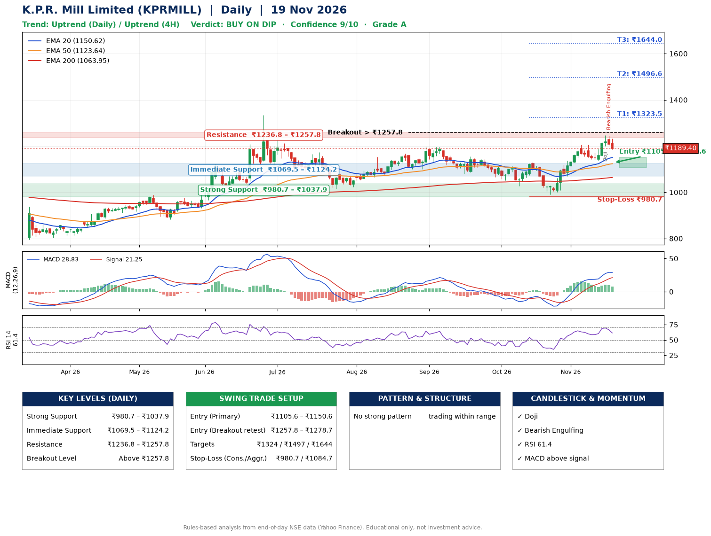

📌 **K.P.R. Mill Limited (KPRMILL) – Multi-Timeframe Technical Analysis (Daily + 4H Combined)**
_Data up to 19 Nov 2026 · Close ₹1189.40_

**📍 Daily Timeframe Trend**
- Trend: **Uptrend** (price above rising EMAs)
- Recent swing highs: ₹1154.4, ₹1129.8, ₹1206.5 · swing lows: ₹1080.0, ₹1027.4, ₹991.2
- EMAs: EMA20 ₹1150.6, EMA50 ₹1123.6, EMA200 ₹1064.0; bullish stack (EMA20 > EMA50 > EMA200); price above EMA20, EMA50, EMA200
- MACD 28.83 above signal 21.25 (above zero); histogram falling
- RSI(14) 61.4; no divergence on the last two swings

**📍 4-Hour Timeframe Trend**
- Structure: **Uptrend** (higher highs and higher lows)
- Pullback/support area: recent 4H swing lows ₹991.5, ₹1140.0; EMA20 ₹1179.5
- EMA20/50: bullish stack (EMA20 > EMA50); price above EMA20, EMA50
- MACD 24.63 below signal 24.90 (above zero), fresh bearish crossover; histogram falling
- RSI(14) 57.1; no divergence

**📍 Pattern Detection (Both Timeframes)**
- No strong pattern detected. Trading within range.

**📍 Candlestick Patterns (last 3 daily candles)**
- **Doji** – 17 Nov: indecision; wait for the next candle to confirm direction
- **Bearish Engulfing** – 18 Nov: sellers fully reversed the prior green candle

**📍 Price Action Key Levels (Daily Structure)**

| Zone | Price Level (₹) | Context |
|------|-----------------|---------|
| Strong Support | ₹980.7 – ₹1037.9 | Cluster of earlier swing lows (demand) |
| Immediate Support | ₹1069.5 – ₹1124.2 | Nearest swing-low / wick area |
| Resistance | ₹1236.8 – ₹1257.8 | Nearest swing-high supply |
| Breakout Level | Above ₹1257.8 | Swing continuation trigger (52-week high ₹1334.0) |

**📍 Swing Trade Setup**

🟢 **Entry Zone**
- Primary: ₹1105.6 – ₹1150.6 (daily support / EMA20 area; enter on a bullish 4H candle)
- Alternate: ₹1257.8 – ₹1278.7 (breakout retest)

🎯 **Profit Targets**
- T1: ₹1323.5
- T2: ₹1496.6
- T3: ₹1644.0

🛑 **Stop-Loss**
- Conservative: below daily swing low (₹980.7)
- Aggressive: below 4H structure (₹1084.7)
- Risk per share ≈ ₹147.4; reward:risk to T1 ≈ 1.3
- Time to T1: about 17 trading days (it rose this much within 60 trading days 39% of the time in the last 2 years)
- Time to T2: about 35 trading days (it rose this much within 60 trading days 25% of the time in the last 2 years)

**📌 Strategy Notes**
- Higher timeframe: daily trend is uptrend; only take longs while price holds above ₹980.7.
- Entry timing: wait for a bullish 4H candle (engulfing/hammer) inside ₹1105.6 – ₹1150.6 rather than buying mid-range.
- EMA stacking: bullish stack (EMA20 > EMA50 > EMA200); price above EMA20, EMA50, EMA200.
- Breakout rule: a daily close above ₹1257.8 with volume above its 20-day average (≈391,670) opens T2/T3.
- Momentum: RSI 61 – room to run; no divergence on the last two swings.
- Exit discipline: move the stop to entry once T1 is hit; book partial profits at each target.

**STEP 2 — Marked Up Chart**

**✅ Trade Validation Checklist**
- Trend + momentum aligned: Yes · Price at entry zone: No
- Stop defined (₹980.7) · Reward:risk ≥ 1.5 to T1: No

## 📌 Final Verdict

Recommendation: **🟡 BUY ON DIP**

Confidence: **9/10**

Trade Quality: **A**

Reason:
• Daily uptrend (price above rising EMAs)
• EMAs stacked bullishly

Next Action:
• Wait for a pullback to ₹1105.6–₹1150.6

_Rules-based analysis from end-of-day data. Educational only, not investment advice. Never place orders without your own confirmation._