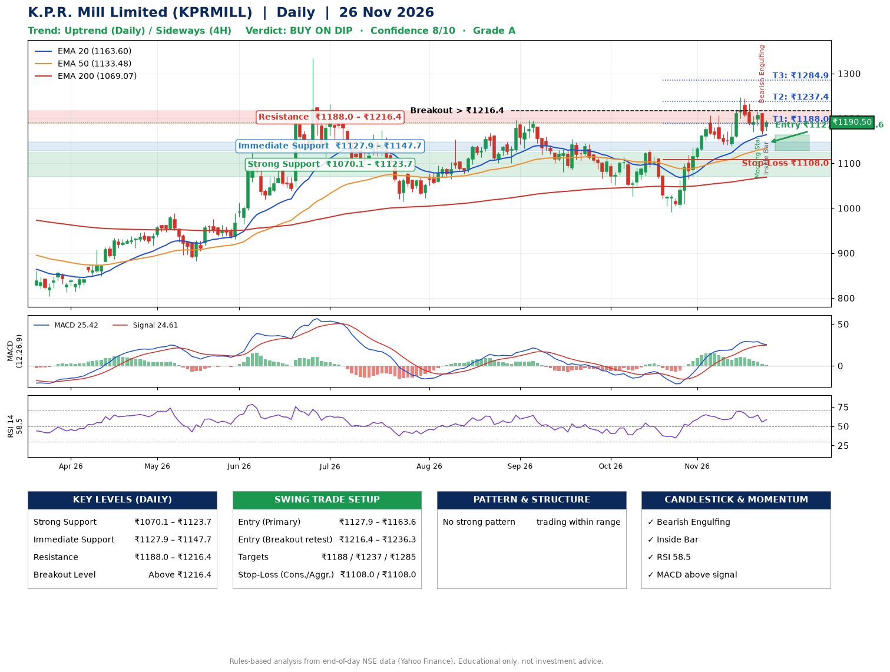

📌 **K.P.R. Mill Limited (KPRMILL) – Multi-Timeframe Technical Analysis (Daily + 4H Combined)**
_Data up to 26 Nov 2026 · Close ₹1190.50_

**📍 Daily Timeframe Trend**
- Trend: **Uptrend** (higher highs and higher lows)
- Recent swing highs: ₹1129.8, ₹1206.5, ₹1247.3 · swing lows: ₹1027.4, ₹991.2, ₹1137.8
- EMAs: EMA20 ₹1163.6, EMA50 ₹1133.5, EMA200 ₹1069.1; bullish stack (EMA20 > EMA50 > EMA200); price above EMA20, EMA50, EMA200
- MACD 25.42 above signal 24.61 (above zero); histogram falling
- RSI(14) 58.5; no divergence on the last two swings

**📍 4-Hour Timeframe Trend**
- Structure: **Sideways** (mixed swing structure)
- Pullback/support area: recent 4H swing lows ₹1140.0, ₹1170.6; EMA20 ₹1186.4
- EMA20/50: bullish stack (EMA20 > EMA50); price above EMA50
- MACD 11.86 below signal 17.53 (above zero); histogram falling
- RSI(14) 52.2; no divergence

**📍 Pattern Detection (Both Timeframes)**
- 4H: **Double Bottom** – bottoms near ₹1140.0/₹1170.6, neckline ₹1246.7, forming
- 4H: **Ascending Triangle** – converging swing highs and lows over the last ~60 sessions

**📍 Candlestick Patterns (last 3 daily candles)**
- **Morning Star** – 23 Nov: three-candle bullish reversal
- **Bearish Engulfing** – 25 Nov: sellers fully reversed the prior green candle
- **Inside Bar** – 26 Nov: compression inside the prior range ₹1164.1–₹1209.8

**📍 Price Action Key Levels (Daily Structure)**

| Zone | Price Level (₹) | Context |
|------|-----------------|---------|
| Strong Support | ₹1070.1 – ₹1123.7 | Cluster of earlier swing lows (demand) |
| Immediate Support | ₹1127.9 – ₹1147.7 | Nearest swing-low / wick area |
| Resistance | ₹1188.0 – ₹1216.4 | Nearest swing-high supply |
| Breakout Level | Above ₹1216.4 | Swing continuation trigger (52-week high ₹1334.0) |

**📍 Swing Trade Setup**

🟢 **Entry Zone**
- Primary: ₹1127.9 – ₹1163.6 (daily support / EMA20 area; enter on a bullish 4H candle)
- Alternate: ₹1216.4 – ₹1236.3 (breakout retest)

🎯 **Profit Targets**
- T1: ₹1188.0
- T2: ₹1237.4
- T3: ₹1284.9

🛑 **Stop-Loss**
- Conservative: below daily swing low (₹1108.0)
- Aggressive: below 4H structure (₹1108.0)
- Risk per share ≈ ₹39.8; reward:risk to T1 ≈ 1.1
- Time to T1: about 5 trading days (it rose this much within 60 trading days 89% of the time in the last 2 years)
- Time to T2: about 10 trading days (it rose this much within 60 trading days 71% of the time in the last 2 years)

**📌 Strategy Notes**
- Higher timeframe: daily trend is uptrend; only take longs while price holds above ₹1070.1.
- Entry timing: wait for a bullish 4H candle (engulfing/hammer) inside ₹1127.9 – ₹1163.6 rather than buying mid-range.
- EMA stacking: bullish stack (EMA20 > EMA50 > EMA200); price above EMA20, EMA50, EMA200.
- Breakout rule: a daily close above ₹1216.4 with volume above its 20-day average (≈537,275) opens T2/T3.
- Momentum: RSI 59 – room to run; no divergence on the last two swings.
- Exit discipline: move the stop to entry once T1 is hit; book partial profits at each target.

**STEP 2 — Marked Up Chart**

**✅ Trade Validation Checklist**
- Trend + momentum aligned: Yes · Price at entry zone: No
- Stop defined (₹1108.0) · Reward:risk ≥ 1.5 to T1: No

## 📌 Final Verdict

Recommendation: **🟡 BUY ON DIP**

Confidence: **8/10**

Trade Quality: **A**

Reason:
• Daily uptrend (higher highs and higher lows)
• EMAs stacked bullishly

Next Action:
• Wait for a pullback to ₹1127.9–₹1163.6, or a breakout above ₹1216.4

_Rules-based analysis from end-of-day data. Educational only, not investment advice. Never place orders without your own confirmation._