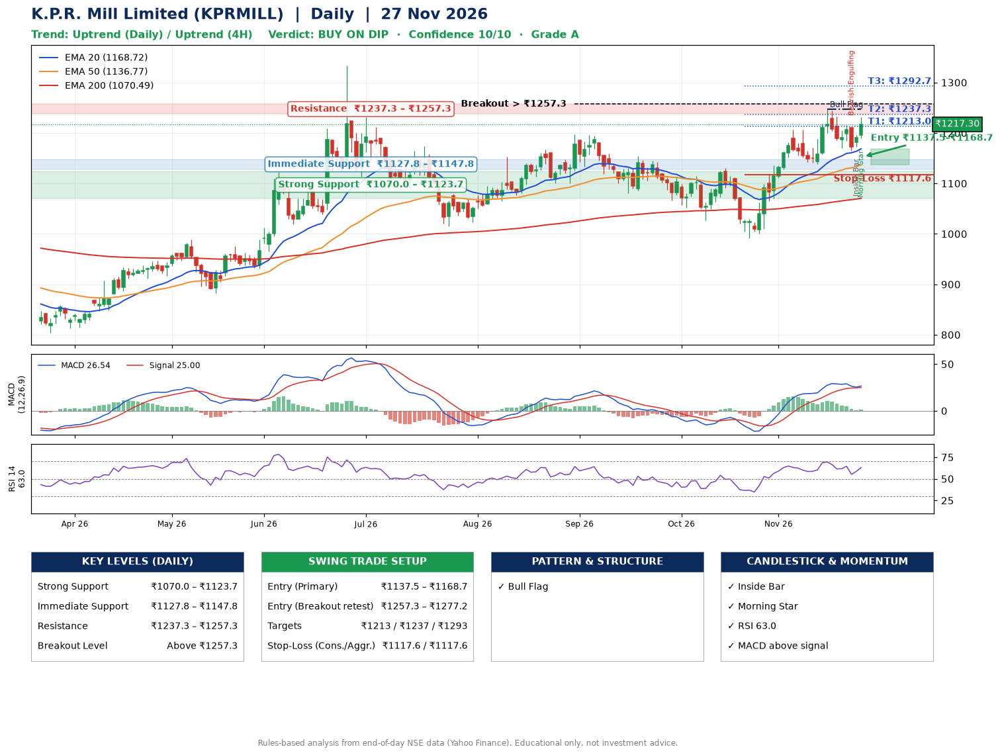

📌 **K.P.R. Mill Limited (KPRMILL) – Multi-Timeframe Technical Analysis (Daily + 4H Combined)**
_Data up to 27 Nov 2026 · Close ₹1217.30_

**📍 Daily Timeframe Trend**
- Trend: **Uptrend** (higher highs and higher lows)
- Recent swing highs: ₹1129.8, ₹1206.5, ₹1247.3 · swing lows: ₹1027.4, ₹991.2, ₹1137.8
- EMAs: EMA20 ₹1168.7, EMA50 ₹1136.8, EMA200 ₹1070.5; bullish stack (EMA20 > EMA50 > EMA200); price above EMA20, EMA50, EMA200
- MACD 26.54 above signal 25.00 (above zero); histogram rising
- RSI(14) 63.0; no divergence on the last two swings

**📍 4-Hour Timeframe Trend**
- Structure: **Uptrend** (price above rising EMAs)
- Pullback/support area: recent 4H swing lows ₹1170.6, ₹1167.7; EMA20 ₹1189.8
- EMA20/50: bullish stack (EMA20 > EMA50); price above EMA20, EMA50
- MACD 12.20 below signal 15.41 (above zero); histogram rising
- RSI(14) 60.5; no divergence

**📍 Pattern Detection (Both Timeframes)**
- Daily: **Bull Flag** – 16% pole then a tight 7% flag; trigger above ₹1247.3
- 4H: **Ascending Triangle** – converging swing highs and lows over the last ~60 sessions

**📍 Candlestick Patterns (last 3 daily candles)**
- **Bearish Engulfing** – 25 Nov: sellers fully reversed the prior green candle
- **Inside Bar** – 26 Nov: compression inside the prior range ₹1164.1–₹1209.8
- **Morning Star** – 27 Nov: three-candle bullish reversal

**📍 Price Action Key Levels (Daily Structure)**

| Zone | Price Level (₹) | Context |
|------|-----------------|---------|
| Strong Support | ₹1070.0 – ₹1123.7 | Cluster of earlier swing lows (demand) |
| Immediate Support | ₹1127.8 – ₹1147.8 | Nearest swing-low / wick area |
| Resistance | ₹1237.3 – ₹1257.3 | Nearest swing-high supply |
| Breakout Level | Above ₹1257.3 | Swing continuation trigger (52-week high ₹1334.0) |

**📍 Swing Trade Setup**

🟢 **Entry Zone**
- Primary: ₹1137.5 – ₹1168.7 (daily support / EMA20 area; enter on a bullish 4H candle)
- Alternate: ₹1257.3 – ₹1277.2 (breakout retest)

🎯 **Profit Targets**
- T1: ₹1213.0
- T2: ₹1237.3
- T3: ₹1292.7

🛑 **Stop-Loss**
- Conservative: below daily swing low (₹1117.6)
- Aggressive: below 4H structure (₹1117.6)
- Risk per share ≈ ₹39.9; reward:risk to T1 ≈ 1.5
- Time to T1: about 7 trading days (it rose this much within 60 trading days 83% of the time in the last 2 years)
- Time to T2: about 10 trading days (it rose this much within 60 trading days 73% of the time in the last 2 years)

**📌 Strategy Notes**
- Higher timeframe: daily trend is uptrend; only take longs while price holds above ₹1070.0.
- Entry timing: wait for a bullish 4H candle (engulfing/hammer) inside ₹1137.5 – ₹1168.7 rather than buying mid-range.
- EMA stacking: bullish stack (EMA20 > EMA50 > EMA200); price above EMA20, EMA50, EMA200.
- Breakout rule: a daily close above ₹1257.3 with volume above its 20-day average (≈472,513) opens T2/T3.
- Momentum: RSI 63 – room to run; no divergence on the last two swings.
- Exit discipline: move the stop to entry once T1 is hit; book partial profits at each target.

**STEP 2 — Marked Up Chart**

**✅ Trade Validation Checklist**
- Trend + momentum aligned: Yes · Price at entry zone: No
- Stop defined (₹1117.6) · Reward:risk ≥ 1.5 to T1: Yes

## 📌 Final Verdict

Recommendation: **🟡 BUY ON DIP**

Confidence: **10/10**

Trade Quality: **A**

Reason:
• Daily uptrend (higher highs and higher lows)
• EMAs stacked bullishly

Next Action:
• Wait for a pullback to ₹1137.5–₹1168.7

_Rules-based analysis from end-of-day data. Educational only, not investment advice. Never place orders without your own confirmation._