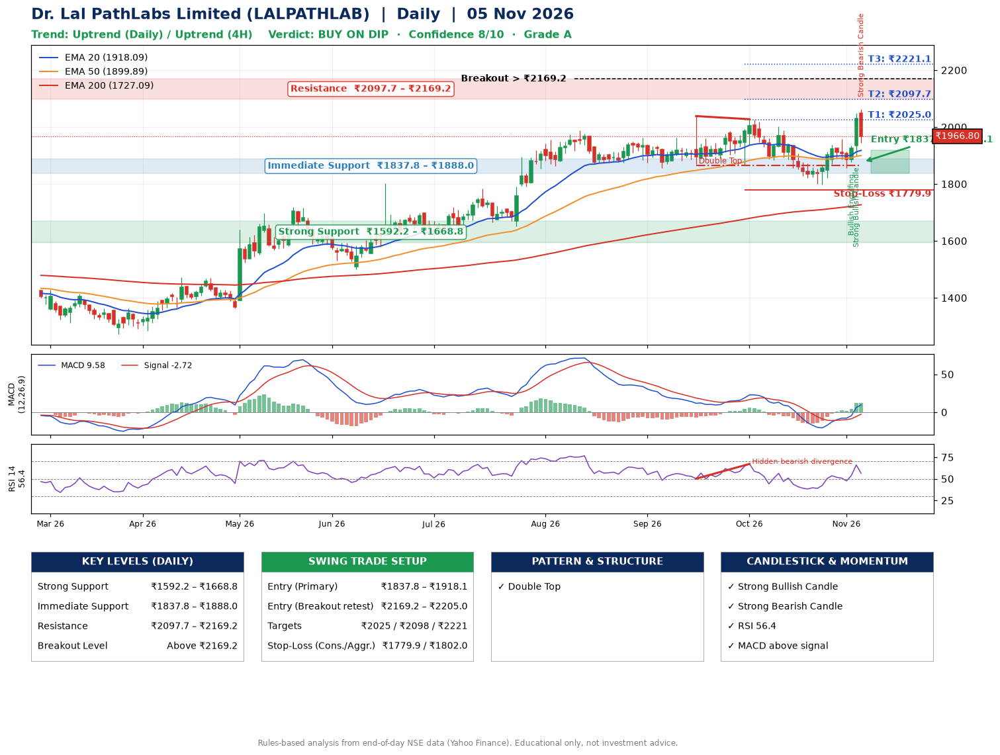

📌 **Dr. Lal PathLabs Limited (LALPATHLAB) – Multi-Timeframe Technical Analysis (Daily + 4H Combined)**
_Data up to 05 Nov 2026 · Close ₹1966.80_

**📍 Daily Timeframe Trend**
- Trend: **Uptrend** (price above rising EMAs)
- Recent swing highs: ₹1963.0, ₹2038.6, ₹2027.6 · swing lows: ₹1870.0, ₹1865.0, ₹1797.8
- EMAs: EMA20 ₹1918.1, EMA50 ₹1899.9, EMA200 ₹1727.1; bullish stack (EMA20 > EMA50 > EMA200); price above EMA20, EMA50, EMA200
- MACD 9.58 above signal -2.72 (above zero); histogram rising
- RSI(14) 56.4; Hidden bearish divergence

**📍 4-Hour Timeframe Trend**
- Structure: **Uptrend** (higher highs and higher lows)
- Pullback/support area: recent 4H swing lows ₹1798.3, ₹1856.5; EMA20 ₹1920.2
- EMA20/50: bullish stack (EMA20 > EMA50); price above EMA20, EMA50
- MACD 20.08 above signal 9.87 (above zero); histogram falling
- RSI(14) 57.7; Regular bearish divergence

**📍 Pattern Detection (Both Timeframes)**
- Daily: **Double Top** – tops near ₹2038.6/₹2027.6, neckline ₹1865.0, forming
- 4H: **Symmetrical Triangle** – converging swing highs and lows over the last ~60 sessions

**📍 Candlestick Patterns (last 3 daily candles)**
- **Bullish Engulfing** – 03 Nov: buyers fully reversed the prior red candle
- **Strong Bullish Candle** – 04 Nov: wide-range green candle, buyers in control
- **Strong Bearish Candle** – 05 Nov: wide-range red candle, sellers in control

**📍 Price Action Key Levels (Daily Structure)**

| Zone | Price Level (₹) | Context |
|------|-----------------|---------|
| Strong Support | ₹1592.2 – ₹1668.8 | Cluster of earlier swing lows (demand) |
| Immediate Support | ₹1837.8 – ₹1888.0 | Nearest swing-low / wick area |
| Resistance | ₹2097.7 – ₹2169.2 | Nearest swing-high supply |
| Breakout Level | Above ₹2169.2 | Swing continuation trigger (52-week high ₹2061.9) |

**📍 Swing Trade Setup**

🟢 **Entry Zone**
- Primary: ₹1837.8 – ₹1918.1 (daily support / EMA20 area; enter on a bullish 4H candle)
- Alternate: ₹2169.2 – ₹2205.0 (breakout retest)

🎯 **Profit Targets**
- T1: ₹2025.0
- T2: ₹2097.7
- T3: ₹2221.1

🛑 **Stop-Loss**
- Conservative: below daily swing low (₹1779.9)
- Aggressive: below 4H structure (₹1802.0)
- Risk per share ≈ ₹98.0; reward:risk to T1 ≈ 1.5

**📌 Strategy Notes**
- Higher timeframe: daily trend is uptrend; only take longs while price holds above ₹1592.2.
- Entry timing: wait for a bullish 4H candle (engulfing/hammer) inside ₹1837.8 – ₹1918.1 rather than buying mid-range.
- EMA stacking: bullish stack (EMA20 > EMA50 > EMA200); price above EMA20, EMA50, EMA200.
- Breakout rule: a daily close above ₹2169.2 with volume above its 20-day average (≈269,627) opens T2/T3.
- Momentum: RSI 56 – room to run; Hidden bearish divergence.
- Exit discipline: move the stop to entry once T1 is hit; book partial profits at each target.

**STEP 2 — Marked Up Chart**

**✅ Trade Validation Checklist**
- Trend + momentum aligned: Yes · Price at entry zone: No
- Stop defined (₹1779.9) · Reward:risk ≥ 1.5 to T1: No

## 📌 Final Verdict

Recommendation: **🟡 BUY ON DIP**

Confidence: **8/10**

Trade Quality: **A**

Reason:
• Daily uptrend (price above rising EMAs)
• EMAs stacked bullishly

Next Action:
• Wait for a pullback to ₹1837.8–₹1918.1, or a breakout above ₹2169.2

_Rules-based analysis from end-of-day data. Educational only, not investment advice. Never place orders without your own confirmation._