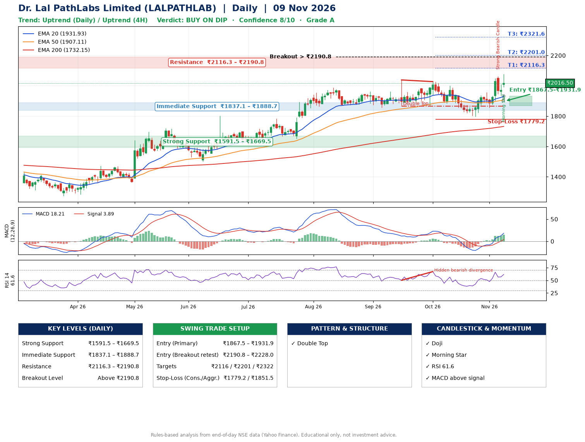

📌 **Dr. Lal PathLabs Limited (LALPATHLAB) – Multi-Timeframe Technical Analysis (Daily + 4H Combined)**
_Data up to 09 Nov 2026 · Close ₹2016.50_

**📍 Daily Timeframe Trend**
- Trend: **Uptrend** (price above rising EMAs)
- Recent swing highs: ₹1963.0, ₹2038.6, ₹2027.6 · swing lows: ₹1870.0, ₹1865.0, ₹1797.8
- EMAs: EMA20 ₹1931.9, EMA50 ₹1907.1, EMA200 ₹1732.1; bullish stack (EMA20 > EMA50 > EMA200); price above EMA20, EMA50, EMA200
- MACD 18.21 above signal 3.89 (above zero); histogram rising
- RSI(14) 61.6; Hidden bearish divergence

**📍 4-Hour Timeframe Trend**
- Structure: **Uptrend** (higher highs and higher lows)
- Pullback/support area: recent 4H swing lows ₹1798.3, ₹1856.5; EMA20 ₹1946.0
- EMA20/50: bullish stack (EMA20 > EMA50); price above EMA20, EMA50
- MACD 29.49 above signal 19.55 (above zero); histogram falling
- RSI(14) 61.9; Regular bearish divergence

**📍 Pattern Detection (Both Timeframes)**
- Daily: **Double Top** – tops near ₹2038.6/₹2027.6, neckline ₹1865.0, forming

**📍 Candlestick Patterns (last 3 daily candles)**
- **Strong Bearish Candle** – 05 Nov: wide-range red candle, sellers in control
- **Doji** – 09 Nov: indecision; wait for the next candle to confirm direction
- **Morning Star** – 09 Nov: three-candle bullish reversal

**📍 Price Action Key Levels (Daily Structure)**

| Zone | Price Level (₹) | Context |
|------|-----------------|---------|
| Strong Support | ₹1591.5 – ₹1669.5 | Cluster of earlier swing lows (demand) |
| Immediate Support | ₹1837.1 – ₹1888.7 | Nearest swing-low / wick area |
| Resistance | ₹2116.3 – ₹2190.8 | Nearest swing-high supply |
| Breakout Level | Above ₹2190.8 | Swing continuation trigger (52-week high ₹2079.0) |

**📍 Swing Trade Setup**

🟢 **Entry Zone**
- Primary: ₹1867.5 – ₹1931.9 (daily support / EMA20 area; enter on a bullish 4H candle)
- Alternate: ₹2190.8 – ₹2228.0 (breakout retest)

🎯 **Profit Targets**
- T1: ₹2116.3
- T2: ₹2201.0
- T3: ₹2321.6

🛑 **Stop-Loss**
- Conservative: below daily swing low (₹1779.2)
- Aggressive: below 4H structure (₹1851.5)
- Risk per share ≈ ₹120.5; reward:risk to T1 ≈ 1.8

**📌 Strategy Notes**
- Higher timeframe: daily trend is uptrend; only take longs while price holds above ₹1591.5.
- Entry timing: wait for a bullish 4H candle (engulfing/hammer) inside ₹1867.5 – ₹1931.9 rather than buying mid-range.
- EMA stacking: bullish stack (EMA20 > EMA50 > EMA200); price above EMA20, EMA50, EMA200.
- Breakout rule: a daily close above ₹2190.8 with volume above its 20-day average (≈292,990) opens T2/T3.
- Momentum: RSI 62 – room to run; Hidden bearish divergence.
- Exit discipline: move the stop to entry once T1 is hit; book partial profits at each target.

**STEP 2 — Marked Up Chart**

**✅ Trade Validation Checklist**
- Trend + momentum aligned: Yes · Price at entry zone: No
- Stop defined (₹1779.2) · Reward:risk ≥ 1.5 to T1: Yes

## 📌 Final Verdict

Recommendation: **🟡 BUY ON DIP**

Confidence: **8/10**

Trade Quality: **A**

Reason:
• Daily uptrend (price above rising EMAs)
• EMAs stacked bullishly

Next Action:
• Wait for a pullback to ₹1867.5–₹1931.9

_Rules-based analysis from end-of-day data. Educational only, not investment advice. Never place orders without your own confirmation._