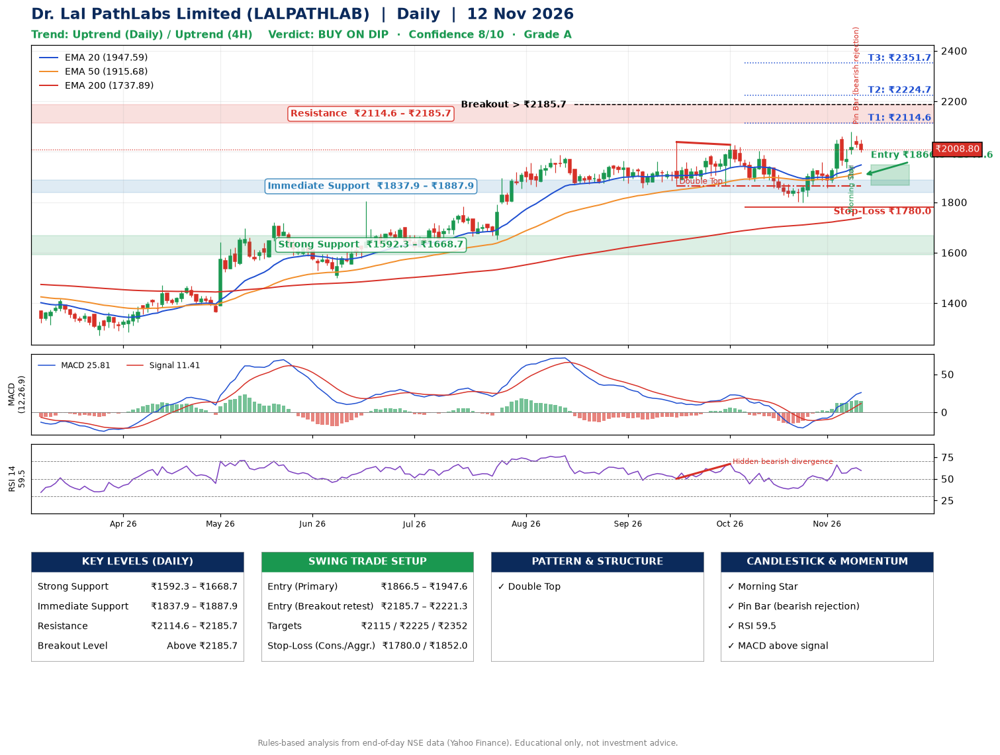

📌 **Dr. Lal PathLabs Limited (LALPATHLAB) – Multi-Timeframe Technical Analysis (Daily + 4H Combined)**
_Data up to 12 Nov 2026 · Close ₹2008.80_

**📍 Daily Timeframe Trend**
- Trend: **Uptrend** (price above rising EMAs)
- Recent swing highs: ₹1963.0, ₹2038.6, ₹2027.6 · swing lows: ₹1870.0, ₹1865.0, ₹1797.8
- EMAs: EMA20 ₹1947.6, EMA50 ₹1915.7, EMA200 ₹1737.9; bullish stack (EMA20 > EMA50 > EMA200); price above EMA20, EMA50, EMA200
- MACD 25.81 above signal 11.41 (above zero); histogram falling
- RSI(14) 59.5; Hidden bearish divergence

**📍 4-Hour Timeframe Trend**
- Structure: **Uptrend** (higher highs and higher lows)
- Pullback/support area: recent 4H swing lows ₹1798.3, ₹1856.5; EMA20 ₹1971.6
- EMA20/50: bullish stack (EMA20 > EMA50); price above EMA20, EMA50
- MACD 34.06 above signal 28.16 (above zero); histogram falling
- RSI(14) 60.4; no divergence

**📍 Pattern Detection (Both Timeframes)**
- Daily: **Double Top** – tops near ₹2038.6/₹2027.6, neckline ₹1865.0, forming

**📍 Candlestick Patterns (last 3 daily candles)**
- **Doji** – 09 Nov: indecision; wait for the next candle to confirm direction
- **Morning Star** – 09 Nov: three-candle bullish reversal
- **Pin Bar (bearish rejection)** – 11 Nov: long upper wick shows selling near ₹2065.0

**📍 Price Action Key Levels (Daily Structure)**

| Zone | Price Level (₹) | Context |
|------|-----------------|---------|
| Strong Support | ₹1592.3 – ₹1668.7 | Cluster of earlier swing lows (demand) |
| Immediate Support | ₹1837.9 – ₹1887.9 | Nearest swing-low / wick area |
| Resistance | ₹2114.6 – ₹2185.7 | Nearest swing-high supply |
| Breakout Level | Above ₹2185.7 | Swing continuation trigger (52-week high ₹2079.0) |

**📍 Swing Trade Setup**

🟢 **Entry Zone**
- Primary: ₹1866.5 – ₹1947.6 (daily support / EMA20 area; enter on a bullish 4H candle)
- Alternate: ₹2185.7 – ₹2221.3 (breakout retest)

🎯 **Profit Targets**
- T1: ₹2114.6
- T2: ₹2224.7
- T3: ₹2351.7

🛑 **Stop-Loss**
- Conservative: below daily swing low (₹1780.0)
- Aggressive: below 4H structure (₹1852.0)
- Risk per share ≈ ₹127.0; reward:risk to T1 ≈ 1.6
- Time to T1: about 23 trading days (it rose this much within 60 trading days 53% of the time in the last 2 years)
- Time to T2: about 30 trading days (it rose this much within 60 trading days 43% of the time in the last 2 years)

**📌 Strategy Notes**
- Higher timeframe: daily trend is uptrend; only take longs while price holds above ₹1592.3.
- Entry timing: wait for a bullish 4H candle (engulfing/hammer) inside ₹1866.5 – ₹1947.6 rather than buying mid-range.
- EMA stacking: bullish stack (EMA20 > EMA50 > EMA200); price above EMA20, EMA50, EMA200.
- Breakout rule: a daily close above ₹2185.7 with volume above its 20-day average (≈317,345) opens T2/T3.
- Momentum: RSI 60 – room to run; Hidden bearish divergence.
- Exit discipline: move the stop to entry once T1 is hit; book partial profits at each target.

**STEP 2 — Marked Up Chart**

**✅ Trade Validation Checklist**
- Trend + momentum aligned: Yes · Price at entry zone: No
- Stop defined (₹1780.0) · Reward:risk ≥ 1.5 to T1: Yes

## 📌 Final Verdict

Recommendation: **🟡 BUY ON DIP**

Confidence: **8/10**

Trade Quality: **A**

Reason:
• Daily uptrend (price above rising EMAs)
• EMAs stacked bullishly

Next Action:
• Wait for a pullback to ₹1866.5–₹1947.6

_Rules-based analysis from end-of-day data. Educational only, not investment advice. Never place orders without your own confirmation._