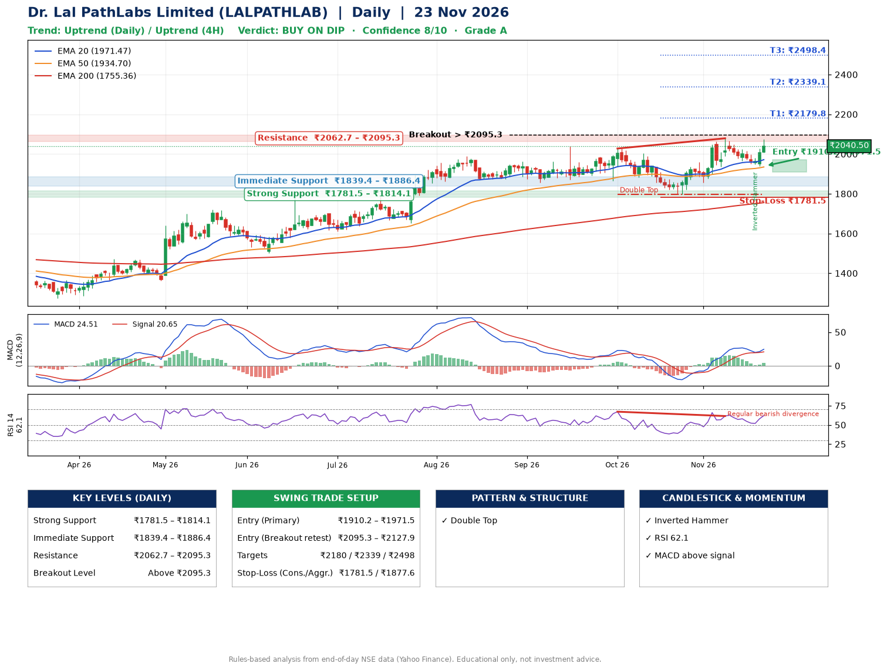

📌 **Dr. Lal PathLabs Limited (LALPATHLAB) – Multi-Timeframe Technical Analysis (Daily + 4H Combined)**
_Data up to 23 Nov 2026 · Close ₹2040.50_

**📍 Daily Timeframe Trend**
- Trend: **Uptrend** (price above rising EMAs)
- Recent swing highs: ₹2038.6, ₹2027.6, ₹2079.0 · swing lows: ₹1870.0, ₹1865.0, ₹1797.8
- EMAs: EMA20 ₹1971.5, EMA50 ₹1934.7, EMA200 ₹1755.4; bullish stack (EMA20 > EMA50 > EMA200); price above EMA20, EMA50, EMA200
- MACD 24.51 above signal 20.65 (above zero); histogram rising
- RSI(14) 62.1; Regular bearish divergence

**📍 4-Hour Timeframe Trend**
- Structure: **Uptrend** (price above rising EMAs)
- Pullback/support area: recent 4H swing lows ₹1967.2, ₹1948.7; EMA20 ₹1995.6
- EMA20/50: bullish stack (EMA20 > EMA50); price above EMA20, EMA50
- MACD 19.63 above signal 17.12 (above zero), fresh bullish crossover; histogram rising
- RSI(14) 59.9; no divergence

**📍 Pattern Detection (Both Timeframes)**
- Daily: **Double Top** – tops near ₹2027.6/₹2079.0, neckline ₹1797.8, forming
- 4H: **Symmetrical Triangle** – converging swing highs and lows over the last ~60 sessions

**📍 Candlestick Patterns (last 3 daily candles)**
- **Inverted Hammer** – 19 Nov: long upper wick shows selling near ₹1978.9

**📍 Price Action Key Levels (Daily Structure)**

| Zone | Price Level (₹) | Context |
|------|-----------------|---------|
| Strong Support | ₹1781.5 – ₹1814.1 | Cluster of earlier swing lows (demand) |
| Immediate Support | ₹1839.4 – ₹1886.4 | Nearest swing-low / wick area |
| Resistance | ₹2062.7 – ₹2095.3 | Nearest swing-high supply |
| Breakout Level | Above ₹2095.3 | Swing continuation trigger (52-week high ₹2079.0) |

**📍 Swing Trade Setup**

🟢 **Entry Zone**
- Primary: ₹1910.2 – ₹1971.5 (daily support / EMA20 area; enter on a bullish 4H candle)
- Alternate: ₹2095.3 – ₹2127.9 (breakout retest)

🎯 **Profit Targets**
- T1: ₹2179.8
- T2: ₹2339.1
- T3: ₹2498.4

🛑 **Stop-Loss**
- Conservative: below daily swing low (₹1781.5)
- Aggressive: below 4H structure (₹1877.6)
- Risk per share ≈ ₹159.3; reward:risk to T1 ≈ 1.5
- Time to T1: about 25 trading days (it rose this much within 60 trading days 51% of the time in the last 2 years)
- Time to T2: about 37 trading days (it rose this much within 60 trading days 30% of the time in the last 2 years)

**📌 Strategy Notes**
- Higher timeframe: daily trend is uptrend; only take longs while price holds above ₹1781.5.
- Entry timing: wait for a bullish 4H candle (engulfing/hammer) inside ₹1910.2 – ₹1971.5 rather than buying mid-range.
- EMA stacking: bullish stack (EMA20 > EMA50 > EMA200); price above EMA20, EMA50, EMA200.
- Breakout rule: a daily close above ₹2095.3 with volume above its 20-day average (≈319,826) opens T2/T3.
- Momentum: RSI 62 – room to run; Regular bearish divergence.
- Exit discipline: move the stop to entry once T1 is hit; book partial profits at each target.

**STEP 2 — Marked Up Chart**

**✅ Trade Validation Checklist**
- Trend + momentum aligned: Yes · Price at entry zone: No
- Stop defined (₹1781.5) · Reward:risk ≥ 1.5 to T1: No

## 📌 Final Verdict

Recommendation: **🟡 BUY ON DIP**

Confidence: **8/10**

Trade Quality: **A**

Reason:
• Daily uptrend (price above rising EMAs)
• EMAs stacked bullishly

Next Action:
• Wait for a pullback to ₹1910.2–₹1971.5

_Rules-based analysis from end-of-day data. Educational only, not investment advice. Never place orders without your own confirmation._