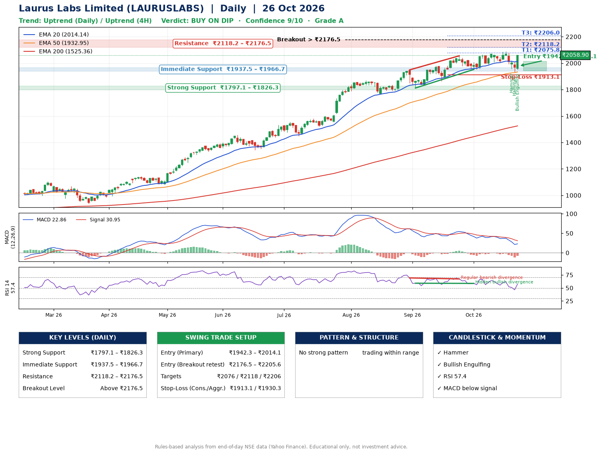

📌 **Laurus Labs Limited (LAURUSLABS) – Multi-Timeframe Technical Analysis (Daily + 4H Combined)**
_Data up to 26 Oct 2026 · Close ₹2058.90_

**📍 Daily Timeframe Trend**
- Trend: **Uptrend** (higher highs and higher lows)
- Recent swing highs: ₹1870.8, ₹1949.0, ₹2055.3 · swing lows: ₹1769.4, ₹1811.7, ₹1952.1
- EMAs: EMA20 ₹2014.1, EMA50 ₹1933.0, EMA200 ₹1525.4; bullish stack (EMA20 > EMA50 > EMA200); price above EMA20, EMA50, EMA200
- MACD 22.86 below signal 30.95 (above zero); histogram rising
- RSI(14) 57.4; Hidden bullish divergence; Regular bearish divergence

**📍 4-Hour Timeframe Trend**
- Structure: **Uptrend** (price above rising EMAs)
- Pullback/support area: recent 4H swing lows ₹2008.0, ₹1934.2; EMA20 ₹2021.9
- EMA20/50: bullish stack (EMA20 > EMA50); price above EMA20, EMA50
- MACD -0.02 below signal 2.85 (below zero); histogram rising
- RSI(14) 56.1; Regular bearish divergence

**📍 Pattern Detection (Both Timeframes)**
- No strong pattern detected. Trading within range.

**📍 Candlestick Patterns (last 3 daily candles)**
- **Hammer** – 22 Oct: long lower wick shows dip-buying near ₹1956.6
- **Hammer** – 23 Oct: long lower wick shows dip-buying near ₹1933.5
- **Bullish Engulfing** – 26 Oct: buyers fully reversed the prior red candle

**📍 Price Action Key Levels (Daily Structure)**

| Zone | Price Level (₹) | Context |
|------|-----------------|---------|
| Strong Support | ₹1797.1 – ₹1826.3 | Cluster of earlier swing lows (demand) |
| Immediate Support | ₹1937.5 – ₹1966.7 | Nearest swing-low / wick area |
| Resistance | ₹2118.2 – ₹2176.5 | Nearest swing-high supply |
| Breakout Level | Above ₹2176.5 | Swing continuation trigger (52-week high ₹2089.0) |

**📍 Swing Trade Setup**

🟢 **Entry Zone**
- Primary: ₹1942.3 – ₹2014.1 (daily support / EMA20 area; enter on a bullish 4H candle)
- Alternate: ₹2176.5 – ₹2205.6 (breakout retest)

🎯 **Profit Targets**
- T1: ₹2075.8
- T2: ₹2118.2
- T3: ₹2206.0

🛑 **Stop-Loss**
- Conservative: below daily swing low (₹1913.1)
- Aggressive: below 4H structure (₹1930.3)
- Risk per share ≈ ₹65.1; reward:risk to T1 ≈ 1.5

**📌 Strategy Notes**
- Higher timeframe: daily trend is uptrend; only take longs while price holds above ₹1797.1.
- Entry timing: wait for a bullish 4H candle (engulfing/hammer) inside ₹1942.3 – ₹2014.1 rather than buying mid-range.
- EMA stacking: bullish stack (EMA20 > EMA50 > EMA200); price above EMA20, EMA50, EMA200.
- Breakout rule: a daily close above ₹2176.5 with volume above its 20-day average (≈1,476,491) opens T2/T3.
- Momentum: RSI 57 – room to run; Hidden bullish divergence; Regular bearish divergence.
- Exit discipline: move the stop to entry once T1 is hit; book partial profits at each target.

**STEP 2 — Marked Up Chart**

**✅ Trade Validation Checklist**
- Trend + momentum aligned: No · Price at entry zone: No
- Stop defined (₹1913.1) · Reward:risk ≥ 1.5 to T1: No

## 📌 Final Verdict

Recommendation: **🟡 BUY ON DIP**

Confidence: **9/10**

Trade Quality: **A**

Reason:
• Daily uptrend (higher highs and higher lows)
• EMAs stacked bullishly

Next Action:
• Wait for a pullback to ₹1942.3–₹2014.1, or a breakout above ₹2176.5

_Rules-based analysis from end-of-day data. Educational only, not investment advice. Never place orders without your own confirmation._