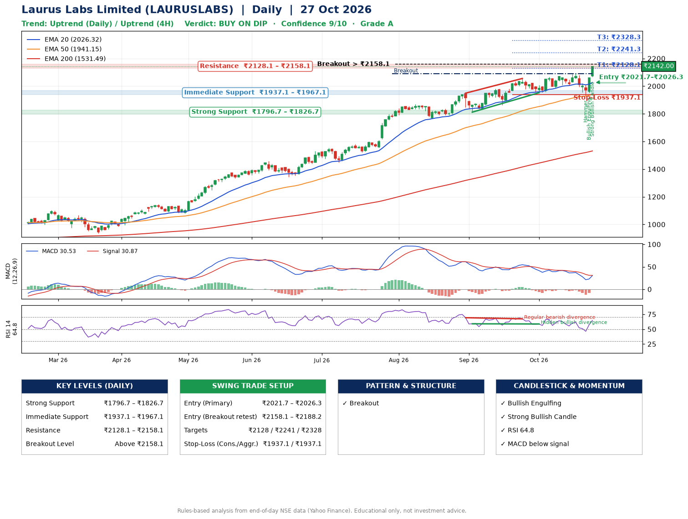

📌 **Laurus Labs Limited (LAURUSLABS) – Multi-Timeframe Technical Analysis (Daily + 4H Combined)**
_Data up to 27 Oct 2026 · Close ₹2142.00_

**📍 Daily Timeframe Trend**
- Trend: **Uptrend** (higher highs and higher lows)
- Recent swing highs: ₹1870.8, ₹1949.0, ₹2055.3 · swing lows: ₹1769.4, ₹1811.7, ₹1952.1
- EMAs: EMA20 ₹2026.3, EMA50 ₹1941.1, EMA200 ₹1531.5; bullish stack (EMA20 > EMA50 > EMA200); price above EMA20, EMA50, EMA200
- MACD 30.53 below signal 30.87 (above zero); histogram rising
- RSI(14) 64.8; Hidden bullish divergence; Regular bearish divergence

**📍 4-Hour Timeframe Trend**
- Structure: **Uptrend** (price above rising EMAs)
- Pullback/support area: recent 4H swing lows ₹2008.0, ₹1934.2; EMA20 ₹2041.8
- EMA20/50: bullish stack (EMA20 > EMA50); price above EMA20, EMA50
- MACD 15.84 above signal 6.26 (above zero), fresh bullish crossover; histogram rising
- RSI(14) 65.3; Regular bearish divergence

**📍 Pattern Detection (Both Timeframes)**
- Daily: **Breakout** – closed above the 60-session high ₹2089.0 on strong volume

**📍 Candlestick Patterns (last 3 daily candles)**
- **Hammer** – 23 Oct: long lower wick shows dip-buying near ₹1933.5
- **Bullish Engulfing** – 26 Oct: buyers fully reversed the prior red candle
- **Strong Bullish Candle** – 27 Oct: wide-range green candle, buyers in control

**📍 Price Action Key Levels (Daily Structure)**

| Zone | Price Level (₹) | Context |
|------|-----------------|---------|
| Strong Support | ₹1796.7 – ₹1826.7 | Cluster of earlier swing lows (demand) |
| Immediate Support | ₹1937.1 – ₹1967.1 | Nearest swing-low / wick area |
| Resistance | ₹2128.1 – ₹2158.1 | Nearest swing-high supply |
| Breakout Level | Above ₹2158.1 | Swing continuation trigger (52-week high ₹2143.1) |

**📍 Swing Trade Setup**

🟢 **Entry Zone**
- Primary: ₹2021.7 – ₹2026.3 (daily support / EMA20 area; enter on a bullish 4H candle)
- Alternate: ₹2158.1 – ₹2188.2 (breakout retest)

🎯 **Profit Targets**
- T1: ₹2128.1
- T2: ₹2241.3
- T3: ₹2328.3

🛑 **Stop-Loss**
- Conservative: below daily swing low (₹1937.1)
- Aggressive: below 4H structure (₹1937.1)
- Risk per share ≈ ₹86.9; reward:risk to T1 ≈ 1.2

**📌 Strategy Notes**
- Higher timeframe: daily trend is uptrend; only take longs while price holds above ₹1796.7.
- Entry timing: wait for a bullish 4H candle (engulfing/hammer) inside ₹2021.7 – ₹2026.3 rather than buying mid-range.
- EMA stacking: bullish stack (EMA20 > EMA50 > EMA200); price above EMA20, EMA50, EMA200.
- Breakout rule: a daily close above ₹2158.1 with volume above its 20-day average (≈1,560,213) opens T2/T3.
- Momentum: RSI 65 – room to run; Hidden bullish divergence; Regular bearish divergence.
- Exit discipline: move the stop to entry once T1 is hit; book partial profits at each target.

**STEP 2 — Marked Up Chart**

**✅ Trade Validation Checklist**
- Trend + momentum aligned: No · Price at entry zone: No
- Stop defined (₹1937.1) · Reward:risk ≥ 1.5 to T1: No

## 📌 Final Verdict

Recommendation: **🟡 BUY ON DIP**

Confidence: **9/10**

Trade Quality: **A**

Reason:
• Daily uptrend (higher highs and higher lows)
• EMAs stacked bullishly

Next Action:
• Wait for a pullback to ₹2021.7–₹2026.3

_Rules-based analysis from end-of-day data. Educational only, not investment advice. Never place orders without your own confirmation._