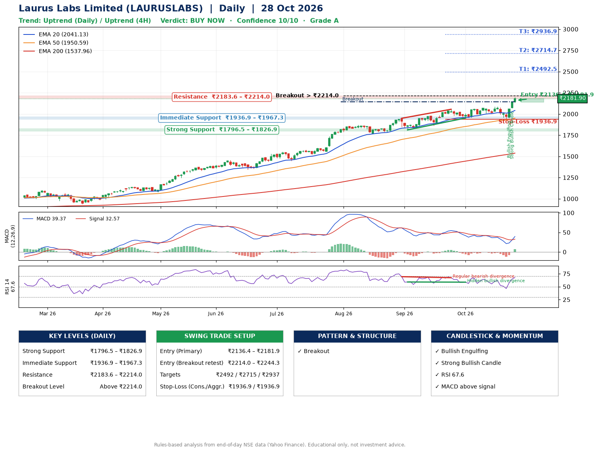

📌 **Laurus Labs Limited (LAURUSLABS) – Multi-Timeframe Technical Analysis (Daily + 4H Combined)**
_Data up to 28 Oct 2026 · Close ₹2181.90_

**📍 Daily Timeframe Trend**
- Trend: **Uptrend** (higher highs and higher lows)
- Recent swing highs: ₹1870.8, ₹1949.0, ₹2055.3 · swing lows: ₹1769.4, ₹1811.7, ₹1952.1
- EMAs: EMA20 ₹2041.1, EMA50 ₹1950.6, EMA200 ₹1538.0; bullish stack (EMA20 > EMA50 > EMA200); price above EMA20, EMA50, EMA200
- MACD 39.37 above signal 32.57 (above zero), fresh bullish crossover; histogram rising
- RSI(14) 67.6; Hidden bullish divergence; Regular bearish divergence

**📍 4-Hour Timeframe Trend**
- Structure: **Uptrend** (price above rising EMAs)
- Pullback/support area: recent 4H swing lows ₹2008.0, ₹1934.2; EMA20 ₹2067.8
- EMA20/50: bullish stack (EMA20 > EMA50); price above EMA20, EMA50
- MACD 32.29 above signal 14.55 (above zero), fresh bullish crossover; histogram rising
- RSI(14) 68.2; Regular bearish divergence

**📍 Pattern Detection (Both Timeframes)**
- Daily: **Breakout** – closed above the 60-session high ₹2143.1 on strong volume

**📍 Candlestick Patterns (last 3 daily candles)**
- **Bullish Engulfing** – 26 Oct: buyers fully reversed the prior red candle
- **Strong Bullish Candle** – 27 Oct: wide-range green candle, buyers in control

**📍 Price Action Key Levels (Daily Structure)**

| Zone | Price Level (₹) | Context |
|------|-----------------|---------|
| Strong Support | ₹1796.5 – ₹1826.9 | Cluster of earlier swing lows (demand) |
| Immediate Support | ₹1936.9 – ₹1967.3 | Nearest swing-low / wick area |
| Resistance | ₹2183.6 – ₹2214.0 | Nearest swing-high supply |
| Breakout Level | Above ₹2214.0 | Swing continuation trigger (52-week high ₹2198.8) |

**📍 Swing Trade Setup**

🟢 **Entry Zone**
- Primary: ₹2136.4 – ₹2181.9 (daily support / EMA20 area; enter on a bullish 4H candle)
- Alternate: ₹2214.0 – ₹2244.3 (breakout retest)

🎯 **Profit Targets**
- T1: ₹2492.5
- T2: ₹2714.7
- T3: ₹2936.9

🛑 **Stop-Loss**
- Conservative: below daily swing low (₹1936.9)
- Aggressive: below 4H structure (₹1936.9)
- Risk per share ≈ ₹222.2; reward:risk to T1 ≈ 1.5

**📌 Strategy Notes**
- Higher timeframe: daily trend is uptrend; only take longs while price holds above ₹1796.5.
- Entry timing: wait for a bullish 4H candle (engulfing/hammer) inside ₹2136.4 – ₹2181.9 rather than buying mid-range.
- EMA stacking: bullish stack (EMA20 > EMA50 > EMA200); price above EMA20, EMA50, EMA200.
- Breakout rule: a daily close above ₹2214.0 with volume above its 20-day average (≈1,622,756) opens T2/T3.
- Momentum: RSI 68 – elevated, prefer dips; Hidden bullish divergence; Regular bearish divergence.
- Exit discipline: move the stop to entry once T1 is hit; book partial profits at each target.

**STEP 2 — Marked Up Chart**

**✅ Trade Validation Checklist**
- Trend + momentum aligned: Yes · Price at entry zone: Yes
- Stop defined (₹1936.9) · Reward:risk ≥ 1.5 to T1: Yes

## 📌 Final Verdict

Recommendation: **🟢 BUY NOW**

Confidence: **10/10**

Trade Quality: **A**

Reason:
• Daily uptrend (higher highs and higher lows)
• EMAs stacked bullishly

Next Action:
• Buy now within the entry zone, with the stop-loss in place

_Rules-based analysis from end-of-day data. Educational only, not investment advice. Never place orders without your own confirmation._