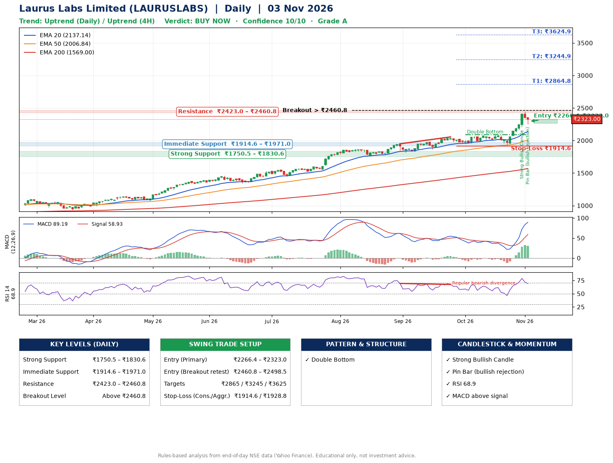

📌 **Laurus Labs Limited (LAURUSLABS) – Multi-Timeframe Technical Analysis (Daily + 4H Combined)**
_Data up to 03 Nov 2026 · Close ₹2323.00_

**📍 Daily Timeframe Trend**
- Trend: **Uptrend** (price above rising EMAs)
- Recent swing highs: ₹1870.8, ₹1949.0, ₹2055.3 · swing lows: ₹1811.7, ₹1952.1, ₹1933.5
- EMAs: EMA20 ₹2137.1, EMA50 ₹2006.8, EMA200 ₹1569.0; bullish stack (EMA20 > EMA50 > EMA200); price above EMA20, EMA50, EMA200
- MACD 89.19 above signal 58.93 (above zero), fresh bullish crossover; histogram falling
- RSI(14) 68.9; Regular bearish divergence

**📍 4-Hour Timeframe Trend**
- Structure: **Uptrend** (price above rising EMAs)
- Pullback/support area: recent 4H swing lows ₹2008.0, ₹1934.2; EMA20 ₹2207.4
- EMA20/50: bullish stack (EMA20 > EMA50); price above EMA20, EMA50
- MACD 84.28 above signal 66.76 (above zero); histogram falling
- RSI(14) 66.0; no divergence

**📍 Pattern Detection (Both Timeframes)**
- Daily: **Double Bottom** – bottoms near ₹1952.1/₹1933.5, neckline ₹2089.0, confirmed (closed above neckline)

**📍 Candlestick Patterns (last 3 daily candles)**
- **Strong Bullish Candle** – 30 Oct: wide-range green candle, buyers in control
- **Pin Bar (bullish rejection)** – 03 Nov: long lower wick shows dip-buying near ₹2252.4

**📍 Price Action Key Levels (Daily Structure)**

| Zone | Price Level (₹) | Context |
|------|-----------------|---------|
| Strong Support | ₹1750.5 – ₹1830.6 | Cluster of earlier swing lows (demand) |
| Immediate Support | ₹1914.6 – ₹1971.0 | Nearest swing-low / wick area |
| Resistance | ₹2423.0 – ₹2460.8 | Nearest swing-high supply |
| Breakout Level | Above ₹2460.8 | Swing continuation trigger (52-week high ₹2441.9) |

**📍 Swing Trade Setup**

🟢 **Entry Zone**
- Primary: ₹2266.4 – ₹2323.0 (daily support / EMA20 area; enter on a bullish 4H candle)
- Alternate: ₹2460.8 – ₹2498.5 (breakout retest)

🎯 **Profit Targets**
- T1: ₹2864.8
- T2: ₹3244.9
- T3: ₹3624.9

🛑 **Stop-Loss**
- Conservative: below daily swing low (₹1914.6)
- Aggressive: below 4H structure (₹1928.8)
- Risk per share ≈ ₹380.1; reward:risk to T1 ≈ 1.5

**📌 Strategy Notes**
- Higher timeframe: daily trend is uptrend; only take longs while price holds above ₹1750.5.
- Entry timing: wait for a bullish 4H candle (engulfing/hammer) inside ₹2266.4 – ₹2323.0 rather than buying mid-range.
- EMA stacking: bullish stack (EMA20 > EMA50 > EMA200); price above EMA20, EMA50, EMA200.
- Breakout rule: a daily close above ₹2460.8 with volume above its 20-day average (≈2,183,960) opens T2/T3.
- Momentum: RSI 69 – elevated, prefer dips; Regular bearish divergence.
- Exit discipline: move the stop to entry once T1 is hit; book partial profits at each target.

**STEP 2 — Marked Up Chart**

**✅ Trade Validation Checklist**
- Trend + momentum aligned: Yes · Price at entry zone: Yes
- Stop defined (₹1914.6) · Reward:risk ≥ 1.5 to T1: No

## 📌 Final Verdict

Recommendation: **🟢 BUY NOW**

Confidence: **10/10**

Trade Quality: **A**

Reason:
• Daily uptrend (price above rising EMAs)
• EMAs stacked bullishly

Next Action:
• Buy now within the entry zone, with the stop-loss in place

_Rules-based analysis from end-of-day data. Educational only, not investment advice. Never place orders without your own confirmation._