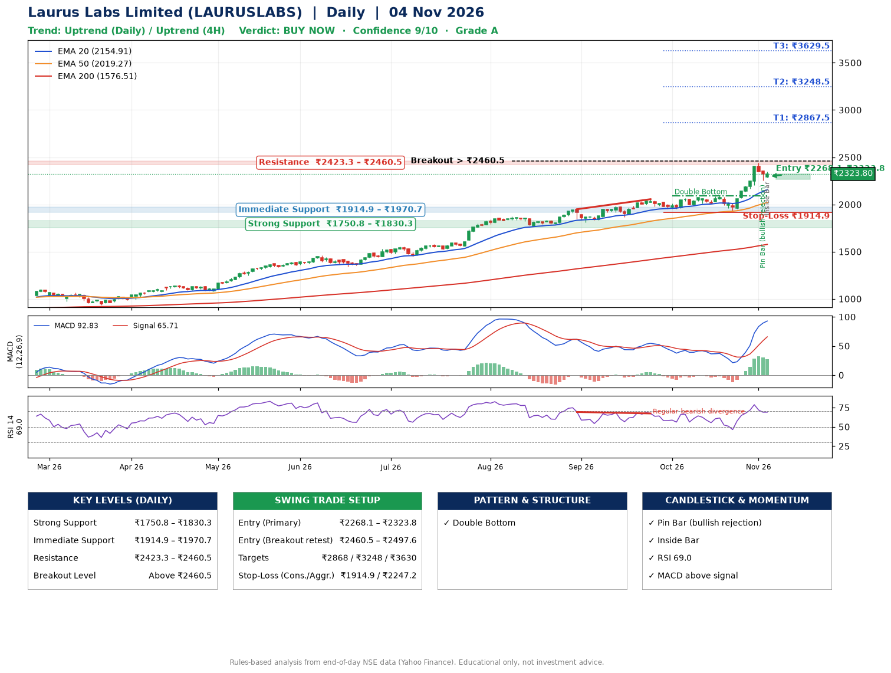

📌 **Laurus Labs Limited (LAURUSLABS) – Multi-Timeframe Technical Analysis (Daily + 4H Combined)**
_Data up to 04 Nov 2026 · Close ₹2323.80_

**📍 Daily Timeframe Trend**
- Trend: **Uptrend** (price above rising EMAs)
- Recent swing highs: ₹1870.8, ₹1949.0, ₹2055.3 · swing lows: ₹1811.7, ₹1952.1, ₹1933.5
- EMAs: EMA20 ₹2154.9, EMA50 ₹2019.3, EMA200 ₹1576.5; bullish stack (EMA20 > EMA50 > EMA200); price above EMA20, EMA50, EMA200
- MACD 92.83 above signal 65.71 (above zero); histogram falling
- RSI(14) 69.0; Regular bearish divergence

**📍 4-Hour Timeframe Trend**
- Structure: **Uptrend** (higher highs and higher lows)
- Pullback/support area: recent 4H swing lows ₹1934.2, ₹2252.4; EMA20 ₹2228.2
- EMA20/50: bullish stack (EMA20 > EMA50); price above EMA20, EMA50
- MACD 80.68 above signal 72.08 (above zero); histogram falling
- RSI(14) 65.9; no divergence

**📍 Pattern Detection (Both Timeframes)**
- Daily: **Double Bottom** – bottoms near ₹1952.1/₹1933.5, neckline ₹2089.0, confirmed (closed above neckline)

**📍 Candlestick Patterns (last 3 daily candles)**
- **Pin Bar (bullish rejection)** – 03 Nov: long lower wick shows dip-buying near ₹2252.4
- **Inside Bar** – 04 Nov: compression inside the prior range ₹2252.4–₹2354.9

**📍 Price Action Key Levels (Daily Structure)**

| Zone | Price Level (₹) | Context |
|------|-----------------|---------|
| Strong Support | ₹1750.8 – ₹1830.3 | Cluster of earlier swing lows (demand) |
| Immediate Support | ₹1914.9 – ₹1970.7 | Nearest swing-low / wick area |
| Resistance | ₹2423.3 – ₹2460.5 | Nearest swing-high supply |
| Breakout Level | Above ₹2460.5 | Swing continuation trigger (52-week high ₹2441.9) |

**📍 Swing Trade Setup**

🟢 **Entry Zone**
- Primary: ₹2268.1 – ₹2323.8 (daily support / EMA20 area; enter on a bullish 4H candle)
- Alternate: ₹2460.5 – ₹2497.6 (breakout retest)

🎯 **Profit Targets**
- T1: ₹2867.5
- T2: ₹3248.5
- T3: ₹3629.5

🛑 **Stop-Loss**
- Conservative: below daily swing low (₹1914.9)
- Aggressive: below 4H structure (₹2247.2)
- Risk per share ≈ ₹381.0; reward:risk to T1 ≈ 1.5

**📌 Strategy Notes**
- Higher timeframe: daily trend is uptrend; only take longs while price holds above ₹1750.8.
- Entry timing: wait for a bullish 4H candle (engulfing/hammer) inside ₹2268.1 – ₹2323.8 rather than buying mid-range.
- EMA stacking: bullish stack (EMA20 > EMA50 > EMA200); price above EMA20, EMA50, EMA200.
- Breakout rule: a daily close above ₹2460.5 with volume above its 20-day average (≈2,235,054) opens T2/T3.
- Momentum: RSI 69 – elevated, prefer dips; Regular bearish divergence.
- Exit discipline: move the stop to entry once T1 is hit; book partial profits at each target.

**STEP 2 — Marked Up Chart**

**✅ Trade Validation Checklist**
- Trend + momentum aligned: Yes · Price at entry zone: Yes
- Stop defined (₹1914.9) · Reward:risk ≥ 1.5 to T1: Yes

## 📌 Final Verdict

Recommendation: **🟢 BUY NOW**

Confidence: **9/10**

Trade Quality: **A**

Reason:
• Daily uptrend (price above rising EMAs)
• EMAs stacked bullishly

Next Action:
• Buy now within the entry zone, with the stop-loss in place

_Rules-based analysis from end-of-day data. Educational only, not investment advice. Never place orders without your own confirmation._