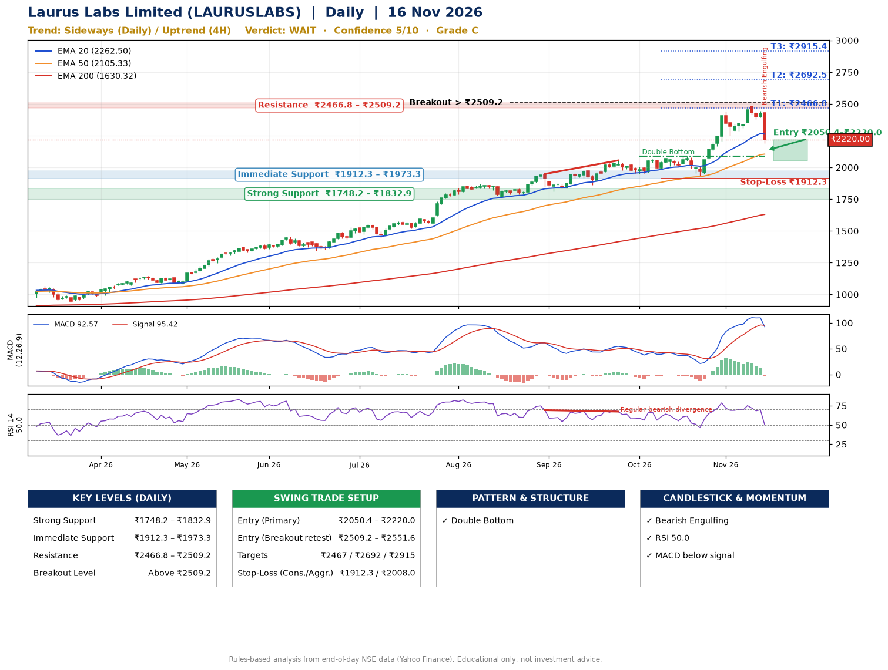

📌 **Laurus Labs Limited (LAURUSLABS) – Multi-Timeframe Technical Analysis (Daily + 4H Combined)**
_Data up to 16 Nov 2026 · Close ₹2220.00_

**📍 Daily Timeframe Trend**
- Trend: **Sideways** (mixed swing structure)
- Recent swing highs: ₹1870.8, ₹1949.0, ₹2055.3 · swing lows: ₹1811.7, ₹1952.1, ₹1933.5
- EMAs: EMA20 ₹2262.5, EMA50 ₹2105.3, EMA200 ₹1630.3; bullish stack (EMA20 > EMA50 > EMA200); price above EMA50, EMA200
- MACD 92.57 below signal 95.42 (above zero), fresh bearish crossover; histogram falling
- RSI(14) 50.0; Regular bearish divergence

**📍 4-Hour Timeframe Trend**
- Structure: **Uptrend** (price above rising EMAs)
- Pullback/support area: recent 4H swing lows ₹1934.2, ₹2252.4; EMA20 ₹2330.8
- EMA20/50: bullish stack (EMA20 > EMA50); price above EMA20, EMA50
- MACD 30.58 below signal 52.54 (above zero); histogram rising
- RSI(14) 52.9; no divergence

**📍 Pattern Detection (Both Timeframes)**
- Daily: **Double Bottom** – bottoms near ₹1952.1/₹1933.5, neckline ₹2089.0, confirmed (closed above neckline)
- 4H: **Ascending Triangle** – converging swing highs and lows over the last ~60 sessions

**📍 Candlestick Patterns (last 3 daily candles)**
- **Bearish Engulfing** – 16 Nov: sellers fully reversed the prior green candle

**📍 Price Action Key Levels (Daily Structure)**

| Zone | Price Level (₹) | Context |
|------|-----------------|---------|
| Strong Support | ₹1748.2 – ₹1832.9 | Cluster of earlier swing lows (demand) |
| Immediate Support | ₹1912.3 – ₹1973.3 | Nearest swing-low / wick area |
| Resistance | ₹2466.8 – ₹2509.2 | Nearest swing-high supply |
| Breakout Level | Above ₹2509.2 | Swing continuation trigger (52-week high ₹2488.0) |

**📍 Swing Trade Setup**

🟢 **Entry Zone**
- Primary: ₹2050.4 – ₹2220.0 (daily support / EMA20 area; enter on a bullish 4H candle)
- Alternate: ₹2509.2 – ₹2551.6 (breakout retest)

🎯 **Profit Targets**
- T1: ₹2466.8
- T2: ₹2692.5
- T3: ₹2915.4

🛑 **Stop-Loss**
- Conservative: below daily swing low (₹1912.3)
- Aggressive: below 4H structure (₹2008.0)
- Risk per share ≈ ₹222.9; reward:risk to T1 ≈ 1.5
- Time to T1: about 29 trading days (it rose this much within 60 trading days 71% of the time in the last 2 years)
- Time to T2: about 39 trading days (it rose this much within 60 trading days 47% of the time in the last 2 years)

**📌 Strategy Notes**
- Higher timeframe: daily trend is sideways; only take longs while price holds above ₹1748.2.
- Entry timing: wait for a bullish 4H candle (engulfing/hammer) inside ₹2050.4 – ₹2220.0 rather than buying mid-range.
- EMA stacking: bullish stack (EMA20 > EMA50 > EMA200); price above EMA50, EMA200.
- Breakout rule: a daily close above ₹2509.2 with volume above its 20-day average (≈2,883,703) opens T2/T3.
- Momentum: RSI 50 – room to run; Regular bearish divergence.
- Exit discipline: move the stop to entry once T1 is hit; book partial profits at each target.

**STEP 2 — Marked Up Chart**

**✅ Trade Validation Checklist**
- Trend + momentum aligned: No · Price at entry zone: Yes
- Stop defined (₹1912.3) · Reward:risk ≥ 1.5 to T1: No

## 📌 Final Verdict

Recommendation: **🟠 WAIT**

Confidence: **5/10**

Trade Quality: **C**

Reason:
• Sharp pullback: 11% below the recent ₹2488.0 high
• EMAs stacked bullishly

Next Action:
• Wait for a breakout above ₹2509.2

_Rules-based analysis from end-of-day data. Educational only, not investment advice. Never place orders without your own confirmation._