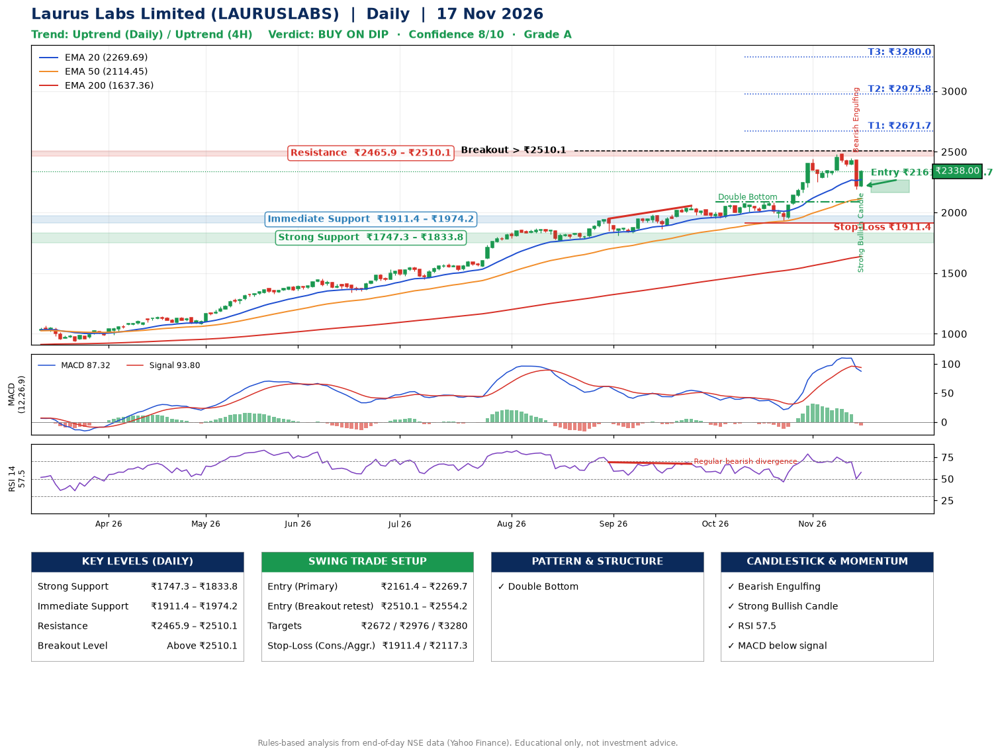

📌 **Laurus Labs Limited (LAURUSLABS) – Multi-Timeframe Technical Analysis (Daily + 4H Combined)**
_Data up to 17 Nov 2026 · Close ₹2338.00_

**📍 Daily Timeframe Trend**
- Trend: **Uptrend** (price above rising EMAs)
- Recent swing highs: ₹1870.8, ₹1949.0, ₹2055.3 · swing lows: ₹1811.7, ₹1952.1, ₹1933.5
- EMAs: EMA20 ₹2269.7, EMA50 ₹2114.5, EMA200 ₹1637.4; bullish stack (EMA20 > EMA50 > EMA200); price above EMA20, EMA50, EMA200
- MACD 87.32 below signal 93.80 (above zero), fresh bearish crossover; histogram falling
- RSI(14) 57.5; Regular bearish divergence

**📍 4-Hour Timeframe Trend**
- Structure: **Uptrend** (price above rising EMAs)
- Pullback/support area: recent 4H swing lows ₹1934.2, ₹2252.4; EMA20 ₹2330.8
- EMA20/50: bullish stack (EMA20 > EMA50); price above EMA20, EMA50
- MACD 30.58 below signal 52.54 (above zero); histogram rising
- RSI(14) 52.9; no divergence

**📍 Pattern Detection (Both Timeframes)**
- Daily: **Double Bottom** – bottoms near ₹1952.1/₹1933.5, neckline ₹2089.0, confirmed (closed above neckline)
- 4H: **Ascending Triangle** – converging swing highs and lows over the last ~60 sessions

**📍 Candlestick Patterns (last 3 daily candles)**
- **Bearish Engulfing** – 16 Nov: sellers fully reversed the prior green candle
- **Strong Bullish Candle** – 17 Nov: wide-range green candle, buyers in control

**📍 Price Action Key Levels (Daily Structure)**

| Zone | Price Level (₹) | Context |
|------|-----------------|---------|
| Strong Support | ₹1747.3 – ₹1833.8 | Cluster of earlier swing lows (demand) |
| Immediate Support | ₹1911.4 – ₹1974.2 | Nearest swing-low / wick area |
| Resistance | ₹2465.9 – ₹2510.1 | Nearest swing-high supply |
| Breakout Level | Above ₹2510.1 | Swing continuation trigger (52-week high ₹2488.0) |

**📍 Swing Trade Setup**

🟢 **Entry Zone**
- Primary: ₹2161.4 – ₹2269.7 (daily support / EMA20 area; enter on a bullish 4H candle)
- Alternate: ₹2510.1 – ₹2554.2 (breakout retest)

🎯 **Profit Targets**
- T1: ₹2671.7
- T2: ₹2975.8
- T3: ₹3280.0

🛑 **Stop-Loss**
- Conservative: below daily swing low (₹1911.4)
- Aggressive: below 4H structure (₹2117.3)
- Risk per share ≈ ₹304.1; reward:risk to T1 ≈ 1.5
- Time to T1: about 33 trading days (it rose this much within 60 trading days 56% of the time in the last 2 years)
- Time to T2: about 47 trading days (it rose this much within 60 trading days 32% of the time in the last 2 years)

**📌 Strategy Notes**
- Higher timeframe: daily trend is uptrend; only take longs while price holds above ₹1747.3.
- Entry timing: wait for a bullish 4H candle (engulfing/hammer) inside ₹2161.4 – ₹2269.7 rather than buying mid-range.
- EMA stacking: bullish stack (EMA20 > EMA50 > EMA200); price above EMA20, EMA50, EMA200.
- Breakout rule: a daily close above ₹2510.1 with volume above its 20-day average (≈3,047,770) opens T2/T3.
- Momentum: RSI 57 – room to run; Regular bearish divergence.
- Exit discipline: move the stop to entry once T1 is hit; book partial profits at each target.

**STEP 2 — Marked Up Chart**

**✅ Trade Validation Checklist**
- Trend + momentum aligned: No · Price at entry zone: No
- Stop defined (₹1911.4) · Reward:risk ≥ 1.5 to T1: No

## 📌 Final Verdict

Recommendation: **🟡 BUY ON DIP**

Confidence: **8/10**

Trade Quality: **A**

Reason:
• Daily uptrend (price above rising EMAs)
• EMAs stacked bullishly

Next Action:
• Wait for a pullback to ₹2161.4–₹2269.7

_Rules-based analysis from end-of-day data. Educational only, not investment advice. Never place orders without your own confirmation._