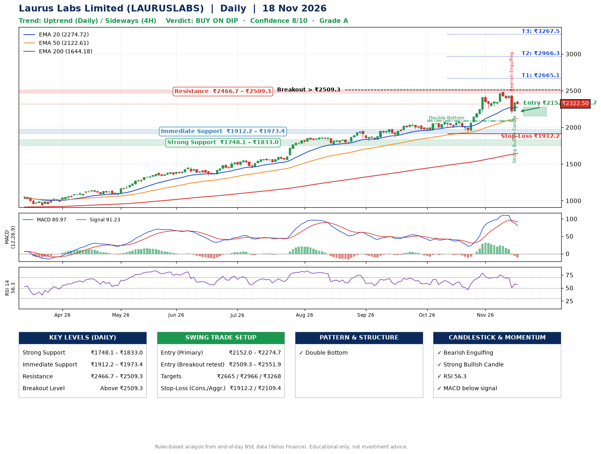

📌 **Laurus Labs Limited (LAURUSLABS) – Multi-Timeframe Technical Analysis (Daily + 4H Combined)**
_Data up to 18 Nov 2026 · Close ₹2322.50_

**📍 Daily Timeframe Trend**
- Trend: **Uptrend** (price above rising EMAs)
- Recent swing highs: ₹1949.0, ₹2055.3, ₹2488.0 · swing lows: ₹1811.7, ₹1952.1, ₹1933.5
- EMAs: EMA20 ₹2274.7, EMA50 ₹2122.6, EMA200 ₹1644.2; bullish stack (EMA20 > EMA50 > EMA200); price above EMA20, EMA50, EMA200
- MACD 80.97 below signal 91.23 (above zero), fresh bearish crossover; histogram falling
- RSI(14) 56.3; no divergence on the last two swings

**📍 4-Hour Timeframe Trend**
- Structure: **Sideways** (mixed swing structure)
- Pullback/support area: recent 4H swing lows ₹2252.4, ₹2190.7; EMA20 ₹2329.3
- EMA20/50: bullish stack (EMA20 > EMA50); price above EMA50
- MACD 23.33 below signal 42.57 (above zero); histogram rising
- RSI(14) 51.3; no divergence

**📍 Pattern Detection (Both Timeframes)**
- Daily: **Double Bottom** – bottoms near ₹1952.1/₹1933.5, neckline ₹2089.0, confirmed (closed above neckline)
- 4H: **Double Bottom** – bottoms near ₹2252.4/₹2190.7, neckline ₹2480.0, forming
- 4H: **Ascending Triangle** – converging swing highs and lows over the last ~60 sessions

**📍 Candlestick Patterns (last 3 daily candles)**
- **Bearish Engulfing** – 16 Nov: sellers fully reversed the prior green candle
- **Strong Bullish Candle** – 17 Nov: wide-range green candle, buyers in control

**📍 Price Action Key Levels (Daily Structure)**

| Zone | Price Level (₹) | Context |
|------|-----------------|---------|
| Strong Support | ₹1748.1 – ₹1833.0 | Cluster of earlier swing lows (demand) |
| Immediate Support | ₹1912.2 – ₹1973.4 | Nearest swing-low / wick area |
| Resistance | ₹2466.7 – ₹2509.3 | Nearest swing-high supply |
| Breakout Level | Above ₹2509.3 | Swing continuation trigger (52-week high ₹2488.0) |

**📍 Swing Trade Setup**

🟢 **Entry Zone**
- Primary: ₹2152.0 – ₹2274.7 (daily support / EMA20 area; enter on a bullish 4H candle)
- Alternate: ₹2509.3 – ₹2551.9 (breakout retest)

🎯 **Profit Targets**
- T1: ₹2665.1
- T2: ₹2966.3
- T3: ₹3267.5

🛑 **Stop-Loss**
- Conservative: below daily swing low (₹1912.2)
- Aggressive: below 4H structure (₹2109.4)
- Risk per share ≈ ₹301.2; reward:risk to T1 ≈ 1.5
- Time to T1: about 34 trading days (it rose this much within 60 trading days 56% of the time in the last 2 years)
- Time to T2: about 47 trading days (it rose this much within 60 trading days 33% of the time in the last 2 years)

**📌 Strategy Notes**
- Higher timeframe: daily trend is uptrend; only take longs while price holds above ₹1748.1.
- Entry timing: wait for a bullish 4H candle (engulfing/hammer) inside ₹2152.0 – ₹2274.7 rather than buying mid-range.
- EMA stacking: bullish stack (EMA20 > EMA50 > EMA200); price above EMA20, EMA50, EMA200.
- Breakout rule: a daily close above ₹2509.3 with volume above its 20-day average (≈3,071,805) opens T2/T3.
- Momentum: RSI 56 – room to run; no divergence on the last two swings.
- Exit discipline: move the stop to entry once T1 is hit; book partial profits at each target.

**STEP 2 — Marked Up Chart**

**✅ Trade Validation Checklist**
- Trend + momentum aligned: No · Price at entry zone: No
- Stop defined (₹1912.2) · Reward:risk ≥ 1.5 to T1: No

## 📌 Final Verdict

Recommendation: **🟡 BUY ON DIP**

Confidence: **8/10**

Trade Quality: **A**

Reason:
• Daily uptrend (price above rising EMAs)
• EMAs stacked bullishly

Next Action:
• Wait for a pullback to ₹2152.0–₹2274.7, or a breakout above ₹2509.3

_Rules-based analysis from end-of-day data. Educational only, not investment advice. Never place orders without your own confirmation._