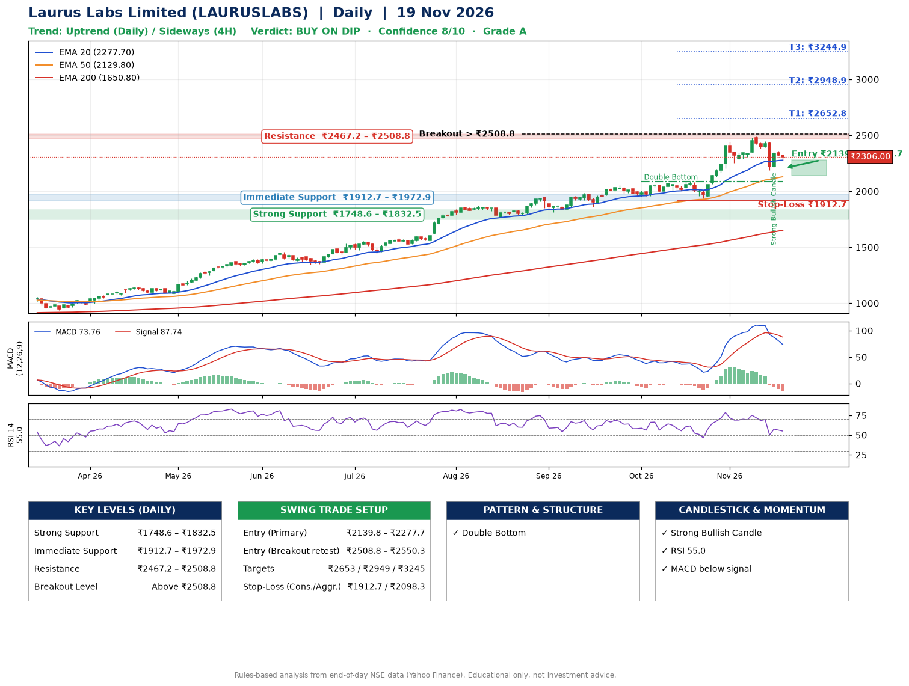

📌 **Laurus Labs Limited (LAURUSLABS) – Multi-Timeframe Technical Analysis (Daily + 4H Combined)**
_Data up to 19 Nov 2026 · Close ₹2306.00_

**📍 Daily Timeframe Trend**
- Trend: **Uptrend** (price above rising EMAs)
- Recent swing highs: ₹1949.0, ₹2055.3, ₹2488.0 · swing lows: ₹1811.7, ₹1952.1, ₹1933.5
- EMAs: EMA20 ₹2277.7, EMA50 ₹2129.8, EMA200 ₹1650.8; bullish stack (EMA20 > EMA50 > EMA200); price above EMA20, EMA50, EMA200
- MACD 73.76 below signal 87.74 (above zero), fresh bearish crossover; histogram falling
- RSI(14) 55.0; no divergence on the last two swings

**📍 4-Hour Timeframe Trend**
- Structure: **Sideways** (mixed swing structure)
- Pullback/support area: recent 4H swing lows ₹2252.4, ₹2190.7; EMA20 ₹2325.2
- EMA20/50: bullish stack (EMA20 > EMA50); price above EMA50
- MACD 15.63 below signal 33.44 (above zero); histogram rising
- RSI(14) 49.4; no divergence

**📍 Pattern Detection (Both Timeframes)**
- Daily: **Double Bottom** – bottoms near ₹1952.1/₹1933.5, neckline ₹2089.0, confirmed (closed above neckline)
- 4H: **Double Bottom** – bottoms near ₹2252.4/₹2190.7, neckline ₹2480.0, forming
- 4H: **Symmetrical Triangle** – converging swing highs and lows over the last ~60 sessions

**📍 Candlestick Patterns (last 3 daily candles)**
- **Strong Bullish Candle** – 17 Nov: wide-range green candle, buyers in control

**📍 Price Action Key Levels (Daily Structure)**

| Zone | Price Level (₹) | Context |
|------|-----------------|---------|
| Strong Support | ₹1748.6 – ₹1832.5 | Cluster of earlier swing lows (demand) |
| Immediate Support | ₹1912.7 – ₹1972.9 | Nearest swing-low / wick area |
| Resistance | ₹2467.2 – ₹2508.8 | Nearest swing-high supply |
| Breakout Level | Above ₹2508.8 | Swing continuation trigger (52-week high ₹2488.0) |

**📍 Swing Trade Setup**

🟢 **Entry Zone**
- Primary: ₹2139.8 – ₹2277.7 (daily support / EMA20 area; enter on a bullish 4H candle)
- Alternate: ₹2508.8 – ₹2550.3 (breakout retest)

🎯 **Profit Targets**
- T1: ₹2652.8
- T2: ₹2948.9
- T3: ₹3244.9

🛑 **Stop-Loss**
- Conservative: below daily swing low (₹1912.7)
- Aggressive: below 4H structure (₹2098.3)
- Risk per share ≈ ₹296.0; reward:risk to T1 ≈ 1.5
- Time to T1: about 34 trading days (it rose this much within 60 trading days 57% of the time in the last 2 years)
- Time to T2: about 46 trading days (it rose this much within 60 trading days 34% of the time in the last 2 years)

**📌 Strategy Notes**
- Higher timeframe: daily trend is uptrend; only take longs while price holds above ₹1748.6.
- Entry timing: wait for a bullish 4H candle (engulfing/hammer) inside ₹2139.8 – ₹2277.7 rather than buying mid-range.
- EMA stacking: bullish stack (EMA20 > EMA50 > EMA200); price above EMA20, EMA50, EMA200.
- Breakout rule: a daily close above ₹2508.8 with volume above its 20-day average (≈3,085,508) opens T2/T3.
- Momentum: RSI 55 – room to run; no divergence on the last two swings.
- Exit discipline: move the stop to entry once T1 is hit; book partial profits at each target.

**STEP 2 — Marked Up Chart**

**✅ Trade Validation Checklist**
- Trend + momentum aligned: No · Price at entry zone: No
- Stop defined (₹1912.7) · Reward:risk ≥ 1.5 to T1: No

## 📌 Final Verdict

Recommendation: **🟡 BUY ON DIP**

Confidence: **8/10**

Trade Quality: **A**

Reason:
• Daily uptrend (price above rising EMAs)
• EMAs stacked bullishly

Next Action:
• Wait for a pullback to ₹2139.8–₹2277.7, or a breakout above ₹2508.8

_Rules-based analysis from end-of-day data. Educational only, not investment advice. Never place orders without your own confirmation._