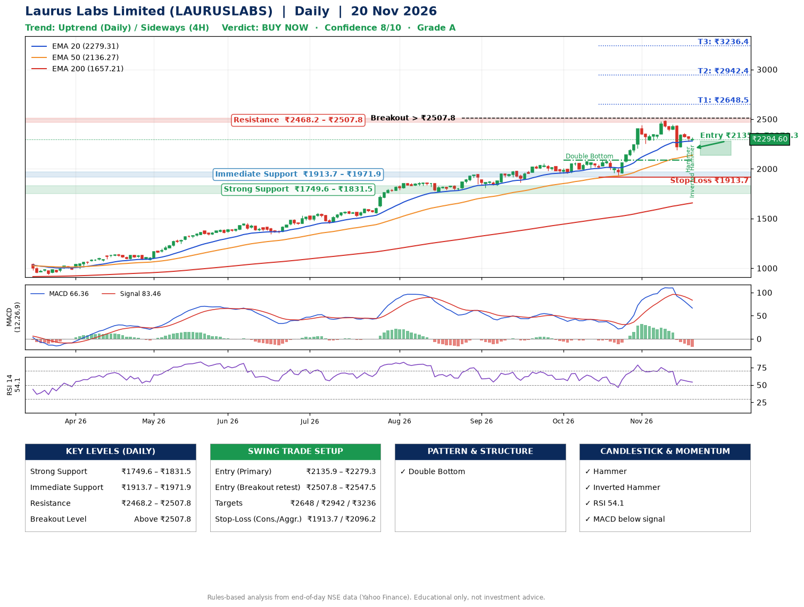

📌 **Laurus Labs Limited (LAURUSLABS) – Multi-Timeframe Technical Analysis (Daily + 4H Combined)**
_Data up to 20 Nov 2026 · Close ₹2294.60_

**📍 Daily Timeframe Trend**
- Trend: **Uptrend** (price above rising EMAs)
- Recent swing highs: ₹1949.0, ₹2055.3, ₹2488.0 · swing lows: ₹1811.7, ₹1952.1, ₹1933.5
- EMAs: EMA20 ₹2279.3, EMA50 ₹2136.3, EMA200 ₹1657.2; bullish stack (EMA20 > EMA50 > EMA200); price above EMA20, EMA50, EMA200
- MACD 66.36 below signal 83.46 (above zero), fresh bearish crossover; histogram falling
- RSI(14) 54.1; no divergence on the last two swings

**📍 4-Hour Timeframe Trend**
- Structure: **Sideways** (mixed swing structure)
- Pullback/support area: recent 4H swing lows ₹2190.7, ₹2274.0; EMA20 ₹2320.4
- EMA20/50: bullish stack (EMA20 > EMA50); price above EMA50
- MACD 9.17 below signal 25.23 (above zero); histogram rising
- RSI(14) 48.0; no divergence

**📍 Pattern Detection (Both Timeframes)**
- Daily: **Double Bottom** – bottoms near ₹1952.1/₹1933.5, neckline ₹2089.0, confirmed (closed above neckline)
- 4H: **Descending Triangle** – converging swing highs and lows over the last ~60 sessions

**📍 Candlestick Patterns (last 3 daily candles)**
- **Hammer** – 19 Nov: long lower wick shows dip-buying near ₹2272.6
- **Inverted Hammer** – 20 Nov: long upper wick shows selling near ₹2320.0

**📍 Price Action Key Levels (Daily Structure)**

| Zone | Price Level (₹) | Context |
|------|-----------------|---------|
| Strong Support | ₹1749.6 – ₹1831.5 | Cluster of earlier swing lows (demand) |
| Immediate Support | ₹1913.7 – ₹1971.9 | Nearest swing-low / wick area |
| Resistance | ₹2468.2 – ₹2507.8 | Nearest swing-high supply |
| Breakout Level | Above ₹2507.8 | Swing continuation trigger (52-week high ₹2488.0) |

**📍 Swing Trade Setup**

🟢 **Entry Zone**
- Primary: ₹2135.9 – ₹2279.3 (daily support / EMA20 area; enter on a bullish 4H candle)
- Alternate: ₹2507.8 – ₹2547.5 (breakout retest)

🎯 **Profit Targets**
- T1: ₹2648.5
- T2: ₹2942.4
- T3: ₹3236.4

🛑 **Stop-Loss**
- Conservative: below daily swing low (₹1913.7)
- Aggressive: below 4H structure (₹2096.2)
- Risk per share ≈ ₹293.9; reward:risk to T1 ≈ 1.5
- Time to T1: about 34 trading days (it rose this much within 60 trading days 57% of the time in the last 2 years)
- Time to T2: about 46 trading days (it rose this much within 60 trading days 35% of the time in the last 2 years)

**📌 Strategy Notes**
- Higher timeframe: daily trend is uptrend; only take longs while price holds above ₹1749.6.
- Entry timing: wait for a bullish 4H candle (engulfing/hammer) inside ₹2135.9 – ₹2279.3 rather than buying mid-range.
- EMA stacking: bullish stack (EMA20 > EMA50 > EMA200); price above EMA20, EMA50, EMA200.
- Breakout rule: a daily close above ₹2507.8 with volume above its 20-day average (≈3,055,326) opens T2/T3.
- Momentum: RSI 54 – room to run; no divergence on the last two swings.
- Exit discipline: move the stop to entry once T1 is hit; book partial profits at each target.

**STEP 2 — Marked Up Chart**

**✅ Trade Validation Checklist**
- Trend + momentum aligned: No · Price at entry zone: No
- Stop defined (₹1913.7) · Reward:risk ≥ 1.5 to T1: No

## 📌 Final Verdict

Recommendation: **🟢 BUY NOW**

Confidence: **8/10**

Trade Quality: **A**

Reason:
• Daily uptrend (price above rising EMAs)
• EMAs stacked bullishly

Next Action:
• Buy now within the entry zone, with the stop-loss in place

_Rules-based analysis from end-of-day data. Educational only, not investment advice. Never place orders without your own confirmation._