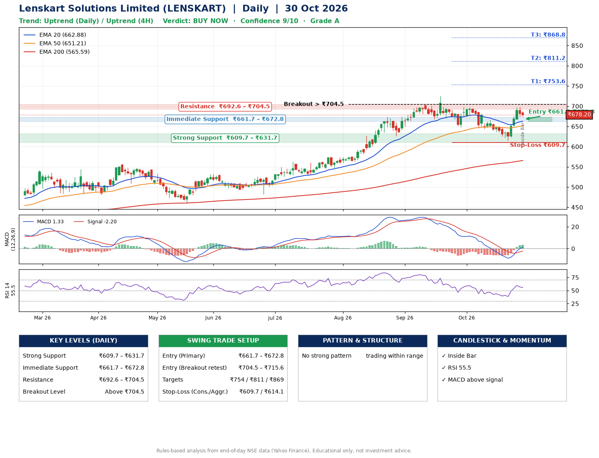

📌 **Lenskart Solutions Limited (LENSKART) – Multi-Timeframe Technical Analysis (Daily + 4H Combined)**
_Data up to 30 Oct 2026 · Close ₹678.20_

**📍 Daily Timeframe Trend**
- Trend: **Uptrend** (price above rising EMAs)
- Recent swing highs: ₹575.7, ₹725.0, ₹698.1 · swing lows: ₹667.2, ₹648.3, ₹615.2
- EMAs: EMA20 ₹662.9, EMA50 ₹651.2, EMA200 ₹565.6; bullish stack (EMA20 > EMA50 > EMA200); price above EMA20, EMA50, EMA200
- MACD 1.33 above signal -2.20 (above zero), fresh bullish crossover; histogram rising
- RSI(14) 55.5; no divergence on the last two swings

**📍 4-Hour Timeframe Trend**
- Structure: **Uptrend** (price above rising EMAs)
- Pullback/support area: recent 4H swing lows ₹644.4, ₹615.5; EMA20 ₹665.0
- EMA20/50: bullish stack (EMA20 > EMA50); price above EMA20, EMA50
- MACD 5.58 above signal 3.38 (above zero); histogram falling
- RSI(14) 51.7; no divergence

**📍 Pattern Detection (Both Timeframes)**
- No strong pattern detected. Trading within range.

**📍 Candlestick Patterns (last 3 daily candles)**
- **Inside Bar** – 30 Oct: compression inside the prior range ₹673.7–₹699.0

**📍 Price Action Key Levels (Daily Structure)**

| Zone | Price Level (₹) | Context |
|------|-----------------|---------|
| Strong Support | ₹609.7 – ₹631.7 | Cluster of earlier swing lows (demand) |
| Immediate Support | ₹661.7 – ₹672.8 | Nearest swing-low / wick area |
| Resistance | ₹692.6 – ₹704.5 | Nearest swing-high supply |
| Breakout Level | Above ₹704.5 | Swing continuation trigger (52-week high ₹725.0) |

**📍 Swing Trade Setup**

🟢 **Entry Zone**
- Primary: ₹661.7 – ₹672.8 (daily support / EMA20 area; enter on a bullish 4H candle)
- Alternate: ₹704.5 – ₹715.6 (breakout retest)

🎯 **Profit Targets**
- T1: ₹753.6
- T2: ₹811.2
- T3: ₹868.8

🛑 **Stop-Loss**
- Conservative: below daily swing low (₹609.7)
- Aggressive: below 4H structure (₹614.1)
- Risk per share ≈ ₹57.6; reward:risk to T1 ≈ 1.5

**📌 Strategy Notes**
- Higher timeframe: daily trend is uptrend; only take longs while price holds above ₹609.7.
- Entry timing: wait for a bullish 4H candle (engulfing/hammer) inside ₹661.7 – ₹672.8 rather than buying mid-range.
- EMA stacking: bullish stack (EMA20 > EMA50 > EMA200); price above EMA20, EMA50, EMA200.
- Breakout rule: a daily close above ₹704.5 with volume above its 20-day average (≈4,270,542) opens T2/T3.
- Momentum: RSI 56 – room to run; no divergence on the last two swings.
- Exit discipline: move the stop to entry once T1 is hit; book partial profits at each target.

**STEP 2 — Marked Up Chart**

**✅ Trade Validation Checklist**
- Trend + momentum aligned: Yes · Price at entry zone: No
- Stop defined (₹609.7) · Reward:risk ≥ 1.5 to T1: No

## 📌 Final Verdict

Recommendation: **🟢 BUY NOW**

Confidence: **9/10**

Trade Quality: **A**

Reason:
• Daily uptrend (price above rising EMAs)
• EMAs stacked bullishly

Next Action:
• Buy now within the entry zone, with the stop-loss in place

_Rules-based analysis from end-of-day data. Educational only, not investment advice. Never place orders without your own confirmation._